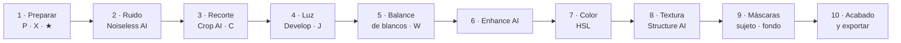

<div align="center">

# 📸 Luminar · Safari, paisaje y noche

### Guía paso a paso para sacar el máximo partido a tus JPEG con Luminar


**[📖 Empezar a leer](docs/00-introduccion.md)** · **[🗂️ Índice](docs/README.md)** · **[📄 PDF (A4)](guia-luminar-jpeg-safari-paisaje-noche.pdf)** · **[✅ Lista de comprobación](docs/14-errores-y-lista.md#142-lista-de-comprobación)**

</div>

---

Volviste del viaje con cientos de fotos en **JPEG**: leones a contraluz, dunas al atardecer, la Vía Láctea sobre una acacia. Esta guía, en español, te lleva **paso a paso** por **Luminar** para mejorarlas sin romperlas: sin bandas en el cielo, sin halos y sin colores de cartón piedra.

## ✨ Qué la hace distinta

- 🎯 **Pensada para JPEG**, no para RAW: ajustes que respetan un archivo de 8 bits ya procesado por la cámara.
- 🧠 **Cada paso explica el porqué**, así que aprendes a decidir y no solo a copiar valores.
- 🔍 **Precisa:** cada herramienta, control, atajo y límite técnico está **comprobado con la documentación oficial de Skylum** ([fuentes](docs/18-fuentes.md)). Los valores numéricos se presentan como puntos de partida, no como verdades.
- 🦁🏜️🌌 **Tres tipos de foto** con sus problemas y soluciones propias, más decenas de casos concretos: plumas blancas, cebras, leopardos con luz moteada, plumas quemadas, contaminación lumínica, fuego de campamento.
- 🧭 **Ética incluida:** qué se considera manipulación, normas de concurso y por qué quitar el GPS a las fotos de rinocerontes.

## 🔁 El flujo en un vistazo



El detalle de cada paso está en el [capítulo 3](docs/03-flujo-base.md).

## 🧭 Empieza por aquí

| Si quieres… | Lee |
|---|---|
| Entender por qué un JPEG "se rompe" | [1. Conceptos básicos](docs/01-conceptos-basicos.md) |
| Saber dónde está cada cosa en Luminar | [2. Luminar por dentro](docs/02-luminar-por-dentro.md) |
| Editar cualquier foto ya | [3. El flujo base: 10 pasos](docs/03-flujo-base.md) |
| Que el animal "salte" de la foto | [5. Safari](docs/05-safari.md) |
| Equilibrar cielo y suelo | [6. Paisaje](docs/06-paisaje.md) |
| Rescatar la Vía Láctea del ruido | [7. Noche](docs/07-noche.md) |
| Editar 500 fotos sin morir en el intento | [9. Trabajar en serie](docs/09-trabajar-en-serie.md) |
| Imprimir o publicar | [11. Exportar](docs/11-exportar.md) |
| Hacer mejores JPEG en el próximo viaje | [13. Disparar mejores JPEG](docs/13-disparar-mejores-jpeg.md) |

## 📚 Contenido

<details open>
<summary><b>Parte I · Fundamentos</b></summary>

1. [Conceptos básicos](docs/01-conceptos-basicos.md): JPEG frente a RAW, bandas, zonas de brillo, histograma, balance de blancos, contraste local, ruido, color.
2. [Luminar por dentro](docs/02-luminar-por-dentro.md): categorías de herramientas, copias virtuales, los siete tipos de máscara, capas.
</details>

<details open>
<summary><b>Parte II · El método</b></summary>

3. [El flujo base: 10 pasos](docs/03-flujo-base.md)
4. [Herramientas avanzadas](docs/04-herramientas-avanzadas.md): Curves, Supercontrast, Color Harmony, Dodge & Burn, Light Depth, Black & White, Landscape y herramientas creativas.
</details>

<details open>
<summary><b>Parte III · Por tipo de foto</b></summary>

5. [🦁 Safari](docs/05-safari.md)
6. [🏜️ Paisaje](docs/06-paisaje.md)
7. [🌌 Noche](docs/07-noche.md)
</details>

<details>
<summary><b>Parte IV · Más allá de una foto</b></summary>

8. [Recetas completas](docs/08-recetas.md) ⚠️ *provisional, pendiente de probar con fotos reales*
9. [Trabajar en serie](docs/09-trabajar-en-serie.md)
10. [Varias fotos en una, ampliar y generar](docs/10-varias-fotos.md)
11. [Exportar](docs/11-exportar.md)
12. [Ética, concursos y ubicación](docs/12-etica.md)
13. [Disparar mejores JPEG la próxima vez](docs/13-disparar-mejores-jpeg.md)
</details>

<details>
<summary><b>Parte V · Referencia</b></summary>

14. [Errores típicos y lista de comprobación](docs/14-errores-y-lista.md)
15. [Atajos de teclado](docs/15-atajos.md)
16. [Glosario](docs/16-glosario.md)
17. [Preguntas frecuentes](docs/17-preguntas-frecuentes.md)
18. [Fuentes](docs/18-fuentes.md)
</details>

## ⌨️ Los diez atajos que más vas a usar

| | | | |
|---|---|---|---|
| **`J`** aviso de recorte | **`\`** ver el original | **`⌘1`** zoom 100 % | **`C`** recortar |
| **`W`** cuentagotas | **`A`** Mask AI | **`/`** ver la máscara | **`⌘I`** invertir máscara |
| **`⇧⌘S`** sincronizar ajustes | **`⇧⌘E`** exportar | | |

Todos los atajos: [capítulo 15](docs/15-atajos.md).

## 🎯 Sobre la precisión

- **Verificado con la documentación oficial de Skylum** (noviembre de 2026): nombres de herramientas y controles, atajos, opciones de exportación, límites (Upscale hasta 6×, panorámicas de hasta 15.000 px, Focus Stacking de hasta 100 fotos, GenExpand hasta un 25 %…).
- **Recomendaciones de la guía:** los valores numéricos de los deslizadores. Son puntos de partida para JPEG.
- **Provisional:** las [recetas completas](docs/08-recetas.md) se revisarán con fotos de muestra reales.
- Algunas herramientas dependen de la versión o de la licencia (por ejemplo, las versiones *Improved* requieren Luminar for Desktop 1.29.0 o posterior).

¿Has encontrado algo que no coincide con tu versión de Luminar? Abre un *issue* indicando la versión.

## 🛠️ Para editar la guía

Los capítulos de `docs/` son la **fuente**. La guía en un solo archivo y el PDF se **generan**:

```sh
./build.sh            # navegación entre capítulos + guía completa en .md + PDF
./build.sh --no-pdf   # sin PDF
```

Necesita `pandoc` y Google Chrome (para imprimir el PDF sin ventana). El estilo del PDF está en `pdf.css`.

---

<sub>Guía no oficial. Luminar es una marca de Skylum. Esta guía no tiene relación con Skylum.</sub>
