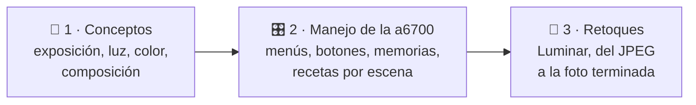
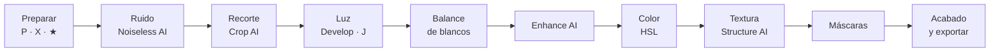

<div align="center">

# 📷 Foto

### Conceptos, manejo de la Sony a6700 y retoque con Luminar: todo en un sitio


<sub>Elefantes hacia el agua, Etosha. Foto de [Yathin S. Krishnappa](https://commons.wikimedia.org/wiki/File:Elephants_rushing_to_water_(Etosha,_2013).jpg), CC BY-SA 3.0, vía Wikimedia Commons</sub>

**[🧭 Ruta de aprendizaje](RUTA.md)** · **[🎓 Autoevaluación](AUTOEVALUACION.md)** · **[✅ Pendientes](PENDIENTES.md)** · **[🧠 Conceptos](#conceptos)** · **[🎛️ Manejo de la a6700](#manejo-a6700)** · **[🎨 Retoques](#retoques)** · **[🖨️ Para imprimir](#para-imprimir)** · **[🧭 Por dónde empiezo](#por-donde-empiezo)**

</div>

---

Guía **práctica** de fotografía en español, para quien viene del móvil: **entender** qué pasa dentro de una foto, **manejar** la cámara sin mirarla y **retocar** el resultado sin estropearlo. Escrita alrededor de un equipo real y de un viaje real (safari, paisaje y cielos nocturnos en Namibia), con recetas de valores concretos, pasos numerados y tablas de *"si sale mal, toca esto"*.

> **El equipo:** Sony a6700 (APS-C, factor 1,5) · Sony E 11 mm F1.8 (astro y paisaje, 16,5 mm equivalentes) · Viltrox AF 25 mm F1.7 Air (retrato, calle y poca luz, 37,5 mm equivalentes) · Sony E 70-350 mm F4.5-6.3 G OSS (fauna, 105–525 mm equivalentes; **prestado**) · Luminar for Desktop 1.29.x (Luminar Neo) en macOS.

## 🗺️ Cómo está organizado



| Carpeta | Qué hay | Guías |
|---|---|---|
| [`conceptos/`](conceptos/) | Lo que vale para cualquier cámara: la luz, el modelo técnico, el histograma, el balance de blancos, la composición y la mirada | 8 |
| [`manejo-a6700/`](manejo-a6700/) | La cámara: del móvil a la a6700, menús, diales, configuración, recetas por escenario, equipo y referencia completa de ajustes | 17 |
| [`retoques/`](retoques/) | La guía de Luminar en 19 capítulos, desde cero, verificada con la documentación oficial de Skylum | 19 |
| [`pdf/`](pdf/) | Las tres hojas imprimibles y cada sección completa (conceptos, manejo, retoques), maquetadas en A4 | 6 PDF |
| [`sources/`](sources/) | Material de origen: la **edición completa en PDF** de a6700-namibia (264 páginas), con la configuración de la cámara y el anexo de verificación de menús | 1 PDF |

Las tres secciones tienen la **misma estructura**: capítulos numerados (`NN-nombre.md`, número de archivo = número de capítulo) agrupados en partes, una introducción (`00-introduccion.md`), un índice (`README.md`), navegación anterior/siguiente en cada capítulo y la sección entera en un archivo (`guia-completa.md`) y en PDF.

Cada guía de conceptos y de manejo abre con su **nivel**: 🟢 **Iniciación** (nunca has manejado una cámara en serio) · 🔵 **Básico** (las recetas) · 🔴 **Avanzado** (el porqué y la foto que no es correcta, sino buena). En cada una se indica qué da por sabido y qué te desbloquea.

<a id="conceptos"></a>

## 🧠 1 · Conceptos

| Nivel | Guía | Qué resuelve |
|:---:|---|---|
| 🟢 | [**1 · La luz**](conceptos/01-la-luz.md) 🆕 | Cuánta hay, dura o suave, de dónde viene y de qué color: leer la luz antes de disparar |
| 🟢 | [**2 · El histograma por escenario**](conceptos/02-histograma.md) | Juzgar la exposición sin fiarte de la pantalla, dibujado escena a escena |
| 🟢 | [**Glosario**](conceptos/08-glosario.md) | Todas las palabras raras, en una línea cada una |
| 🔵 | [**Balance de blancos por escena**](conceptos/03-balance-de-blancos.md) | Valores de partida en Kelvin por luz, y por qué el automático te roba los atardeceres |
| 🔵 | [**Atlas de encuadres**](conceptos/05-atlas-de-encuadres.md) | El repertorio: 14 encuadres de fauna y 6 de cielo, cada uno con su diagrama, su focal y **el error que lo mata** |
| 🔵 | [**Cuaderno de composición**](conceptos/07-cuaderno-de-composicion.md) | 20 ejercicios en escalera, con criterio de aprobado, para imprimir y tachar ([PDF](pdf/cuaderno-de-composicion.pdf)) |
| 🔴 | [**Por qué funciona**](conceptos/04-por-que-funciona.md) | El modelo detrás de las recetas: el paso como moneda, ETTR, profundidad de campo con los números del equipo, difracción, compresión, ruido e invarianza ISO, el AF por dentro |
| 🔴 | [**La mirada**](conceptos/06-la-mirada.md) | Cómo piensan los que hacen las fotos que te gustan, el comportamiento que se anticipa y **cómo se mide si estás mejorando** |

Índice: [`conceptos/README.md`](conceptos/README.md) · Todo en un archivo: [`guia-completa.md`](conceptos/guia-completa.md) · [PDF](pdf/guia-conceptos.pdf)

<a id="manejo-a6700"></a>

## 🎛️ 2 · Manejo de la a6700

**Empezar de cero**

| Nivel | Guía | Qué resuelve |
|:---:|---|---|
| 🟢 | [**1 · Del móvil a la a6700**](manejo-a6700/01-de-movil-a-la-a6700.md) | Los tres números, las ruedas, el visor, RAW, los errores típicos y **7 tardes de deberes** |
| 🟢 | [**2 · Los menús, los botones y el primer día**](manejo-a6700/02-menus-y-primer-dia.md) | De la caja a la primera foto: el mapa del menú, el Fn, Mi Menú, revisar al 100 % y cómo deshacerlo todo |
| 🟢 | [**3 · Los diales y los botones**](manejo-a6700/03-diales-y-botones.md) | Qué hace cada mando, la botonera del viaje (y por qué se intercambian los diales), el táctil, el bloqueo y la noche sin luz |
| 🟢 | [**5 · Enfocar el 11 mm**](manejo-a6700/05-enfocar-el-11mm.md) | De día (AF con el pulgar e hiperfocal), a una estrella y a una luz lejana; la configuración de la lupa y el *peaking*, y un ejercicio para **esta noche** |
| 🔵 | [**4 · Configuración básica**](manejo-a6700/04-configuracion-basica.md) | Firmware, **RAW**, enfoque con el pulgar, memorias **MR1** (safari) y **MR2** (astro), los mandos de los objetivos y el glosario de menús español/inglés |

**Recetas por escenario**

| Nivel | Guía | Qué resuelve |
|:---:|---|---|
| 🔵 | [**6 · Astrofotografía**](manejo-a6700/06-astrofotografia-namibia.md) | La noche completa paso a paso: Vía Láctea, star trails con el intervalómetro integrado y apilado |
| 🔵 → 🔴 | [**7 · Estrellas con la tierra dentro**](manejo-a6700/07-estrellas-con-tierra.md) | Astro **desde cero en tres noches** con el 11 mm: la primera foto de estrellas, la postal con silueta y los círculos |
| 🔵 | [**8 · Safari diurno**](manejo-a6700/08-safari-diurno.md) | El AF con reconocimiento de animales, la rutina de 10 segundos, composición y receta por escena |
| 🔵 | [**9 · Charcas nocturnas**](manejo-a6700/09-safari-nocturno-charcas.md) | Fauna con foco artificial: obturador silencioso, AF en penumbra, techo de ISO |
| 🔵 | [**10 · Equipo y accesorios**](manejo-a6700/10-equipo-accesorios.md) | El kit con precios y alternativas, tarjetas (y el búfer), baterías, filtros y polvo |
| 🔵 | [**11 · El Viltrox 25 mm F1.7**](manejo-a6700/11-viltrox-25mm.md) | El objetivo "normal": ficha, recetas, cómo enfocar **sin interruptor AF/MF** (MF desde el menú o con un botón), hiperfocal y astro con 25 mm |
| 🔴 | [**12 · El AF y la exposición a fondo**](manejo-a6700/12-af-y-exposicion-a-fondo.md) | Los tres mandos del AF, la medición puntual vinculada, la botonera "de francotirador" y el 70-350 al límite |

**Referencia y hojas de campo**

| Nivel | Guía | Qué resuelve |
|:---:|---|---|
| 🟢 | [**13 · Todos los ajustes, con su ruta de menú**](manejo-a6700/13-ajustes-a6700.md) | La referencia única: cada ajuste con su ruta exacta y su valor para fauna y para noche, con el mapa del menú dibujado |
| 🟢 | [**14 · El menú completo**](manejo-a6700/14-menu-completo.md) | Las pestañas línea a línea: qué hace cada ajuste, tu valor y las líneas que hay que cambiar sí o sí |
| ✅ | [**15 · Verificación de los menús**](manejo-a6700/15-verificacion-de-menus.md) | La auditoría contra la Guía de ayuda de Sony: **79/79 rutas correctas**, el mapa oficial completo del menú y las 11 subopciones por confirmar con C3 |
| 📋 | [**16 · Chuleta**](manejo-a6700/16-chuleta.md) | Todas las recetas y arreglos rápidos en **una cara** ([PDF](pdf/chuleta.pdf)) |
| ✅ | [**17 · Verificación in situ**](manejo-a6700/17-verificacion-in-situ.md) | Listas de comprobación por momento del día, con el porqué de cada una, y diagnóstico de averías ([PDF](pdf/verificacion-in-situ.pdf)) |

Las capturas de pantalla de los menús tienen su guion en [`manejo-a6700/img/menus/`](manejo-a6700/img/menus/). Índice: [`manejo-a6700/README.md`](manejo-a6700/README.md) · Todo en un archivo: [`guia-completa.md`](manejo-a6700/guia-completa.md) · [PDF](pdf/guia-manejo-a6700.pdf). La numeración antigua (0, 0.5, 0.7, 1–5), la del PDF de `sources/`, tiene su tabla de equivalencias en la [introducción](manejo-a6700/00-introduccion.md#numeración-antigua).

> **Datos de la cámara que conviene saber** (verificados con la Guía de ayuda de Sony): **una sola ranura** SD (UHS-II), sin copia automática; el búfer aguanta unas **23 fotos en RAW comprimido sin pérdida** (unos 2 s de ráfaga); la caja **no trae cargador** (carga por USB-C); la compensación de exposición **funciona en M con ISO Auto** (±5 EV); el intervalómetro va **integrado** (`Func. capt. interv.`).

<a id="retoques"></a>

## 🎨 3 · Retoques con Luminar

Guía paso a paso para mejorar **JPEG** de safari, paisaje y noche en **Luminar**. Es justo el formato de las fotos de Namibia, que salieron solo en JPEG por un error de configuración (para que no se repita: [configuración básica](manejo-a6700/04-configuracion-basica.md)). Cada herramienta, control, atajo y límite técnico está **comprobado con la documentación oficial de Skylum**. Los valores numéricos se presentan como puntos de partida.



| Parte | Capítulos |
|---|---|
| **I · Fundamentos** | [1. Conceptos básicos](retoques/01-conceptos-basicos.md) · [2. Luminar por dentro](retoques/02-luminar-por-dentro.md) |
| **II · El método** | [3. El flujo base: 10 pasos](retoques/03-flujo-base.md) · [4. Ajustes locales](retoques/04-ajustes-locales.md) 🆕 · [5. Herramientas avanzadas](retoques/05-herramientas-avanzadas.md) |
| **III · Por tipo de foto** | [6. Safari 🦁](retoques/06-safari.md) · [7. Paisaje 🏜️](retoques/07-paisaje.md) · [8. Noche 🌌](retoques/08-noche.md) |
| **IV · Más allá de una foto** | [9. Recetas](retoques/09-recetas.md) ⚠️ *provisional* · [10. Trabajar en serie](retoques/10-trabajar-en-serie.md) · [11. HDR, panorámicas, Upscale](retoques/11-varias-fotos.md) · [12. Exportar](retoques/12-exportar.md) · [13. Ética y GPS](retoques/13-etica.md) · [14. Disparar mejores JPEG](retoques/14-disparar-mejores-jpeg.md) |
| **V · Referencia** | [15. Errores y lista](retoques/15-errores-y-lista.md) · [16. Atajos](retoques/16-atajos.md) · [17. Glosario](retoques/17-glosario.md) · [18. Preguntas](retoques/18-preguntas-frecuentes.md) · [19. Fuentes](retoques/19-fuentes.md) |

Índice detallado: [`retoques/README.md`](retoques/README.md) · Todo en un archivo: [`retoques/guia-completa.md`](retoques/guia-completa.md) · [PDF de 56 páginas](pdf/guia-retoques.pdf)

**Los atajos de Luminar que más vas a usar:** **`J`** aviso de recorte · **`\`** ver el original · **`⌘1`** zoom 100 % · **`C`** recortar · **`W`** cuentagotas · **`A`** Mask AI · **`/`** ver la máscara · **`⌘I`** invertir la máscara · **`⇧⌘S`** sincronizar ajustes · **`⇧⌘E`** exportar.

<a id="para-imprimir"></a>

## 🖨️ Para imprimir

| Hoja | Para qué | PDF |
|---|---|---|
| 📋 [Chuleta de la a6700](manejo-a6700/16-chuleta.md) | Todas las recetas de cámara en una cara | [chuleta.pdf](pdf/chuleta.pdf) |
| ✅ [Verificación in situ](manejo-a6700/17-verificacion-in-situ.md) | Comprobaciones por momento del día | [verificacion-in-situ.pdf](pdf/verificacion-in-situ.pdf) |
| ✏️ [Cuaderno de composición](conceptos/07-cuaderno-de-composicion.md) | 20 ejercicios para tachar | [cuaderno-de-composicion.pdf](pdf/cuaderno-de-composicion.pdf) |
| 🧠 [Conceptos completo](conceptos/guia-completa.md) | Los 7 capítulos de conceptos | [guia-conceptos.pdf](pdf/guia-conceptos.pdf) |
| 🎛️ [Manejo de la a6700 completo](manejo-a6700/guia-completa.md) | Los 17 capítulos de la cámara | [guia-manejo-a6700.pdf](pdf/guia-manejo-a6700.pdf) |
| 🎨 [Retoques completo](retoques/guia-completa.md) | Los 19 capítulos de Luminar | [guia-retoques.pdf](pdf/guia-retoques.pdf) |

<a id="por-donde-empiezo"></a>

## 🧭 Por dónde empiezo

> **¿Empiezas de cero?** Sigue la **[ruta de aprendizaje](RUTA.md)**: ordena todo el repo en cinco etapas, de las palabras básicas al nivel avanzado, con ejercicios y una lista de "lo dominas cuando…" en cada una.

- 🐣 *Nunca he manejado una cámara en serio* → [Del móvil a la a6700](manejo-a6700/01-de-movil-a-la-a6700.md) y el [glosario](conceptos/08-glosario.md).
- 📦 *La cámara acaba de llegar* → [Los menús y el primer día](manejo-a6700/02-menus-y-primer-dia.md), luego [los diales y los botones](manejo-a6700/03-diales-y-botones.md) y la [configuración básica](manejo-a6700/04-configuracion-basica.md).
- 🔭 *Quiero fotografiar estrellas con el 11 mm* → [Enfocar el 11 mm](manejo-a6700/05-enfocar-el-11mm.md) (esta misma noche) y luego [Estrellas con la tierra dentro](manejo-a6700/07-estrellas-con-tierra.md).
- 🙂 *Retratos, calle o interiores con poca luz* → [El Viltrox 25 mm](manejo-a6700/11-viltrox-25mm.md).
- 🔎 *¿Qué es esta línea del menú?* → [El menú completo](manejo-a6700/14-menu-completo.md).
- 📊 *No sé si la foto está bien expuesta* → [El histograma](conceptos/02-histograma.md).
- 🦁 *Voy de safari* → [Safari diurno](manejo-a6700/08-safari-diurno.md) para disparar y [Retoques · Safari](retoques/06-safari.md) para editar.
- 🌌 *Quiero la Vía Láctea* → [Astrofotografía](manejo-a6700/06-astrofotografia-namibia.md) para disparar y [Retoques · Noche](retoques/08-noche.md) para editar.
- 🎨 *Ya tengo las fotos, ¿y ahora?* → [El flujo base en Luminar](retoques/03-flujo-base.md).
- 👁️ *Quiero aclarar los ojos, abrir una sombra u oscurecer el cielo* → [Ajustes locales](retoques/04-ajustes-locales.md), desde cero: qué, cómo y qué significa para la foto.
- 🧠 *Quiero entender por qué funcionan las recetas* → [Por qué funciona](conceptos/04-por-que-funciona.md) y [La mirada](conceptos/06-la-mirada.md).
- ✈️ *Salgo pronto* → imprime la [chuleta](pdf/chuleta.pdf) y la [verificación in situ](pdf/verificacion-in-situ.pdf).

## 🎯 Sobre la precisión

> Lo que solo tú puedes comprobar (en la cámara, en los objetivos o en Luminar) está en **[PENDIENTES.md](PENDIENTES.md)**.

- **Manejo de la a6700:** las guías describen **cómo está configurada la cámara**. Los nombres de menú, las rutas y los datos técnicos están verificados con la [Guía de ayuda oficial de Sony](https://helpguide.sony.net/ilc/2320/v1/es/) (edición 5-051-980-47(1), que ya recoge el firmware 2.00 de la cámara): [79 de 79 rutas correctas](manejo-a6700/15-verificacion-de-menus.md), con 11 subopciones pendientes de confirmar en la cámara. Los menús se escriben **abreviados, como aparecen en pantalla** (`Calid. img/grab.`, `AF c/obturador`, `Rec. motivo en AF`…).
- **Retoques:** cada herramienta y atajo de Luminar está comprobado con la [documentación de Skylum](https://support.skylum.com/). Lo que la documentación no dice, la guía lo indica en lugar de suponerlo.
- **Valores:** las cifras de los deslizadores y de las recetas son puntos de partida, no verdades. Las [recetas de Luminar](retoques/09-recetas.md) están marcadas como provisionales hasta probarlas con fotos reales.

## 🛠️ Mantenimiento

```sh
python3 tools/comprobar.py                # comprueba enlaces, anclas, bloques de código, numeración y la chuleta
./pdf/generar.sh                          # regenera todo: navegación, guías completas y los 6 PDF
./pdf/generar.sh chuleta                  # uno solo: chuleta · verificacion-in-situ · cuaderno-de-composicion
                                          #           guia-conceptos · guia-manejo-a6700 · guia-retoques
./pdf/generar-guia.sh retoques --no-pdf   # una sección: navegación + guia-completa.md, sin PDF
```

Necesita `pandoc` y Google Chrome. Al editar una hoja, regenera su PDF (la chuleta **debe caber en una cara**).

## 🔗 Origen y enlaces

- Las secciones de **conceptos** y **manejo de la a6700** vienen de [a6700-namibia](https://github.com/morandeirachema/a6700-namibia), la guía del viaje completo (planificación, fauna, logística, vídeo y móvil). Los enlaces a esas guías apuntan allí. *Estrellas con la tierra dentro* también viene de allí.
- El dossier del viaje (itinerario, ruta y presupuesto): [namibia](https://github.com/morandeirachema/namibia).
- Soporte de la Sony a6700: <https://www.sony.es/electronics/support> · Guía de ayuda: <https://helpguide.sony.net/ilc/2320/v1/es/>
- Documentación de Luminar: <https://support.skylum.com/>

---

<sub>Guía no oficial. Sony y a6700 son marcas de Sony Group Corporation; Luminar es una marca de Skylum. Este repositorio no tiene relación con ninguna de las dos empresas.</sub>
