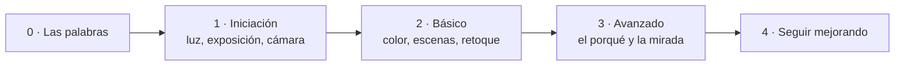

# 🧭 Ruta de aprendizaje: de cero a avanzado

### Qué aprender, en qué orden, cómo practicarlo y cómo saber que ya lo dominas

---

Este repo tiene más de cuarenta capítulos repartidos en tres secciones: [conceptos](conceptos/README.md), [manejo de la a6700](manejo-a6700/README.md) y [retoques con Luminar](retoques/README.md). Esta página es el **orden** para leerlos si empiezas de cero. Avanza por etapas: no pases a la siguiente hasta poder responder a las preguntas de **"Lo dominas cuando…"** de la etapa en la que estás.

**Cómo se comprueba:** al final de cada etapa, la [autoevaluación](AUTOEVALUACION.md) tiene sus preguntas con la respuesta y el capítulo donde se explica. Pasa de etapa cuando aciertes al menos el 85 %.

**Cómo se usa:** cada etapa tiene tres columnas que conviene recorrer juntas: **entender** (conceptos), **hacer con la cámara** (manejo) y **hacer al retocar** (retoques). Los ejercicios son cortos, de una tarde o menos, y se hacen en casa o en la calle.

---

## Etapa 0 · Las palabras (una tarde)

**Objetivo:** que ninguna palabra te frene.

- Lee por encima el [glosario de conceptos](conceptos/11-glosario.md). No hace falta memorizarlo: vuelve a él cada vez que una palabra te pare. Para los términos de retoque, el [glosario de retoques](retoques/18-glosario.md).

**Lo dominas cuando** sabes decir en una frase qué son exposición, ISO, apertura, velocidad, RAW, histograma y balance de blancos, aunque aún no sepas usarlos.

---

## Etapa 1 · Iniciación: la luz, la exposición y la cámara

**Objetivo:** hacer una foto **bien expuesta y enfocada** a propósito, no por suerte.

| | Qué | Dónde |
|---|---|---|
| 🧠 Entender | **La luz**: cuánta, dura o suave, de dónde, de qué color | [Conceptos 1 · La luz](conceptos/01-la-luz.md) |
| 🧠 Entender | **La exposición**: velocidad, apertura e ISO, el **paso** y qué precio tiene cada control | [Conceptos 2 · La exposición](conceptos/02-exposicion.md) · en la cámara: [Manejo 1](manejo-a6700/01-de-movil-a-la-a6700.md#los-3-números-y-qué-hacen-en-la-práctica) |
| 🧠 Entender | **El histograma**: juzgar la exposición sin fiarte de la pantalla | [Conceptos 3 · El histograma](conceptos/03-histograma.md) |
| 🧠 Entender | **La medición**: por qué la cámara "se equivoca" con fondos claros u oscuros (con el experimento del folio blanco) | [Conceptos 1 · El gris medio](conceptos/01-la-luz.md#por-qué-la-cámara-se-equivoca-el-gris-medio) · [Manejo 1 · Medición](manejo-a6700/01-de-movil-a-la-a6700.md#medición-por-qué-la-cámara-se-equivoca-y-cómo-corregirla) |
| 🧠 Entender | **JPEG y RAW**: qué guarda cada uno y por qué importa | [Retoques 1.1](retoques/01-conceptos-basicos.md#11-qué-tiene-de-especial-un-jpeg) · [Manejo 1 · RAW](manejo-a6700/01-de-movil-a-la-a6700.md#raw-y-cómo-pasar-fotos-al-móvil-en-el-viaje) |
| 📷 Hacer | Moverte por los **menús** y los **botones** | [Manejo 2](manejo-a6700/02-menus-y-primer-dia.md) · [Manejo 3](manejo-a6700/03-diales-y-botones.md) |
| 📷 Hacer | **Enfocar**: autofoco con el pulgar, lupa, *peaking* e hiperfocal | [Manejo 1 · Enfoque](manejo-a6700/01-de-movil-a-la-a6700.md#enfoque-lo-mínimo-que-hay-que-saber) · [Manejo 5 · Enfocar el 11 mm](manejo-a6700/05-enfocar-el-11mm.md) |
| 📷 Hacer | **Practicar en casa**: luz de ventana, clave alta y baja, bokeh, salpicaduras, pintar con luz | [Manejo 12 · Fotos en casa](manejo-a6700/12-fotos-en-casa.md) |
| 🎨 Retocar | Cómo funciona **Luminar** por dentro | [Retoques 2](retoques/02-luminar-por-dentro.md) |
| 🎨 Retocar | **Las herramientas, una a una**: dónde está cada una, qué hace y con qué número empezar | [Retoques 3](retoques/03-herramientas-una-a-una.md) |

**Practica:**
- [Las 7 tardes de deberes](manejo-a6700/01-de-movil-a-la-a6700.md#deberes-antes-del-viaje-7-tardes): el curso de iniciación completo.
- [Los tres controles](conceptos/02-exposicion.md#ejercicio-una-tarde) (una tarde) · [El folio blanco y la tela negra](conceptos/01-la-luz.md#por-qué-la-cámara-se-equivoca-el-gris-medio) (5 min) · [La luz junto a una ventana](conceptos/01-la-luz.md#ejercicio-una-tarde-en-casa) · [El histograma](conceptos/03-histograma.md#ejercicio-15-minutos-una-vez) (15 min) · [Enfocar esta noche](manejo-a6700/05-enfocar-el-11mm.md#ejercicio-para-esta-noche-20-minutos-desde-casa) (20 min).
- [Fotos en casa](manejo-a6700/12-fotos-en-casa.md#el-plan-cuatro-semanas-dos-tardes-por-semana): trece ideas y un plan de cuatro semanas, dos tardes por semana.

**Lo dominas cuando…**
- [ ] Explicas por qué abrir un paso el diafragma, duplicar el tiempo o duplicar el ISO dan la misma claridad, y qué cuesta cada uno.
- [ ] Miras un histograma y sabes si hay luces quemadas o sombras empastadas, y si eso es un problema en esa escena.
- [ ] Sabes por qué un animal oscuro sobre fondo blanco sale mal expuesto y qué compensación usar.
- [ ] Ante una escena, dices si la luz es dura o suave y de dónde viene.
- [ ] Enfocas una estrella hasta que sea un punto, y lo repites sin mirar la guía.
- [ ] Sabes qué formato graba tu cámara y lo has comprobado (un archivo `.ARW`).

➡️ **Compruébalo:** [autoevaluación de la etapa 1](AUTOEVALUACION.md#etapa-1--iniciación).

---

## Etapa 2 · Básico: el color, las escenas y el retoque completo

**Objetivo:** resolver las situaciones típicas (fauna, paisaje, noche) con una receta, y terminar la foto en Luminar.

| | Qué | Dónde |
|---|---|---|
| 🧠 Entender | **El balance de blancos**: color creíble, Kelvin por escena | [Conceptos 4](conceptos/04-balance-de-blancos.md) · [Retoques 1.4](retoques/01-conceptos-basicos.md#14-balance-de-blancos-temperatura-y-matiz) |
| 🧠 Entender | **Contraste global y local, ruido y nitidez** | [Retoques 1.5 y 1.6](retoques/01-conceptos-basicos.md#15-contraste-global-y-contraste-local) |
| 🧠 Entender | **Óptica**: focal, factor de recorte, perspectiva, profundidad de campo e hiperfocal | [Conceptos 5 · Óptica](conceptos/05-optica.md) |
| 🧠 Entender | **Composición**: sujeto, tercios, horizonte, líneas, capas, punto de vista y bordes; después, el repertorio | [Conceptos 6 · Composición](conceptos/06-composicion.md) · [Conceptos 7 · Atlas de encuadres](conceptos/07-atlas-de-encuadres.md) |
| 📷 Hacer | **Configurar la cámara** una vez: RAW, enfoque con el pulgar, memorias | [Manejo 4](manejo-a6700/04-configuracion-basica.md) |
| 📷 Hacer | **Recetas por escena**: astro, safari de día, charcas de noche, time-lapse del cielo, estelas de tráfico | [Manejo 6](manejo-a6700/06-astrofotografia-namibia.md) · [7](manejo-a6700/07-estrellas-con-tierra.md) · [8](manejo-a6700/08-safari-diurno.md) · [9](manejo-a6700/09-safari-nocturno-charcas.md) |
| 📷 Hacer | **Tus objetivos**: cuándo cada uno | [Manejo 13](manejo-a6700/13-equipo-accesorios.md) · [14 · Viltrox 25 mm](manejo-a6700/14-viltrox-25mm.md) |
| 🎨 Retocar | **El flujo base**: los 10 pasos de cualquier foto | [Retoques 4](retoques/04-flujo-base.md) |
| 🎨 Retocar | **¿Qué hay en tu foto?** Qué pasos pesan según el contenido: animal, dunas, contraluz, estrellas, fuego | [Retoques 4 · La ruta según el contenido](retoques/04-flujo-base.md#qué-hay-en-tu-foto-la-ruta-según-el-contenido) |
| 🎨 Retocar | **¿Me he pasado?** Cinco pruebas antes de exportar | [Retoques 16.3](retoques/16-errores-y-lista.md#163-me-he-pasado-la-prueba-de-dos-minutos) |
| 🎨 Retocar | **Ajustes locales**: aclarar los ojos, abrir una sombra, oscurecer el cielo | [Retoques 5](retoques/05-ajustes-locales.md) |
| 🎨 Retocar | **Rescatar un JPEG difícil**: oscura, quemada, movida, con ruido, muy recortada | [Retoques 4 · Rescatar](retoques/04-flujo-base.md#rescatar-un-jpeg-difícil) |
| 🎨 Retocar | **Compartir con la familia e imprimir**: qué exportar y hasta qué tamaño imprimir | [Retoques 13.5](retoques/13-exportar.md#135-tus-fotos-compartir-con-la-familia-e-imprimir) |
| 🎨 Retocar | **Por tipo de foto** | [Retoques 7 · Safari](retoques/07-safari.md) · [8 · Paisaje](retoques/08-paisaje.md) · [9 · Noche](retoques/09-noche.md) |

**Practica:**
- [Balance de blancos](conceptos/04-balance-de-blancos.md#ejercicio-10-minutos) (10 min) · [Configurar la cámara](manejo-a6700/04-configuracion-basica.md#ejercicio-una-tarde-en-casa) (una tarde).
- [Óptica: perspectiva, profundidad y bokeh](conceptos/05-optica.md#ejercicio-una-tarde) · [Composición: diez fotos de un solo sujeto](conceptos/06-composicion.md#ejercicio-una-tarde).
- [El cuaderno de composición](conceptos/08-cuaderno-de-composicion.md): 20 ejercicios en escalera ([PDF para imprimir](pdf/cuaderno-de-composicion.pdf)).
- [Las dos tardes del atlas de encuadres](conceptos/07-atlas-de-encuadres.md#ejercicio-dos-tardes).
- [Estrellas en tres noches](manejo-a6700/07-estrellas-con-tierra.md).
- [Estelas de tráfico](manejo-a6700/11-estelas-de-trafico.md#ejercicio-una-tarde) (una tarde) · [Time-lapse del cielo](manejo-a6700/10-time-lapse-del-cielo.md#ejercicio-dos-tardes) (dos tardes).
- [Ajustes locales](retoques/05-ajustes-locales.md#59-ejercicio-una-tarde): la misma foto, retocada y sin retocar, ante alguien que no sabe qué has hecho.

**Lo dominas cuando…**
- [ ] Pones el balance de blancos en Kelvin según la luz, y sabes cuándo **no** neutralizarla.
- [ ] Configuras la cámara para safari o para estrellas en menos de un minuto (memorias MR1 y MR2).
- [ ] Haces el flujo base completo en Luminar sin mirar la guía.
- [ ] Aclaras los ojos de un animal y oscureces un fondo que distrae sin que se note el retoque.
- [ ] Ante una escena, eliges entre al menos tres encuadres del atlas y sabes por qué.
- [ ] Haces una foto de estelas de tráfico con los edificios nítidos, y explicas qué cambia entre 5 s y 30 s.
- [ ] Calculas cuántas fotos y cuánto tiempo necesitas para 12 s de time-lapse, y lanzas la serie con el intervalómetro.

➡️ **Compruébalo:** [autoevaluación de la etapa 2](AUTOEVALUACION.md#etapa-2--básico).

---

## Etapa 3 · Avanzado: el porqué y la mirada

**Objetivo:** inventar tu propia receta cuando la escena no está en ninguna tabla, y pasar de la foto **correcta** a la foto **buena**.

| | Qué | Dónde |
|---|---|---|
| 🧠 Entender | **El modelo**: el paso como moneda, exponer a la derecha (ETTR), profundidad de campo, difracción, compresión, ruido e invarianza ISO, el autofoco por dentro | [Conceptos 9 · Por qué funciona](conceptos/09-por-que-funciona.md) |
| 🧠 Entender | **La mirada**: cómo piensan los que hacen las fotos que te gustan | [Conceptos 10](conceptos/10-la-mirada.md) |
| 📷 Hacer | **El AF y la exposición a fondo**: los mandos del AF, medición puntual vinculada, el tele al límite | [Manejo 15](manejo-a6700/15-af-y-exposicion-a-fondo.md) |
| 📷 Hacer | **La referencia completa**: cada ajuste y cada línea del menú | [Manejo 16](manejo-a6700/16-ajustes-a6700.md) · [17](manejo-a6700/17-menu-completo.md) · [18](manejo-a6700/18-verificacion-de-menus.md) |
| 📷 Hacer | **Del atardecer a la noche** con exposición automática, y **varias fotos para una**: estelas y estrellas apiladas, HDR y apilado de enfoque | [Manejo 10 · Receta B](manejo-a6700/10-time-lapse-del-cielo.md#receta-b--del-atardecer-a-la-noche-la-cámara-lleva-la-exposición) · [10 · En casa](manejo-a6700/10-time-lapse-del-cielo.md#en-casa-tres-cosas-de-la-misma-serie) · [11 · Apilar](manejo-a6700/11-estelas-de-trafico.md#varias-fotos-para-una-apilar-las-estelas) · [12 · Idea 13](manejo-a6700/12-fotos-en-casa.md#13--varias-fotos-para-una-hdr-y-apilado-de-enfoque) |
| 🎨 Retocar | **Herramientas avanzadas**: Curves, Supercontrast, Color Harmony, Dodge & Burn, Light Depth, blanco y negro | [Retoques 6](retoques/06-herramientas-avanzadas.md) |
| 🎨 Retocar | **Trabajar en serie** y **varias fotos en una** | [Retoques 11](retoques/11-trabajar-en-serie.md) · [12](retoques/12-varias-fotos.md) |
| 🎨 Retocar | **Ética**: qué es corregir y qué es manipular | [Retoques 14](retoques/14-etica.md) |

**Practica:**
- [Los ejercicios del modelo técnico](conceptos/09-por-que-funciona.md#ejercicios-tres-tardes-antes-de-volar) (tres tardes).
- [Los ejercicios de la mirada](conceptos/10-la-mirada.md#ejercicios-una-tarde-cada-uno-en-casa).
- [El AF a fondo](manejo-a6700/15-af-y-exposicion-a-fondo.md#ejercicio-una-tarde-antes-de-volar) (una tarde).

**Lo dominas cuando…**
- [ ] Explicas por qué f/16 no da una foto "más nítida" que f/8, y cuándo cerrar más.
- [ ] Sabes cuándo subir el ISO es gratis y cuándo cuesta, y lo aplicas de noche.
- [ ] Calculas, con la tabla de hiperfocal, dónde enfocar un paisaje para que todo salga nítido.
- [ ] Ves la diferencia entre "acercarse con el tele" y "alejarse con el tele" en una foto de un animal en su paisaje.
- [ ] Usas curvas y Dodge & Burn para dirigir la mirada, no solo para corregir.
- [ ] Juntas varias fotos en una (estelas apiladas, HDR o apilado de enfoque) y sabes decir cuándo una sola foto no basta.
- [ ] Sabes decir por qué una foto tuya es correcta pero no buena, y qué cambiarías la próxima vez.

➡️ **Compruébalo:** [autoevaluación de la etapa 3](AUTOEVALUACION.md#etapa-3--avanzado).

---

## Etapa 4 · Seguir mejorando

No es "hacer más fotos": es subir **un escalón cada vez**. El método está en [La mirada · Los cinco escalones](conceptos/10-la-mirada.md#los-cinco-escalones-en-este-orden-no-saltes): **nítida → bien expuesta → limpia → con luz → con momento**.

- Revisa tus fotos con la [lista de errores típicos](retoques/16-errores-y-lista.md).
- Edita en serie con coherencia ([retoques 11](retoques/11-trabajar-en-serie.md)).
- Aprende a usar **la segunda cámara**: el [Pixel 10 Pro](manejo-pixel-10-pro/README.md) hace lo que la a6700 no hace o no tiene a mano (lo muy ancho, el macro, la foto de grupo). Empieza por [qué foto es de cada cámara](manejo-pixel-10-pro/01-de-la-a6700-al-pixel.md); queda fuera de las etapas 0–3 y de la autoevaluación.
- Imprime una foto tuya a buen tamaño ([retoques 13.3](retoques/13-exportar.md#133-imprimir)): en papel se ve todo lo que la pantalla perdona.

---

## Mapa de conceptos: dónde se explica cada uno

| Concepto | 🟢 Primera vez | 🔵 Aplicado | 🔴 A fondo |
|---|---|---|---|
| Luz: calidad, dirección, color | [Conceptos 1](conceptos/01-la-luz.md) | [Retoques 8 · Paisaje](retoques/08-paisaje.md) | [Conceptos 10 · La mirada](conceptos/10-la-mirada.md) |
| Exposición y el paso | [Conceptos 2](conceptos/02-exposicion.md) | [Manejo 1](manejo-a6700/01-de-movil-a-la-a6700.md#los-3-números-y-qué-hacen-en-la-práctica) · [Manejo 8 · Safari](manejo-a6700/08-safari-diurno.md) | [Conceptos 9 · §1](conceptos/09-por-que-funciona.md#1--el-paso-la-única-moneda-del-sistema) |
| Exposición larga y movimiento | [Conceptos 2](conceptos/02-exposicion.md) · [Manejo 12 · Pintar con luz](manejo-a6700/12-fotos-en-casa.md#7--pintar-con-luz) | [Manejo 11 · Estelas](manejo-a6700/11-estelas-de-trafico.md) · [Manejo 10 · Time-lapse](manejo-a6700/10-time-lapse-del-cielo.md) | [Manejo 7 · Star trails](manejo-a6700/07-estrellas-con-tierra.md) |
| Histograma | [Conceptos 3](conceptos/03-histograma.md) | [Retoques 1.3](retoques/01-conceptos-basicos.md#13-el-histograma-y-el-aviso-de-recorte) | [Conceptos 9 · §2 ETTR](conceptos/09-por-que-funciona.md#2--exponer-a-la-derecha-y-por-qué-el-histograma-manda) |
| Medición | [Conceptos 1 · El gris medio](conceptos/01-la-luz.md#por-qué-la-cámara-se-equivoca-el-gris-medio) | [Manejo 1](manejo-a6700/01-de-movil-a-la-a6700.md#medición-por-qué-la-cámara-se-equivoca-y-cómo-corregirla) · [Manejo 8](manejo-a6700/08-safari-diurno.md) | [Manejo 15](manejo-a6700/15-af-y-exposicion-a-fondo.md) |
| Balance de blancos | [Conceptos 4](conceptos/04-balance-de-blancos.md) | [Retoques 1.4](retoques/01-conceptos-basicos.md#14-balance-de-blancos-temperatura-y-matiz) | [Retoques 6.3 · Color Harmony](retoques/06-herramientas-avanzadas.md) |
| Enfoque | [Manejo 1](manejo-a6700/01-de-movil-a-la-a6700.md#enfoque-lo-mínimo-que-hay-que-saber) | [Manejo 5](manejo-a6700/05-enfocar-el-11mm.md) | [Manejo 15](manejo-a6700/15-af-y-exposicion-a-fondo.md) |
| Profundidad de campo e hiperfocal | [Conceptos 5 · Óptica](conceptos/05-optica.md#4--la-profundidad-de-campo-qué-sale-nítido) | [Manejo 5](manejo-a6700/05-enfocar-el-11mm.md) · [Manejo 14 · Viltrox](manejo-a6700/14-viltrox-25mm.md) | [Conceptos 9 · §3](conceptos/09-por-que-funciona.md#3--profundidad-de-campo-tres-palancas-y-una-pesa-más) |
| Focal, perspectiva y compresión | [Conceptos 5 · Óptica](conceptos/05-optica.md#1--la-distancia-focal-y-el-ángulo-de-visión) | [Conceptos 7 · Atlas](conceptos/07-atlas-de-encuadres.md) | [Conceptos 9 · §5](conceptos/09-por-que-funciona.md#5--la-compresión-no-la-hace-el-tele-la-hace-la-distancia) |
| Ruido e ISO | [Manejo 1](manejo-a6700/01-de-movil-a-la-a6700.md) | [Retoques 1.6](retoques/01-conceptos-basicos.md#16-ruido-y-nitidez-siempre-van-juntos) | [Conceptos 9 · §6](conceptos/09-por-que-funciona.md#6--ruido-iso-y-el-punto-en-que-deja-de-importar) |
| Difracción | — | [Manejo 5](manejo-a6700/05-enfocar-el-11mm.md) | [Conceptos 9 · §4](conceptos/09-por-que-funciona.md#4--difracción-por-qué-f16-no-es-más-nítido) |
| JPEG, RAW y rango dinámico | [Retoques 1.1](retoques/01-conceptos-basicos.md#11-qué-tiene-de-especial-un-jpeg) | [Manejo 4](manejo-a6700/04-configuracion-basica.md) | [Conceptos 9 · §2](conceptos/09-por-que-funciona.md#2--exponer-a-la-derecha-y-por-qué-el-histograma-manda) |
| Composición | [Conceptos 6 · Composición](conceptos/06-composicion.md) | [Conceptos 7 · Atlas](conceptos/07-atlas-de-encuadres.md) · [Conceptos 8 · Cuaderno](conceptos/08-cuaderno-de-composicion.md) | [Conceptos 10 · La mirada](conceptos/10-la-mirada.md) |
| Contraste global y local | [Retoques 1.5](retoques/01-conceptos-basicos.md#15-contraste-global-y-contraste-local) | [Retoques 4 · pasos 4 y 8](retoques/04-flujo-base.md) | [Retoques 6 · Curves y Supercontrast](retoques/06-herramientas-avanzadas.md) |
| Ajustes locales y máscaras | [Retoques 1.7](retoques/01-conceptos-basicos.md#17-ajustes-globales-y-locales) | [Retoques 5](retoques/05-ajustes-locales.md) | [Retoques 6.4 · Dodge & Burn](retoques/06-herramientas-avanzadas.md) |
| Varias fotos en una: apilado, HDR, enfoque | [Manejo 12 · Idea 13](manejo-a6700/12-fotos-en-casa.md#13--varias-fotos-para-una-hdr-y-apilado-de-enfoque) | [Manejo 11 · Apilar estelas](manejo-a6700/11-estelas-de-trafico.md#varias-fotos-para-una-apilar-las-estelas) · [Manejo 10 · De la misma serie](manejo-a6700/10-time-lapse-del-cielo.md#en-casa-tres-cosas-de-la-misma-serie) | [Retoques 12](retoques/12-varias-fotos.md) |
| Color: tono, saturación, luminancia | [Retoques 1.10](retoques/01-conceptos-basicos.md#110-color-lo-mínimo-de-teoría) | [Retoques 4 · paso 7](retoques/04-flujo-base.md) | [Retoques 6.6 · Blanco y negro](retoques/06-herramientas-avanzadas.md) |
| Espacio de color y salida | [Retoques 13](retoques/13-exportar.md) | [Retoques 13.2](retoques/13-exportar.md#132-ajustes-recomendados-por-uso) | — |

---

[🏠 Inicio](README.md) · [✅ Pendientes](PENDIENTES.md)
