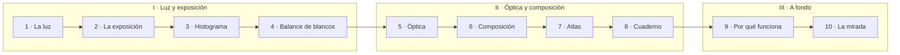

# 🧠 Conceptos

### De los fundamentos al dominio: lo que pasa dentro de una foto, y cómo se mira

**[📖 Empezar](00-introduccion.md)** · **[☀️ La luz](01-la-luz.md)** · **[🧭 Ruta de aprendizaje](../RUTA.md)** · **[🎓 Autoevaluación](../AUTOEVALUACION.md)** · **[📄 Guía completa](guia-completa.md)** · **[🖨️ PDF](../pdf/guia-conceptos.pdf)**

---

Antes de los botones y los deslizadores, **entender**: por qué una foto sale oscura, por qué el cielo se quema, por qué el fondo sale nítido o desenfocado, por qué una imagen "funciona" y otra no. Cada idea termina en una **decisión concreta** que puedes tomar con la cámara en la mano o delante de Luminar, y cada capítulo, en un ejercicio.

## 🗺️ De los fundamentos al dominio

## 🧭 Empieza por aquí

| Si… | Lee |
|---|---|
| Empiezas de cero | La [ruta de aprendizaje](../RUTA.md) y luego, en orden, del [1](01-la-luz.md) al [6](06-composicion.md) |
| Te pierdes con las palabras (ISO, recorte, ETTR…) | [11. Glosario](11-glosario.md) |
| No entiendes qué hace cada número de la cámara | [2. La exposición](02-exposicion.md) |
| La cámara oscurece o quema la foto sin motivo | [1. La luz · El gris medio](01-la-luz.md#por-qué-la-cámara-se-equivoca-el-gris-medio) |
| No sabes si una foto está bien expuesta | [3. El histograma](03-histograma.md) |
| Los colores salen raros | [4. Balance de blancos](04-balance-de-blancos.md) |
| El fondo no se desenfoca, o no sale nítido lo que quieres | [5. Óptica](05-optica.md) |
| Tus fotos son correctas pero no dicen nada | [6. Composición](06-composicion.md), [7. Atlas](07-atlas-de-encuadres.md) y [10. La mirada](10-la-mirada.md) |
| Quieres entender por qué funcionan las recetas | [9. Por qué funciona](09-por-que-funciona.md) |

## 📚 Todos los capítulos

| Parte | Capítulo | Nivel | Contenido |
|---|---|:---:|---|
| | [Introducción](00-introduccion.md) | | Cómo está organizada y cómo leerla |
| **I · La luz y la exposición** | [1. La luz](01-la-luz.md) | 🟢 | Cuánta hay, dura o suave, de dónde viene, de qué color, y el gris medio |
| | [2. La exposición](02-exposicion.md) 🆕 | 🟢 | Velocidad, apertura e ISO, el paso, la exposición equivalente, los modos |
| | [3. El histograma por escenario](03-histograma.md) | 🟢 | Juzgar la exposición sin fiarte de la pantalla, escena a escena |
| | [4. Balance de blancos por escena](04-balance-de-blancos.md) | 🔵 | Valores de partida en Kelvin, y por qué el automático te roba los atardeceres |
| **II · Óptica y composición** | [5. Óptica](05-optica.md) 🆕 | 🟢 → 🔵 | Focal, factor de recorte, perspectiva, profundidad de campo, hiperfocal |
| | [6. Composición: lo básico](06-composicion.md) 🆕 | 🟢 | Sujeto, simplificar, tercios, horizonte, líneas, capas, espacio, punto de vista, bordes |
| | [7. Atlas de encuadres](07-atlas-de-encuadres.md) | 🔵 | 14 encuadres de fauna y 6 de cielo, con su diagrama y el error que los mata |
| | [8. Cuaderno de composición](08-cuaderno-de-composicion.md) | 🔵 | 20 ejercicios en escalera ([PDF](../pdf/cuaderno-de-composicion.pdf)) |
| **III · A fondo** | [9. Por qué funciona](09-por-que-funciona.md) | 🔴 | ETTR, profundidad de campo con números reales, difracción, compresión, invarianza ISO, el AF por dentro, los objetivos |
| | [10. La mirada](10-la-mirada.md) | 🔴 | Cómo piensan los que hacen las fotos que te gustan, y cómo medir si mejoras |
| **IV · Referencia** | [11. Glosario](11-glosario.md) | 🟢 | Todas las palabras raras (las de Luminar, en el [glosario de retoques](../retoques/18-glosario.md)) |

**Niveles:** 🟢 iniciación (nunca has manejado una cámara en serio) · 🔵 básico (las recetas) · 🔴 avanzado (el porqué, y la foto que no es correcta sino buena).

---

Siguiente sección: [🎛️ Manejo de la a6700](../manejo-a6700/README.md) · [🏠 Inicio](../README.md) · [✅ Pendientes](../PENDIENTES.md)
