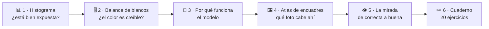

# 🧠 Conceptos

### Lo que pasa dentro de una foto, y cómo se mira

**[📖 Empezar](00-introduccion.md)** · **[📊 Histograma](01-histograma.md)** · **[📄 Guía completa](guia-completa.md)** · **[🖨️ PDF](../pdf/guia-conceptos.pdf)** · **[✏️ Cuaderno para imprimir](../pdf/cuaderno-de-composicion.pdf)**

---

Antes de los botones y los deslizadores, **entender**: por qué una foto sale oscura, por qué el cielo se quema, por qué una imagen "funciona" y otra no. Cada idea termina en una **decisión concreta** que puedes tomar con la cámara en la mano o delante de Luminar.

## 🗺️ De la luz a la mirada

## 🧭 Empieza por aquí

| Si… | Lee |
|---|---|
| Te pierdes con las palabras (ISO, recorte, ETTR…) | [7. Glosario](07-glosario.md) |
| No sabes si una foto está bien expuesta | [1. El histograma](01-histograma.md) |
| Los colores salen raros (atardeceres apagados, noches naranjas) | [2. Balance de blancos](02-balance-de-blancos.md) |
| Quieres entender por qué funcionan las recetas | [3. Por qué funciona](03-por-que-funciona.md) |
| Tus fotos son correctas pero no dicen nada | [4. Atlas de encuadres](04-atlas-de-encuadres.md) y [5. La mirada](05-la-mirada.md) |

## 📚 Todos los capítulos

| Parte | Capítulo | Nivel | Contenido |
|---|---|:---:|---|
| | [Introducción](00-introduccion.md) | | Cómo está organizada y cómo leerla |
| **I · La luz y la exposición** | [1. El histograma por escenario](01-histograma.md) | 🟢 | Juzgar la exposición sin fiarte de la pantalla, dibujado escena a escena |
| | [2. Balance de blancos por escena](02-balance-de-blancos.md) | 🔵 | Valores de partida en Kelvin, y por qué el automático te roba los atardeceres |
| | [3. Por qué funciona](03-por-que-funciona.md) | 🔴 | El paso como moneda, ETTR, profundidad de campo, difracción, ruido e invarianza ISO, el AF por dentro y los objetivos del kit |
| **II · La composición y la mirada** | [4. Atlas de encuadres](04-atlas-de-encuadres.md) | 🔵 | 14 encuadres de fauna y 6 de cielo, con su diagrama, su focal y el error que los mata |
| | [5. La mirada](05-la-mirada.md) | 🔴 | Cómo piensan los que hacen las fotos que te gustan, y cómo medir si mejoras |
| | [6. Cuaderno de composición](06-cuaderno-de-composicion.md) | 🔵 | 20 ejercicios en escalera, con criterio de aprobado ([PDF](../pdf/cuaderno-de-composicion.pdf)) |
| **III · Referencia** | [7. Glosario](07-glosario.md) | 🟢 | Todas las palabras raras, en una línea cada una |

**Niveles:** 🟢 iniciación (nunca has manejado una cámara en serio) · 🔵 básico (las recetas) · 🔴 avanzado (el porqué, y la foto que no es correcta sino buena).

---

Siguiente sección: [🎛️ Manejo de la a6700](../manejo-a6700/README.md) · [🏠 Inicio](../README.md) · [✅ Pendientes](../PENDIENTES.md)
