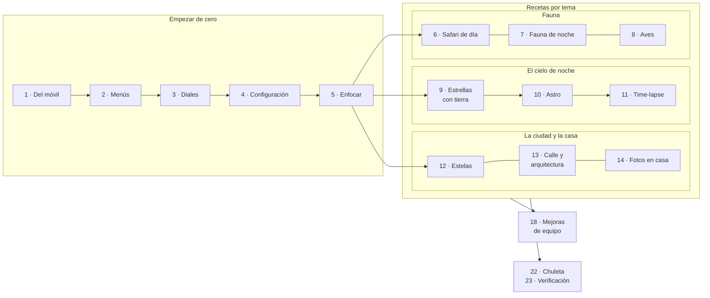

# 🎛️ Manejo de la Sony a6700

### La cámara tal como está configurada, de la caja a las recetas

**[📖 Empezar](00-introduccion.md)** · **[⚙️ Todos los ajustes](19-ajustes-a6700.md)** · **[📄 Guía completa](guia-completa.md)** · **[🖨️ PDF](../pdf/guia-manejo-a6700.pdf)** · **[📋 Chuleta](../pdf/chuleta.pdf)**

---

> **El equipo:** Sony a6700 · Sony E **11 mm** F1.8 (16,5 mm eq: astro, paisaje, interiores y arquitectura) · Viltrox AF **25 mm** F1.7 Air (37,5 mm eq: retrato, calle, poca luz) · Sony E **70-350 mm** G OSS (105–525 mm eq: fauna; **prestado**)

> ⚠️ **Lección de Namibia:** las fotos del viaje salieron solo en JPEG. Antes de salir, comprueba que la cámara dispara en **RAW** ([capítulo 4](04-configuracion-basica.md)).

## 🗺️ El camino

## 🧭 Empieza por aquí

| Si… | Lee |
|---|---|
| Empiezas de cero | La [ruta de aprendizaje](../RUTA.md) y luego [1. Del móvil a la a6700](01-de-movil-a-la-a6700.md) |
| La cámara acaba de llegar | [2. Los menús](02-menus-y-primer-dia.md) → [3. Los diales](03-diales-y-botones.md) → [4. Configuración](04-configuracion-basica.md) |
| Vas de safari (sabana, delta, río o bosque) | [6. Safari de día](06-safari-diurno.md) y [7. Fauna de noche](07-fauna-de-noche.md) |
| Aves en España, en un *hide* o en vuelo | [8. Aves](08-aves.md) |
| Quieres estrellas **esta noche** | [5. Enfocar el 11 mm](05-enfocar-el-11mm.md) → [9. Estrellas con la tierra dentro](09-estrellas-con-tierra.md) |
| Un time-lapse del cielo, o del atardecer a la noche | [11. Time-lapse del cielo](11-time-lapse-del-cielo.md) |
| Las estelas de los coches de noche | [12. Estelas de tráfico](12-estelas-de-trafico.md) |
| Fotografía de calle o edificios | [13. Calle y arquitectura](13-calle-y-arquitectura.md): el enfoque por zonas con el 25 mm y las verticales rectas con el 11 mm |
| Practicar sin salir de casa | [14. Fotos en casa](14-fotos-en-casa.md) |
| Retratos o interiores con poca luz | [16. El Viltrox 25 mm](16-viltrox-25mm.md) |
| Qué comprar después (y qué no) | [18. Mejoras de equipo](18-mejoras-de-equipo.md) |
| ¿Qué es esta línea del menú? | [20. El menú completo](20-menu-completo.md) |
| Sales mañana | Imprime la [chuleta](../pdf/chuleta.pdf) y la [verificación in situ](../pdf/verificacion-in-situ.pdf) |

## 📚 Todos los capítulos

| Parte | Capítulo | Nivel | Contenido |
|---|---|:---:|---|
| | [Introducción](00-introduccion.md) | | Cómo está organizada, cómo leerla y **numeración antigua** |
| **I · Empezar de cero** | [1. Del móvil a la a6700](01-de-movil-a-la-a6700.md) | 🟢 | Los tres números, las ruedas, el visor, RAW y 7 tardes de deberes |
| | [2. Los menús, los botones y el primer día](02-menus-y-primer-dia.md) | 🟢 | De la caja a la primera foto: el menú, el Fn, Mi Menú, revisar al 100 % |
| | [3. Los diales y los botones](03-diales-y-botones.md) | 🟢 | Cada mando, la botonera (C1, C3) y los mandos de los tres objetivos |
| | [4. Configuración básica](04-configuracion-basica.md) | 🔵 | Firmware, **RAW**, enfoque con el pulgar, memorias MR1 y MR2 |
| | [5. Enfocar el 11 mm](05-enfocar-el-11mm.md) | 🟢 | De día, a una estrella y a una luz lejana; ejercicio para esta noche |
| **II · Recetas · Fauna** | [6. Safari de día](06-safari-diurno.md) | 🔵 | AF con reconocimiento, rutina de 10 segundos; coche, todoterreno abierto y barca; sabana, delta y bosque |
| | [7. Fauna de noche](07-fauna-de-noche.md) | 🔵 | Charcas con focos, salidas nocturnas y barca al anochecer: obturador silencioso, techo de ISO |
| | [8. Aves](08-aves.md) | 🔵 → 🔴 | Alcance, *hides* en España, aves en vuelo, humedales tropicales, ética y ley |
| **II · Recetas · El cielo de noche** | [9. Estrellas con la tierra dentro](09-estrellas-con-tierra.md) | 🔵 → 🔴 | Astro desde cero en tres noches con el 11 mm |
| | [10. Astrofotografía](10-astrofotografia.md) | 🔵 | La noche completa paso a paso: Vía Láctea, star trails, apilado |
| | [11. Time-lapse del cielo](11-time-lapse-del-cielo.md) | 🔵 → 🔴 | El cielo girando, del atardecer a la noche, y star trails y apilado con la misma serie |
| **II · Recetas · La ciudad y la casa** | [12. Estelas de tráfico](12-estelas-de-trafico.md) | 🟢 → 🔵 | MR2 con dos números cambiados, BULB, ND y varias fotos apiladas en una |
| | [13. Calle y arquitectura](13-calle-y-arquitectura.md) | 🔵 → 🔴 | MR1 con tres cambios, **enfoque por zonas** con el 25 mm, el momento, la ley; verticales, la luz de los edificios, hora azul e interiores |
| | [14. Fotos en casa](14-fotos-en-casa.md) | 🟢 → 🔵 | Trece ideas creativas para practicar, HDR y apilado de enfoque, plan de cuatro semanas |
| **III · Equipo y objetivos** | [15. Equipo y accesorios](15-equipo-accesorios.md) | 🔵 | El kit del primer viaje, tarjetas y búfer, baterías, filtros y polvo |
| | [16. El Viltrox 25 mm F1.7](16-viltrox-25mm.md) | 🔵 | Sin interruptor AF/MF, hiperfocal, astro a 25 mm |
| | [17. El AF y la exposición a fondo](17-af-y-exposicion-a-fondo.md) | 🔴 | Los mandos del AF, medición puntual vinculada, el 70-350 al límite |
| | [18. Mejoras de equipo](18-mejoras-de-equipo.md) | 🔵 | El GorillaPod y el trípode a fondo, qué falta en cada campo, el tele cuando devuelvas el 70-350, la montura de seguimiento y el orden de compra |
| **IV · Referencia** | [19. Todos los ajustes](19-ajustes-a6700.md) | 🟢 | Cada ajuste con su ruta de menú y su valor |
| | [20. El menú completo](20-menu-completo.md) | 🟢 | Las pestañas línea a línea |
| | [21. Verificación de los menús](21-verificacion-de-menus.md) | ✅ | 79/79 rutas correctas, mapa oficial y 11 subopciones por confirmar |
| **V · Hojas de campo** | [22. Chuleta](22-chuleta.md) | 📋 | Todas las recetas en una cara ([PDF](../pdf/chuleta.pdf)) |
| | [23. Verificación in situ](23-verificacion-in-situ.md) | ✅ | Comprobaciones por momento del día ([PDF](../pdf/verificacion-in-situ.pdf)) |

## 📌 Datos de la cámara que conviene saber

Verificados con la Guía de ayuda de Sony:

| | |
|---|---|
| 💾 **Una sola ranura** SD (UHS-II) | No hay copia automática en una segunda tarjeta |
| ⏱️ **Búfer:** unas 23 fotos en RAW comprimido sin pérdida | Unos 2 s de ráfaga: dispara en ráfagas cortas |
| 🔌 **Sin cargador en la caja** | Carga por USB-C en la cámara |
| ☀️ **Compensación de exposición en M con ISO Auto** | ±5 EV |
| 🌌 **Intervalómetro integrado** | `Func. capt. interv.`: no hace falta cable |

Las capturas de los menús tienen su guion en [`img/menus/`](img/menus/).

---

Sección anterior: [🧠 Conceptos](../conceptos/README.md) · Siguiente: [🎨 Retoques](../retoques/README.md) · [🏠 Inicio](../README.md) · [✅ Pendientes](../PENDIENTES.md)
