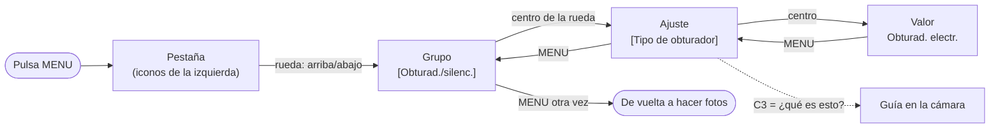
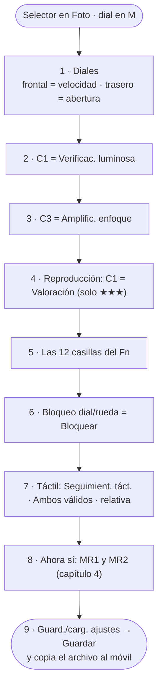
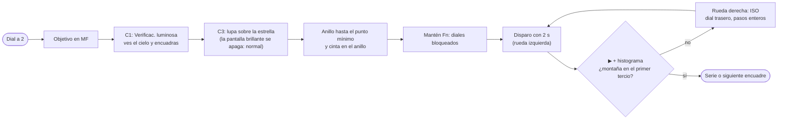
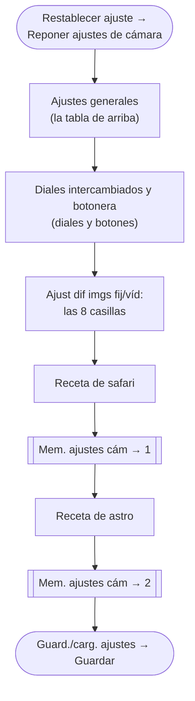
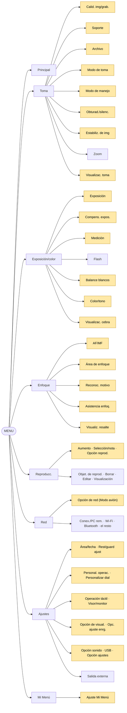

<!-- Archivo generado por pdf/generar-guia.sh a partir de manejo-a6700/. No lo edites a mano. -->

# Manejo de la Sony a6700
### La cámara tal como está configurada, de la caja a las recetas

**Versión:** noviembre de 2026 · Sony a6700 · Sony E 11 mm F1.8 · Viltrox AF 25 mm F1.7 Air · Sony E 70-350 mm F4.5-6.3 G OSS (**prestado**)

## Cómo está organizada

**Parte I · Empezar de cero**
1. Del móvil a la a6700
2. Los menús, los botones y el primer día
3. Los diales y los botones
4. Configuración básica
5. Enfocar el 11 mm

**Parte II · Recetas por escenario**

6. Astrofotografía
7. Estrellas con la tierra dentro
8. Safari diurno
9. Safari nocturno en charcas

**Parte III · Equipo y objetivos**

10. Equipo y accesorios
11. El Viltrox 25 mm F1.7
12. El AF y la exposición a fondo

**Parte IV · Referencia**

13. Todos los ajustes, con su ruta de menú
14. El menú completo
15. Verificación de los menús

**Parte V · Hojas de campo** *(para imprimir)*

16. Chuleta
17. Verificación in situ

## Cómo leerla

- **Cada capítulo abre con su nivel:** 🟢 **Iniciación** · 🔵 **Básico** · 🔴 **Avanzado**, con qué da por sabido y qué te desbloquea.
- **Los valores son los de tu cámara.** Las guías describen cómo está configurada. Si algún día la pantalla no coincide con una guía, manda la pantalla: anótalo en [PENDIENTES.md](../PENDIENTES.md).
- **Los menús se escriben como en la pantalla**, abreviados y en español: `MENU → pestaña → [Grupo] → [Ajuste]`, por ejemplo `Toma → [Calid. img/grab.] → [Formato archivo]`. Están verificados con la Guía de ayuda de Sony ([capítulo 15](15-verificacion-de-menus.md)).
- **Las focales llevan su equivalencia APS-C** (×1,5): 11 mm = 16,5 mm · 25 mm = 37,5 mm · 70–350 mm = 105–525 mm.
- **Lección de Namibia:** las fotos del viaje salieron solo en JPEG. Antes de cualquier salida, comprueba que la cámara dispara en RAW ([capítulo 4](04-configuracion-basica.md)).

## Numeración antigua

El [PDF de `sources/`](../sources/README.md) y el repo [a6700-namibia](https://github.com/morandeirachema/a6700-namibia) usan la numeración anterior. Equivalencias:

| Antes | Ahora |
|---|---|
| 0 · Del móvil a la a6700 | 1 |
| 0.5 · Los menús, los botones y el primer día | 2 |
| 0.7 · Los diales y los botones | 3 |
| 1 · Configuración básica | 4 |
| 2 · Astrofotografía | 6 |
| 3 · Safari diurno | 8 |
| 4 · Safari nocturno en charcas | 9 |
| 5 · Equipo y accesorios | 10 |
| Sin número: estrellas con la tierra, AF a fondo, ajustes, menú completo, chuleta, verificación in situ | 7, 12, 13, 14, 16, 17 |

---

*Parte I · Empezar de cero*

# 1. Del móvil a la a6700 — curso práctico exprés

> 🟢 **Iniciación** · Da por sabido: nada — es el punto de partida · Te desbloquea: entender los tres números y perderle el miedo a la cámara.

El móvil decide todo por ti y lo maquilla con software. En la a6700 decides
tú **tres números**. No hace falta más teoría que esta página; el resto del
tutorial son recetas.

## Los 3 números y qué hacen en la práctica

**Obturación (ej. 1/1000, 1/60, 20")** — cuánto tiempo entra luz.

- 1/1000 o más rápido: congela animales en movimiento.
- 1/60: el límite para sujetar a pulso con un objetivo normal. Más lento = foto movida.
- Varios segundos (20"): solo con trípode. Es el "modo noche" del móvil, pero controlado por ti.

**Apertura (ej. f/2, f/8)** — cuánto se abre el objetivo.

- Número bajo (f/2): entra mucha luz y el fondo sale desenfocado.
- Número alto (f/8): entra poca luz y sale todo nítido.
- Regla práctica de este viaje: astro y safari → la más baja del objetivo;
  paisaje de día → f/8.

**ISO (ej. 100, 6400)** — cuánto se amplifica la señal.

- Bajo (100–800): foto limpia.
- Alto (6400+): grano/ruido. Se arregla bastante en edición, pero es el número
  que subes **el último**, cuando los otros dos no dan más de sí.

### Cómo se compensan: piensa en "pasos"

Un **paso** = el doble (o la mitad) de luz. Cada salto de la lista es un paso:

- Obturación: … 1/250 → 1/500 → 1/1000 → 1/2000 …
- ISO: … 800 → 1600 → 3200 → 6400 …
- Apertura: … f/2.8 → f/4 → f/5.6 → f/8 …

Si oscureces un número un paso (subes la obturación de 1/500 a 1/1000),
aclaras otro un paso (ISO de 1600 a 3200) y la foto sale igual de luminosa.
En la práctica: decide primero el que importa para esa foto —la obturación en
fauna, los segundos y la apertura en astro— y deja que el **ISO en Auto**
absorba el resto.

## Traducción de zooms: del móvil a los objetivos del viaje

En el móvil piensas en "x"; en cámara, en milímetros. Una nota previa: la
a6700 multiplica todos los milímetros por **1,5** (sensor APS-C) — el 11 mm
encuadra como un 16,5 mm y el 70-350 como un **105-525**. A esos números les
llamamos "equivalentes", y son los que se comparan con el móvil (la cámara
principal del móvil ≈ 24 mm ≈ "1x"):

| Móvil | Milímetros | En este viaje |
|---|---|---|
| Ultra gran angular (0.5x) | ~13 mm | El **11 mm** (16,5 mm equivalentes — casi lo mismo que tu 0.5x): la Vía Láctea con paisaje, y el primer plano de las dunas |
| Principal (1x) | ~25 mm | — (el más cercano es el **Viltrox 25 mm**, algo más cerrado) |
| 2x (recorte del principal) | ~50 mm | El **Viltrox 25 mm** (37,5 mm equivalentes) queda entre 1x y 2x: el retrato, el grupo, la calle |
| Tele (5x) | ~113 mm | El extremo corto del **70-350** (105 mm equivalentes): el animal en su paisaje |
| No existe en móvil | 350 mm = 525 mm equivalentes ≈ "21x" | El extremo largo del **70-350**: un león a 50 m llenando el encuadre |

Fíjate en el hueco: entre 16,5 y 105 mm equivalentes solo está el **Viltrox
25 mm** (37,5 mm equivalentes, [su guía](11-viltrox-25mm.md)). Ese tramo (el
retrato, el grupo, el coche en la pista) es el suyo; y cuando hay polvo en el
aire y no quieres cambiar de objetivo, el Pixel.

La lección: el tele de fauna ve cosas que tu móvil jamás ha visto. Al
principio te costará *encontrar* al animal por el visor a 350 mm — es normal,
se entrena (deberes, abajo). Y el móvil no se jubila: lo que le sigues
pidiendo en el viaje (0.5x, macro, modo astro, panorámicas) está en
[la guía del Pixel 10 Pro](https://github.com/morandeirachema/a6700-namibia/blob/main/tecnica/pixel-10-pro.md).

## La cámara en la mano

- **Dial de modos**: usarás cinco posiciones:
  - **A**: tú eliges apertura. Para pasear y paisaje de día.
  - **S**: tú eliges obturación. Transición fácil hacia la fauna.
  - **M**: tú lo eliges todo. Modo safari (con ISO Auto) y modo astro (con ISO fijo).
  - **1 y 2**: memorias con todo preconfigurado ([capítulo 4](04-configuracion-basica.md)).
- **El selector Foto / Vídeo / S&Q** (el anillo de debajo del dial de modos):
  cambia entre hacer fotos, grabar vídeo y cámara lenta/timelapse. Lo bueno
  para un novato: **el vídeo puede llevar sus propios ajustes**, así que
  poner la cámara en vídeo no te descoloca el modo safari (hay que pedírselo
  una vez, marcando las casillas de `Ajust dif imgs fij/víd`: lo explica el
  [capítulo 4](04-configuracion-basica.md)).
- **Tres ruedas**: la delantera (junto al disparador), la trasera superior y
  la rueda de control del respaldo. En M, de fábrica, la **delantera mueve
  la apertura** y la **trasera la obturación**; este repo las intercambia
  (obturación en la delantera, que es la que tocas en el safari) en dos
  minutos: [diales y botones](03-diales-y-botones.md).
- **El ISO**: flecha derecha de la rueda de control. Con ISO Auto no lo tocas.
- **La compensación de exposición**: flecha **inferior** de la rueda de
  control (su sitio de serie). La usarás a diario — y funciona en todos los
  modos, M con ISO Auto incluido (tabla de medición, abajo). Si prefieres
  girar una rueda sin soltar el agarre, asígnala a la que quede libre en M
  desde `MENU → Ajustes → [Personal. operac.] → [Ajuste t. pers./dial]`.
- **No hay joystick**: el punto de enfoque se mueve con la rueda de control o
  **tocando la pantalla** — y lo moverás poco: el reconocimiento de animales
  (abajo) hace la mayor parte del trabajo.
- **Botón Fn**: abre la pantalla rápida con todos los ajustes a la vista y
  editables. Cuando no encuentres cómo cambiar algo, casi seguro está ahí.
- **La ruedecita de dioptrías** (pegada al visor): si ves el visor borroso
  aunque la foto salga enfocada, gírala hasta ver nítidos los números. En una
  cámara **recién estrenada** viene en cualquier posición — ajústala el primer
  día, antes de desconfiar del enfoque.
- **Cómo sujetarla**: mano izquierda **debajo** del objetivo (no encima),
  codos pegados al cuerpo, visor contra la ceja. Con el tele, apóyate siempre
  en algo: ventanilla, bean bag, poste. Cada punto de apoyo es una foto menos
  movida.

## Enfoque: lo mínimo que hay que saber

El móvil enfoca "solo" porque decide por ti. Aquí eliges dos cosas:

1. **AF-S o AF-C**: AF-S enfoca una vez y se queda (sujetos quietos: paisaje,
   animal dormido). **AF-C reenfoca sin parar** mientras mantienes el botón
   (todo lo que se mueve: safari entero en AF-C).
2. **A quién enfoca**: activa el **reconocimiento de sujeto** en Animal (o
   Ave) y la cámara busca el **ojo** ella sola y lo sigue por el encuadre.
   Es la gran ventaja de esta cámara — pero no te jubila: tu trabajo es
   encuadrar, comprobar que el recuadrito está de verdad sobre el ojo (si se
   va al arbusto, **toca al animal en la pantalla** — funciona incluso con el
   ojo en el visor: la pantalla sigue activa como panel táctil y el recuadro
   se arrastra con el pulgar) y verificar en la
   revisión que el ojo salió nítido. La regla de oro no cambia: si el ojo
   está nítido, la foto vale; si no, no.

Media pulsación del disparador = enfocar; pulsación completa = foto. (En el
[capítulo 4](04-configuracion-basica.md) separamos el enfoque al botón AF-ON
del pulgar — aún mejor.)

## Medición: por qué la cámara "se equivoca" y cómo corregirla

La cámara mide la luz suponiendo que la escena es de tono medio. Cuando no lo
es, falla siempre igual — y se corrige con la **compensación de exposición**,
que en la a6700 funciona en todos los modos (también en M con ISO Auto):

| Escena | Qué hace la cámara | Tu corrección |
|---|---|---|
| Fondo muy claro (calcreta blanca al sol, cielo) | Oscurece la foto → el animal sale negro | **+0.7 a +1** |
| Fondo muy oscuro (sombra, noche, foco sobre animal) | Aclara la foto → lo iluminado se quema | **−0.7 a −1** |
| Escena normal | Acierta | 0 |

> ⚠️ **Parece al revés, y es la trampa más común.** Con un fondo muy claro, lo intuitivo es pensar "hay mucha luz, resto". Pero la cámara **ya ha restado**: quiere que todo salga gris medio y ha oscurecido la foto por su cuenta. Tu compensación **deshace** su error, así que **sumas**. Regla corta: **fondo claro → +; fondo oscuro → −**. O, más directo todavía: **¿el sujeto sale quemado? → −; ¿sale oscuro? → +**.

No es un fallo de tu cámara ni tuyo: es física del medidor. Fondo claro →
sube; fondo oscuro → baja.

## El visor enseña la foto antes de hacerla (y aun así, histograma)

El visor de la a6700 es electrónico: ves la **exposición real** de la foto
que va a salir, y pulsando **DISP** puedes añadir el **histograma en vivo**
en una esquina. Aun así, el brillo *percibido* engaña (a pleno sol la
pantalla parece oscura; de noche, clarísima), así que la rutina sigue siendo
la gráfica, no el ojo:

1. Mira el **histograma** (en vivo con DISP, o en la revisión con ▶):
   - Montaña **pegada al borde derecho**: zonas quemadas, blanco puro sin
     información. No se recupera. Baja la exposición.
   - Montaña **pegada al borde izquierdo**: foto oscura. En RAW se levanta,
     pero con ruido.
   - Montaña **despegada de ambos bordes**: perfecta.
   - En astro lo normal es la montaña en el primer tercio izquierdo,
     **despegada del borde**.
2. Activa el **Zebra 100+**: lo que va a salir quemado aparece rayado en la
   pantalla **antes de disparar** — es tu aviso de altas luces en vivo
   ([capítulo 4](04-configuracion-basica.md)).
3. Cada vez que cambie la luz (una nube, el atardecer), vistazo al histograma
   antes del momento importante — de día basta el que va en vivo; de noche,
   foto de prueba y el de la revisión (en exposiciones largas el histograma
   en vivo no acumula los segundos y engaña).

Cómo debe verse el histograma en cada escenario del viaje, dibujado:
[chuleta visual del histograma](../conceptos/03-histograma.md).

## RAW (y cómo pasar fotos al móvil en el viaje)

En el móvil, Google/Apple editan la foto por ti. El RAW (.ARW en esta
cámara) es el negativo sin editar: colores planos al principio, pero
recuperas cielos, sombras y ruido de una forma imposible con JPEG. La
edición está explicada en la [guía de edición](../retoques/README.md).

- Configura **RAW+JPEG** si quieres compartir sobre la marcha.
- La a6700 tiene wifi: con la app **Sony Creators' App** pasas los JPEG al
  móvil sin cables. El lector de tarjetas USB-C sigue en la maleta, pero
  para el volcado nocturno ([logística](https://github.com/morandeirachema/a6700-namibia/blob/main/campo/logistica-viaje.md)).

## Errores típicos de novato (y su antídoto)

| Error | Antídoto |
|---|---|
| Una sola foto del momento bueno | Haz siempre 3; en fauna, ráfaga corta |
| Salir por la mañana con el ISO 6400 de anoche | Las memorias 1/2 del dial lo resuelven solas: al volver a ellas recuperan lo guardado |
| Borrar fotos en la cámara "para hacer sitio" | Nunca: se criba en casa. La a6700 tiene una sola ranura — vuelca cada noche al Mac ([logística](https://github.com/morandeirachema/a6700-namibia/blob/main/campo/logistica-viaje.md)) |
| Fiarse del brillo de la pantalla a pleno sol | Histograma (arriba) |
| Horizontes torcidos | Activa el **nivel electrónico** (botón DISP hasta verlo) |
| Limpiar la lente con la camiseta | Pera + microfibra, siempre en la mochila |
| Buscar al animal a 350 mm y no encontrarlo | Abre los dos ojos: uno al visor y otro a la escena; localiza a 70–100 mm y luego amplía |

## Deberes antes del viaje (7 tardes)

> Estas tardes, junto con todo lo demás que hay que practicar (las
> monográficas, las noches de estrellas, el Pixel), están puestas en
> calendario real — semana a semana hasta el avión — en el
> [plan de entrenamiento](https://github.com/morandeirachema/a6700-namibia/blob/main/plan/plan-de-entrenamiento.md).

1. **Apertura**: modo A en un parque. La misma foto a la apertura mínima de
   tu objetivo y a f/8. Mira el fondo.
2. **Obturación**: modo S con coches, bicis o un perro. 1/60 vs 1/1000.
3. **Enfoque en movimiento**: AF-C + reconocimiento Animal + ráfaga con un
   perro corriendo hacia ti. Comprueba que el recuadro engancha el ojo (y
   recupéralo tocando la pantalla cuando lo suelte). Cuenta cuántas del
   total salen nítidas; repite hasta pasar del 50 %. Es el ejercicio más
   importante — y en cuanto tengas el 70-350, **repítelo con él montado**:
   encontrar y seguir al perro a 250–350 mm es otro deporte, y ahí es donde
   se entrena.
4. **Compensación e histograma**: fotografía a alguien contra una ventana y
   contra una pared oscura (modo A). Corrige con la compensación hasta que
   el histograma quede despegado de los bordes.
5. **Noche en trípode**: modo M en el balcón con el 11 mm: f/1.8 (rueda de
   la cámara, como cualquier objetivo), 10 s, ISO 1600. Juega con los
   segundos mirando el histograma. Si puedes escaparte a cielo oscuro,
   sigue la escalera de tres noches de
   [Estrellas con la tierra dentro](07-estrellas-con-tierra.md) —
   empieza de cero y acaba en la postal del viaje.
6. **La cámara a ciegas**: configura los botones y las memorias MR1/MR2 del
   [capítulo 4](04-configuracion-basica.md) y practica el cambio sin mirar.
   Después vuelca las fotos y prueba el
   [flujo de edición](../retoques/README.md) con las de la tarde 5.
7. **Charca nocturna de ensayo**: busca una fuente o estatua **iluminada con
   focos** en tu ciudad, de noche: trípode, M, 1/60 s, f/6.3, ISO 6400, y
   ajusta el balance de blancos en K hasta que la piedra no salga naranja.
   Es, ajuste por ajuste, el mirador de Okaukuejo
   ([capítulo 9](09-safari-nocturno-charcas.md)) — mejor descubrir los
   problemas en tu barrio que con un rinoceronte delante.

Cuando estas siete salgan solas: [Safari a fondo](https://github.com/morandeirachema/a6700-namibia/blob/main/mejora/safari-a-fondo.md)
propone tres tardes monográficas más (contraluces, barridos y fondos). Y la
segunda cámara del viaje, el Pixel 10 Pro, tiene sus diez minutos de puesta a
punto en [su guía](https://github.com/morandeirachema/a6700-namibia/blob/main/tecnica/pixel-10-pro.md).

## Y ahora, ¿qué?

**Si ya tienes la cámara en las manos**, empieza por los
[29 ejercicios del 11 mm](https://github.com/morandeirachema/a6700-namibia/blob/main/plan/ejercicios-11mm.md): están ordenados de hoy
hacia delante y no necesitan el teleobjetivo.

Si la cámara acaba de llegar (o el menú te da miedo), el siguiente paso es
el [capítulo 2](02-menus-y-primer-dia.md): el día 0 de la caja a la
primera foto, el mapa del menú y cómo revisar las fotos como es debido.
Luego, el [capítulo 4](04-configuracion-basica.md) deja la cámara
configurada para el viaje.

## Referencias

- Help Guide oficial de la a6700 (el manual completo, en línea): <https://helpguide.sony.net/ilc/2320/v1/es/>
- Soporte oficial Sony: <https://www.sony.es/electronics/support>
- dzoom, tutoriales prácticos de fotografía en español: <https://www.dzoom.org.es/>

---

*Parte I · Empezar de cero*

# 2. Los menús, los botones y el primer día

> 🟢 **Iniciación** · Da por sabido: nada (mejor con el capítulo 1 leído) · Te desbloquea: moverte por la cámara sin buscar a ciegas.

El capítulo 1 te explica **qué** poner y el capítulo 4 **qué dejar
guardado** (y [diales y botones](03-diales-y-botones.md), cómo manejarlo
sin mirar); los dos dan por sabido algo que nadie te ha contado: **cómo se
mueve uno por esta cámara**. Cuando una guía dice "en el menú de
personalización" o "mételo en Mi Menú", eso es un muro si vienes del móvil,
donde todo eran tres pantallas de ajustes. Aquí está el mapa: la cámara
recién sacada de la caja, qué es cada botón, cómo está organizado el menú
(y por qué a veces un ajuste "no existe"), cómo revisar las fotos de
verdad, y cómo deshacerlo todo si la lías. Media hora, una vez, en casa.

## Día 0 — de la caja a la primera foto

Hazlo el día que llegue la cámara, con luz y sin prisa. **No configures
nada más hoy**: eso es el capítulo 4.

1. **Carga la batería.** La caja de la a6700 **no trae cargador**: se carga
   por USB-C con la batería dentro de la cámara (cualquier cargador de
   móvil con USB-C PD sirve). Luz naranja encendida = cargando. El cargador
   doble aparte, para cargar fuera de la cámara, ya está resuelto
   ([lista de la compra](https://github.com/morandeirachema/a6700-namibia/blob/main/plan/lista-de-la-compra.md)).
2. **Monta el objetivo.** Cámara apagada, quita las tapas, alinea el
   **punto blanco** del objetivo con el punto blanco de la montura y gira
   hasta el clic. Hazlo con el cuerpo mirando hacia abajo: en una cámara
   sin espejo el sensor queda a la vista.
3. **Mete la tarjeta.** Ranura en el lateral, con la etiqueta hacia la
   pantalla, hasta que haga clic. Si la tarjeta tiene una **pestañita
   lateral marcada LOCK**, súbela: bloqueada, la cámara no dispara y da un
   error que parece una avería grave.
4. **Enciende y responde a la configuración inicial**: idioma, y si te
   ofrece emparejar el móvil, puedes saltarlo (lo harás luego con
   Creators' App, [apps](https://github.com/morandeirachema/a6700-namibia/blob/main/referencia/apps-del-viaje.md)).
5. **Idioma, si quedó en inglés**: `MENU → Ajustes → [Área/fecha] → [Idioma]`.
6. **Fecha, hora y zona**:
   `MENU → Ajustes → [Área/fecha] → [Aj. área/fecha/hora]`. Ahora en hora
   de casa; **el día que aterrices, cámbialo a hora de Namibia** — ordenar
   miles de fotos por hora depende de esto.
7. **Formatea la tarjeta EN la cámara** (nunca en el ordenador):
   `MENU → Toma → [Soporte] → [Formatear]`. Es la manera de dejarla
   limpia y con el sistema de archivos que la cámara espera. Aviso para
   siempre: formatear **borra todo y no se recupera nada** — incluidas las
   fotos protegidas y las memorias M1–M4 guardadas en la tarjeta. Por eso
   en el viaje **no se formatea ninguna tarjeta llena**, ni siquiera ya
   volcada: es tu segunda copia ([logística](https://github.com/morandeirachema/a6700-namibia/blob/main/campo/logistica-viaje.md)).
8. **Ajusta las dioptrías.** La ruedecita pegada al visor. Mira por el
   visor y gírala hasta que **los números y letras** se vean nítidos. Viene
   de fábrica en una posición cualquiera: si no lo haces, verás borroso y
   creerás que la cámara enfoca mal.
9. **Pon la correa** (con el nudo bien hecho) y haz **la primera foto**, a
   lo que sea. Ya está: mañana, el capítulo 1.

## El mapa: qué es cada cosa

| Mando | Dónde | Para qué |
|---|---|---|
| **Dial de modos** | Arriba a la derecha | A, S, M y las memorias 1/2/3 |
| **Selector Foto / Vídeo / S&Q** | Anillo bajo el dial de modos | Cambia entre foto, vídeo y cámara lenta. El vídeo lleva **sus propios ajustes** si marcas las casillas de `Ajust dif imgs fij/víd` ([capítulo 4](04-configuracion-basica.md)) |
| **Dial delantero** | Delante, bajo el disparador | En M, de fábrica, la **apertura**; el repo lo cambia a **obturación** ([diales y botones](03-diales-y-botones.md)) |
| **Dial trasero** | Arriba a la derecha, bajo el pulgar | El otro número |
| **Rueda de control** | La rueda grande del respaldo | Navega por los menús; sus cuatro flechas son atajos (**arriba: DISP**, **derecha: ISO**, **abajo: compensación de exposición**, **izquierda: modo de manejo** — ráfaga y temporizador) y el centro es "aceptar" |
| **MENU** | Arriba a la izquierda del respaldo | Abre el menú. Y **es también el "atrás"** y el "salir" |
| **Fn** | Respaldo, a la derecha | La pantalla rápida de **12 ajustes** del día a día |
| **AF-ON** | Respaldo, bajo el pulgar | Enfocar con el pulgar (el gran ajuste del [capítulo 4](04-configuracion-basica.md)) |
| **C1, C2, C3** | **C1** en la esquina trasera derecha, junto al enganche de la correa; **C2** arriba, delante del dial de modos; **C3** abajo a la derecha | Botones personalizables. C2 trae `Área de enfoque`. **C3 hace de papelera en reproducción y de Guía en la cámara en el menú** |
| **▶ (reproducción)** | Respaldo, abajo | Ver lo que has hecho |
| **DISP** | Flecha superior de la rueda | Cambia qué información se ve encima de la imagen (aquí vive **el histograma**) |
| **MOVIE** | Arriba, junto a C2 | Graba vídeo, incluso con el selector en Foto |
| **Ruedecita de dioptrías** | Pegada al visor | Enfocar **tu ojo**, no la foto |
| **Pantalla táctil** | — | Toca al animal para engancharle el foco; y el menú también se maneja tocando |

La a6700 **no tiene joystick**: el punto de enfoque se mueve con la rueda o
tocando la pantalla — que sigue funcionando como panel táctil **con el ojo
en el visor**, arrastrando con el pulgar.

## El menú, por dentro

Pulsa **MENU** y verás tres columnas: **pestañas** (los iconos de la
izquierda) → **grupos** numerados → **ajustes**. Ocho pestañas, y con saber
qué vive en cada una ya no se busca a ciegas:

| Pestaña | Qué guarda | Ejemplos que usarás |
|---|---|---|
| **Principal** | Una lista con **los ajustes de toma de un vistazo**, editables ahí mismo | El repaso rápido antes de disparar |
| **Toma** | Todo lo que afecta a la foto en sí | Calidad (RAW), ráfaga, temporizador, `Obturad./silenc.`, `Func. capt. interv.` (el intervalómetro), `Soporte → Formatear` |
| **Exposición/color** | Luz y color | Medición, ISO, balance de blancos, Zebra, perfil de imagen |
| **Enfoque** | Todo el AF | AF-S/AF-C, área de enfoque, reconocimiento de sujeto, sensibilidad de seguimiento, `AF c/obturador` |
| **Reproducción** | Revisar y borrar | Ampliación, proteger, borrar, valorar |
| **Red** | Wifi, Bluetooth, transferencia | Emparejar con Creators' App |
| **Ajustes** | La cámara como aparato | Idioma, `Área/fecha`, `Personal. operac.` (botones y menú Fn), `Rest/guard ajust`, brillo de pantalla, `Versión` (firmware) |
| **Mi Menú** | **La tuya**: los ajustes que tú metas | Los tres mandos del AF, `Func. capt. interv.`, lo que uses a diario |

Y cuatro cosas que ahorran mucha desesperación:

- **Se navega con la rueda de control** (arriba/abajo/izquierda/derecha,
  centro para entrar) **o tocando la pantalla**, como en el móvil.
- **MENU es el botón de atrás y el de salir**: pulsándolo vuelves a la
  pantalla anterior y, otra vez, a hacer fotos.
- **El menú cambia según el selector Foto / Vídeo / S&Q.** Es la causa
  número uno de "este ajuste no existe en mi cámara": lo estás buscando con
  el selector en Vídeo (o al revés). Comprueba primero **en qué modo
  estás**.
- **La Guía en la cámara**: la a6700 puede **explicarte en pantalla el
  ajuste que tienes seleccionado**. Selecciona la línea del menú (o la
  casilla del Fn) y pulsa **C3**, el botón de la papelera. No hay que
  configurar nada: viene así.

### Cómo leer las rutas de este repo



Cuando una guía escribe `MENU → Toma → [Obturad./silenc.] → [Tipo de
obturador]`, se lee: pulsa MENU, ve a la pestaña **Toma**, busca el grupo
**Obturad./silenc.** y dentro, el ajuste **Tipo de obturador**. Los nombres
salen **abreviados** en pantalla (`Obturad./silenc.`, `Rest/guard ajust`,
`Personal. operac.`): no te asustes, es la misma cosa.

Las rutas que de verdad vas a usar en el viaje (la lista completa, ajuste a
ajuste y con los valores de fauna y de noche, está en
[la referencia de ajustes](13-ajustes-a6700.md)):

| Lo que quieres | Ruta |
|---|---|
| Obturador silencioso (charca) | `MENU → Toma → [Obturad./silenc.] → [Tipo de obturador] → Obturad. electr.` |
| Intervalómetro (star trails, timelapse) | `MENU → Toma → [Modo de manejo] → [Func. capt. interv.]` |
| Formatear la tarjeta | `MENU → Toma → [Soporte] → [Formatear]` |
| Quitar el AF del disparador | `MENU → Enfoque → [AF/MF] → [AF c/obturador] → Desactivar` |
| Reconocimiento de sujeto (Animal/Ave) | `MENU → Enfoque → [Reconoc. motivo] → [Dest. reconocim.]` |
| Guardar una memoria MR | `MENU → Toma → [Modo de toma] → [Mem. ajustes cám] → 1, 2 o 3` |
| Cambiar los 12 iconos del Fn | `MENU → Ajustes → [Personal. operac.] → [Ajustes del menú Fn]` |
| Reasignar un botón | `MENU → Ajustes → [Personal. operac.] → [Ajuste t. pers./dial]` |
| Idioma · fecha y hora | `MENU → Ajustes → [Área/fecha] → [Idioma]` · `MENU → Ajustes → [Área/fecha] → [Aj. área/fecha/hora]` |
| Volver a empezar | `MENU → Ajustes → [Rest/guard ajust] → [Restablecer ajuste]` |

## El botón Fn: tu pantalla de todos los días

Pulsa **Fn** en modo de toma y aparecen **12 casillas** abajo con los
ajustes del día a día, editables ahí mismo sin entrar en el menú. Cuando no
encuentres cómo cambiar algo corriente, mira aquí primero.

Para cambiar qué hay en las casillas:
`MENU → Ajustes → [Personal. operac.] → [Ajustes del menú Fn]`; eliges la
casilla, centro de la rueda, eliges la función nueva, centro otra vez. Con
el táctil activado hay un atajo: **mantén pulsado el icono** en el propio
menú Fn y te lleva a cambiarlo. Foto y vídeo guardan **listas distintas**.

Los doce que le rentan a un novato en este viaje: modo de enfoque, área de
enfoque, reconocimiento de sujeto, modo de manejo (ráfaga/temporizador),
balance de blancos, ISO, medición, calidad de imagen, SteadyShot, Zebra,
sensibilidad de seguimiento (`Sens. Seguim. AF`) y tipo de obturador.

## Mi Menú: tu propio menú, en 2 minutos

Es una pestaña vacía que rellenas tú, y es **la respuesta al "no encuentro
nada"**: metes ahí los seis u ocho ajustes que tocas de verdad y dejas de
recorrer pestañas.

1. `MENU → Mi Menú → [Ajuste Mi Menú] → [Añadir elemento]`.
2. Navega hasta el ajuste que quieras y acéptalo. Repite.
3. `[Ordenar elemento]` los coloca en el orden que te convenga.
4. Y el remate: `[Mostrar de Mi Menú] → Activar` hace que **el botón MENU abra
   directamente tu pestaña**, no la última que usaste.

Los que merecen estar ahí, según lo que usan las guías de este repo:
**Sens. Seguim. AF**, **Dest. reconocim.**, **Área de enfoque**
(los tres mandos del AF de [AF y exposición a fondo](12-af-y-exposicion-a-fondo.md)),
**Tipo de obturador**, **Func. capt. interv.**, **Formatear** y
**Mem. ajustes cám**

## Reasignar un botón (y el ejemplo que vale la noche)

`MENU → Ajustes → [Personal. operac.] → [Ajuste t. pers./dial]`: sale la
lista de botones (C1, C2, C3, AF-ON, los del objetivo…), eliges uno y le
asignas una función. Se guarda **por separado** para foto, vídeo y
reproducción.

Los tres cambios del viaje (el porqué y el paso a paso, en
[diales y botones](03-diales-y-botones.md)):

- **Los dos diales intercambiados**: de fábrica el delantero mueve la
  apertura en M; el repo lo quiere en la **obturación**.
- **`Verificac. luminosa`** (*Bright Monitoring*) a **C1** — amplifica la
  pantalla en plena oscuridad para **componer la Vía Láctea viéndola**
  ([capítulo 6](06-astrofotografia-namibia.md)). Solo funciona en MF.
- **`Amplific. enfoque`** (la lupa) a **C3**: enfocar una estrella sin
  entrar al menú. C2 se queda con `Área de enfoque`, como viene.

Los botones de retención de foco del 11 mm y del 70-350 también son
reasignables desde aquí — a un novato le renta dejarlos como vienen.

## La pantalla de toma: qué te enseña y qué añadirle

El botón **DISP** (flecha superior de la rueda) va pasando por varias vistas
de la pantalla. De fábrica hay más de las que necesitas, y en el campo eso es
un problema: cada pulsación de más es un segundo perdido.

**Elige tú cuáles aparecen** — y por separado para la pantalla y para el
visor:

```
MENU → Ajustes → [Personal. operac.] → [Aj. DISP (vis. pant.)] → [Monitor] o [Visor]
```

Las opciones son `Mostrar toda info.`, `Sin información`, `Histograma`,
`Nivel`, `Para el visor` y `Monitor desactiv.` Deja marcadas **solo estas
tres** y el ciclo de DISP se vuelve útil:

| Vista | Para qué |
|---|---|
| **Mostrar toda info.** | El día a día: ajustes, batería, disparos restantes |
| **Histograma** | Tras cada cambio de luz. Es la que decide la exposición |
| **Nivel** | Horizontes: dunas, el pan, el mar. Un grado de inclinación **se nota** |

### La cuadrícula: la herramienta de encuadre que nadie activa

Viene desactivada de fábrica y es lo más útil que puedes encender hoy:

```
MENU → Toma → [Visualizac. toma] → [Vis. lín. cuadrícul.] → Activar
MENU → Toma → [Visualizac. toma] → [Tipo lín. cuadríc.]
```

Con la **regla de los tercios** (`Cuadr. regl. terc.`) dibujada encima, dos cosas dejan de fallar:

- **El aire de la mirada**: ves de un vistazo si el animal está en un tercio
  o centrado como una foto de carnet ([atlas de encuadres](../conceptos/07-atlas-de-encuadres.md)).
- **El horizonte torcido**: en el pan de Etosha, en las dunas y en la costa,
  medio grado canta. La cuadrícula lo caza antes de disparar; el **Nivel**
  del DISP lo remata.

Y si te estorba en algún momento, se puede asignar a un botón para
encenderla y apagarla sin entrar al menú
(`Ajustes → [Personal. operac.] → [Ajuste t. pers./dial]`).

### La revisión automática: apágala

De fábrica, después de cada disparo la cámara te enseña la foto unos
segundos. Suena bien y es un estorbo: **te tapa el visor justo cuando la
escena sigue pasando**, y con ráfagas es directamente insufrible.

```
MENU → Ajustes → [Opción de visual.] → [Rev.automática] → Desactivar
```

Tú revisas **cuando tú decides**, con ▶, que es el siguiente apartado. En
paisaje o astro, donde no hay prisa, puedes dejarla en 2 segundos si te gusta
— pero en MR1, apagada.

## Reproducción: revisar como es debido

Aquí está el gesto que este repo te pide una y otra vez ("verifica al
100 % que el ojo salió nítido") y que casi nadie sabe hacer:

1. Pulsa **▶**. Pasas de foto con la rueda de control o el dial.
2. **Pulsa AF-ON para ampliar** (la rueda de control cambia el aumento) — y aquí está el truco: la
   cámara **amplía directamente sobre el punto donde enfocó**, o sea,
   normalmente **sobre el ojo del animal**. No tienes que buscarlo.
3. Muévete por la foto ampliada con las flechas de la rueda.
4. **Gira el dial delantero o el trasero y saltas a la foto siguiente
   manteniendo la misma ampliación y la misma zona.** Con esto revisas una
   ráfaga entera de treinta fotos comprobando el ojo en diez segundos: es
   la diferencia entre descubrir un fallo de AF en la foto 5 o en la 500.
5. **Centro de la rueda o MENU** para salir de la ampliación.
6. **DISP** cambia la información sobre la foto hasta enseñarte el
   **histograma** — la única forma honesta de saber si la exposición está
   bien, porque la pantalla en la oscuridad siempre parece más clara de lo
   que la foto es ([el histograma por escenario](../conceptos/03-histograma.md)).

Si quieres que empiece más ampliada, `MENU → Reproducc. → [Aumento]`
tiene el aumento y la posición iniciales (`Aum. aumento inic` y
`Aum. posic. inicial`).

### Marca las buenas en la propia cámara

Esto conecta la revisión de cada noche con el revelado de dentro de un mes, y
casi nadie lo usa: la a6700 puede **poner estrellas a las fotos**, y esa
valoración viaja dentro del archivo.

```
MENU → Reproducc. → [Selección/nota] → [Valoración]
```

Mejor todavía: asigna la valoración a un **botón personalizado** y cada
pulsación va subiendo estrellas mientras revisas
(`Ajustes → [Personal. operac.] → [Ajuste t. pers./dial]`, en el apartado de
reproducción).

**Para qué sirve de verdad**: el repaso de cada noche te pide elegir **las
tres mejores del día** ([la mirada](../conceptos/10-la-mirada.md)). Si además les
pones tres estrellas ahí mismo, las localizas enseguida al revisar en la
cámara. Que el programa de edición lea esa valoración al importar no está
garantizado (la documentación de Luminar no lo menciona): compruébalo con
un par de archivos la primera vez. Sin eso, el criterio que tenías en Etosha se pierde
por el camino.

**Proteger** (`Reproducc. → [Selección/nota] → [Proteger]`) hace lo contrario
de borrar: blinda una foto contra un borrado accidental. Útil para las dos o
tres irrepetibles del viaje.

**Borrar**: **C3** es la papelera en reproducción. La regla del viaje es
**no borrar nada en la cámara** — se criba en el ordenador, donde se ve de
verdad ([edición](../retoques/README.md)).

## La he liado: volver a empezar

`MENU → Ajustes → [Rest/guard ajust] → [Restablecer ajuste]`, con dos
opciones:

- **Reponer ajustes de cámara** — devuelve los ajustes de toma a como
  vinieron. Es la que quieres el 99 % de las veces.
- **Inicializar** — todo a fábrica, incluido lo de red.

**Ninguna de las dos borra tus fotos.** Y el mejor momento para usarla es
**antes** de guardar MR1 y MR2: dejas la cámara limpia, montas la receta del
capítulo 4 desde cero y la guardas sabiendo exactamente qué hay dentro.

## Si algo no cuadra…

| Problema | Es… | Haces… |
|---|---|---|
| Giro el dial delantero y se mueve la apertura | Es el reparto de fábrica | Intercámbialos: [diales y botones](03-diales-y-botones.md), paso 1 |
| "Ese ajuste no existe en mi cámara" | El selector **Foto / Vídeo / S&Q** está en otro modo: el menú cambia con él | Pon el selector en Foto y vuelve a buscar |
| No encuentro un ajuste corriente | Está en el **Fn** casi seguro | Pulsa Fn antes de bucear en el menú |
| Me pierdo cada vez que entro al menú | No has hecho tu **Mi Menú** | Diez minutos hoy, y `[Mostrar de Mi Menú] → Activar` |
| **No dispara y no sé por qué** | Sin tarjeta · tarjeta **bloqueada (LOCK)** · tarjeta llena · buffer volcando tras una ráfaga · tapa del objetivo puesta · objetivo mal montado | Por ese orden: mira la ranura, la pestañita lateral de la SD, el hueco libre, espera unos segundos, quita la tapa, remonta el objetivo |
| No enfoca nada de repente | El interruptor **AF/MF** del objetivo se movió en la mochila | Ponlo en AF (lo llevan el 11 mm y el 70-350). El **Viltrox** no tiene interruptor: mira `Modo de enfoque` |
| El visor se ve borroso pero las fotos salen nítidas | **Dioptrías** | La ruedecita del visor, hasta ver nítidos los números |
| El visor no se enciende al acercar el ojo | La pantalla desplegada desactiva el sensor de ojo | Pliégala contra el cuerpo |
| El menú está en inglés | — | `MENU → Ajustes → [Área/fecha] → [Idioma]`, y la tabla ES/EN del [capítulo 4](04-configuracion-basica.md) |
| Toqué cuarenta cosas y ya no sé qué tengo puesto | — | **Reponer ajustes de cámara** (arriba). No borra fotos |
| Un mensaje de error raro en pantalla | Sony los tiene documentados uno a uno | La página de mensajes de aviso, en Referencias |

## Referencias

- Guía de ayuda oficial de la a6700 (manual completo en línea): <https://helpguide.sony.net/ilc/2320/v1/es/>
- El botón MENU y cómo se navega: <https://helpguide.sony.net/ilc/2320/v1/es/contents/0201B_using_menu.html>
- Asignar funciones a botones y diales: <https://helpguide.sony.net/ilc/2320/v1/es/contents/0413M_custom_key.html>
- Ajustes del menú Fn: <https://helpguide.sony.net/ilc/2320/v1/es/contents/201h_fn_menu_setting.html>
- Ampliar la imagen en reproducción: <https://helpguide.sony.net/ilc/2320/v1/en/contents/0501C_playback_zoom.html>
- Guía en la cámara: <https://helpguide.sony.net/ilc/2320/v1/en/contents/0105C_in_camera_guide.html>
- Formatear la tarjeta: <https://helpguide.sony.net/ilc/2320/v1/es/contents/0601_memory_format.html>
- Restablecer ajuste: <https://helpguide.sony.net/ilc/2320/v1/es/contents/0601_setting_reset.html>
- Aj. área/fecha/hora: <https://helpguide.sony.net/ilc/2320/v1/es/contents/0601_area_date_time_setting.html>
- Mensajes de aviso (todos los errores de pantalla): <https://helpguide.sony.net/ilc/2320/v1/es/contents/t11_messages.html>
- Soporte oficial Sony (firmware y manuales): <https://www.sony.es/electronics/support>

---

*Parte I · Empezar de cero*

# 3. Los diales y los botones — manejar la a6700 sin mirarla

> 🟢 **Iniciación** · Da por sabido: el [capítulo 2](02-menus-y-primer-dia.md) (qué es MENU y cómo se vuelve atrás) · Te desbloquea: cambiar cualquier ajuste del viaje **sin apartar el ojo del visor**, y de noche, sin encender la frontal.

Con el móvil tocas la pantalla y ya está. Con la a6700 el truco es el
contrario: **casi nada se cambia en el menú**. Se cambia con dos diales, una
rueda y siete botones, y cada uno hace una cosa distinta según el modo en
que estés, en reproducción o en el menú. Esta guía es el mapa de todos los
mandos, lo que hace cada uno en cada situación, **la botonera que dejas
configurada para Namibia**, y el ejercicio para manejarla a ciegas. Todo
verificado contra la Guía de ayuda oficial de Sony (octubre de 2026).

> ⚠️ **Lo primero, porque cambia todo el repo**: de fábrica, en M, el **dial
> frontal mueve la abertura** y el **dial trasero, la velocidad**. Todas las
> guías de este repo dicen "obturación = rueda delantera", porque la
> velocidad es lo que tocas en el safari y el índice es el dedo rápido. El
> paso 1 de abajo los intercambia. Si no lo haces, cada receta te mueve el
> número equivocado.

## La botonera del viaje, en una tabla

Lo que hace cada mando **en foto**, de fábrica y como lo vas a dejar:

| Mando | Dónde | De fábrica | **Para el viaje** |
|---|---|---|---|
| **Dial frontal** | Delante, bajo el disparador (índice) | En M: abertura | **Velocidad** (paso 1) |
| **Dial trasero** | Arriba a la derecha del respaldo (pulgar) | En M: velocidad | **Abertura** (paso 1) |
| **Rueda de control**: arriba | Respaldo | `DISP` | Igual (no se puede cambiar) |
| **Rueda**: abajo | | `Compensar exp.` | Igual |
| **Rueda**: izquierda | | `Modo manejo` | Igual |
| **Rueda**: derecha | | `ISO` | Igual |
| **Rueda**: centro | | Aceptar | Igual |
| **AF-ON** | Respaldo, bajo el pulgar | `AF activado` | Igual: **enfocas con él** ([capítulo 4](04-configuracion-basica.md)) |
| **C1** | Esquina trasera derecha, junto al enganche de la correa | (varía) | **`Verificac. luminosa`** (*Bright Monitoring*: ver la noche) |
| **C2** | Arriba, delante del dial de modos | `Área de enfoque` | Igual |
| **C3** | Respaldo, abajo a la derecha | (varía) · en reproducción, **borrar** · en el menú, **Guía en la cámara** | **`Amplific. enfoque`** (la lupa) |
| **Fn** | Respaldo | Menú Fn · mantenido, **bloqueo de diales** | Igual |
| **MOVIE** | Arriba, junto a C2 | Graba vídeo, también desde Foto | Igual |
| **MENU** | Arriba a la izquierda del respaldo | Menú · atrás · salir | Igual |
| **▶** | Respaldo, abajo | Reproducción | Igual |
| **Botón del objetivo** (los dos tienen) | En el barrilete | `Retención enfoque` | Igual |

Tres cambios y nada más: **los dos diales intercambiados, C1 y C3**. Lo demás
se queda como viene, que es lo que también te encontrarás en cualquier tutorial.

## El mapa, dibujado

```
 ARRIBA                                RESPALDO
 ┌───────────────────────────────┐     ┌──────────────────────────────────┐
 │  [MOVIE] [C2]   (dial modos)  │     │ [MENU]  ┌visor┐ ◉dioptrías       │
 │                 AUTO P A S M  │     │         └─────┘ sensor de ojo    │
 │                 1  2  3       │     │                    (dial trasero)│
 │                 └ anillo:     │     │  ┌──────────────┐  [AF-ON]       │
 │   Foto / Vídeo / S&Q          │     │  │              │  [Fn]          │
 │                               │     │  │   pantalla   │    ▲ DISP      │
 │  (disparador con ON/OFF)      │     │  │   táctil     │ ◄  ●  ► ISO    │
 │  (dial frontal, delante)      │     │  │              │ manejo ▼ comp. │
 └───────────────────────────────┘     │  └──────────────┘  [▶]   [C3]    │
                                       └──────────────────────────────────┘
 LATERAL DERECHO: [C1] en la esquina trasera, junto al enganche de la correa
 LATERAL IZQUIERDO, tras una tapa: ranura SD · USB-C · micro HDMI · micro · auriculares
```

La a6700 **no tiene joystick**: el punto de enfoque se mueve con la rueda o
arrastrando el pulgar por la pantalla, también con el ojo en el visor.

## Lo que hace cada dial, situación por situación

| Situación | Dial frontal | Dial trasero | Rueda de control |
|---|---|---|---|
| **M** (tras el paso 1) | Velocidad | Abertura | Giro: lo que tenga asignado; flechas: los atajos |
| **M en BULB** | Gira la velocidad más allá de 30" hasta `BULB` | Abertura | — |
| **A** | Abertura | Abertura | — |
| **S** | Velocidad | Velocidad | — |
| **P** | Cambio de programa | Cambio de programa | — |
| **Pantalla de ISO** (rueda derecha) | ISO en tercios | ISO en **pasos enteros** (más rápido) | ISO en tercios |
| **Balance en K** (`Tem.col./filtro`) | — | **Los grados K** | Ajuste fino |
| **Menú Fn abierto** | Cambia el valor de la casilla | Ajuste fino de algunas | Moverse entre casillas |
| **MENU** | — | — | Navegar; centro = entrar; **MENU = atrás** |
| **Reproducción** | Foto siguiente | Foto siguiente | Flechas o giro: foto siguiente; abajo: miniaturas |
| **Reproducción ampliada** | Foto siguiente **con el mismo zoom y la misma zona** | Ídem | Giro: más o menos zoom; flechas: moverse |

La última fila es la mejor herramienta para revisar una ráfaga: amplías la
primera sobre el ojo (AF-ON en reproducción amplía, y empieza en el punto
enfocado) y giras el dial frontal: las treinta fotos pasan con el ojo al
100 %. En diez segundos sabes si el AF aguantó.

**En M con ISO AUTO** el ISO lo pone la cámara, y si no llega a la
exposición correcta **el número de ISO parpadea**: es la señal de que
tienes que bajar la velocidad o abrir. Y la compensación de exposición
(rueda abajo) **sí funciona en M con ISO AUTO**: ±5 EV en foto, ±2 en vídeo.

## Configúralo: la botonera en 15 minutos



Con el selector en **Foto** y el dial en **M**:

1. **Los diales.** `MENU → Ajustes → [Personal. operac.] → [Ajuste t. pers./dial]`
   (el de icono de cámara). Baja con la rueda hasta la pantalla de los
   diales: **`Dial frontal` → la velocidad** (`Velocidad obturador`) y
   **`Dial trasero` → la abertura** (`Abertura`). Comprueba: en M, el dial
   delantero tiene que mover el número de velocidad. Si solo quieres el
   cambio en M, marca `Separe el modo M y los otros modos.` — no hace falta:
   en A y S cada dial ya mueve lo único que hay.
2. **C1 = `Verificac. luminosa`.** En la misma pantalla, `Botón personaliz. 1`
   → `Verificac. luminosa`. Es la función que en inglés se llama *Bright
   Monitoring*, y **no está en ningún menú**: solo existe como botón.
3. **C3 = `Amplific. enfoque`.** `Botón personaliz. 3` → `Amplific. enfoque`.
   La lupa para enfocar una estrella o comprobar el ojo de un león a
   oscuras. (La papelera de reproducción y la Guía en la cámara siguen en
   C3: van aparte.)
4. **Reproducción.** `MENU → Ajustes → [Personal. operac.] → [Aj. Tecla person.]`
   → `Botón personaliz. 1` → `Valoración`. Y en
   `Reproducc. → [Selección/nota] → [Ajust. val.(tecl. pers)]` marca solo
   las tres estrellas: una pulsación por cada foto del día que valga.
5. **El Fn.** `MENU → Ajustes → [Personal. operac.] → [Ajustes del menú Fn]`:
   eliges casilla, centro, eliges función, centro. Las doce de abajo.
6. **El bloqueo.** `MENU → Ajustes → [Personalizar dial] → [Bloqueo dial/rueda]`
   → `Bloquear`. Desde ahora, **mantener Fn** bloquea los diales y la rueda
   (sale "Bloqueado."), y mantenerlo otra vez los suelta.
7. **El táctil.** `MENU → Ajustes → [Operación táctil] → [Ajust. pantalla táctil]`
   → `Func. táctil dur. toma` → **`Seguimient. táct.`** (tocas al animal y el
   AF se le pega). En `[Pantall./almoh. táctil]`, **Ambos válidos**; en
   `[Ajust. almohad.táctil]` → `Modo posición táctil`, **Posición relativa**.
8. **Las memorias, después.** Ahora sí, monta MR1 y MR2
   ([capítulo 4](04-configuracion-basica.md)). Ojo: **las memorias no guardan
   la botonera** — la asignación de botones es de la cámara, igual en
   1, 2 y 3. Eso es bueno: C1 siempre es C1.
9. **Guárdalo todo**: `Ajustes → [Rest/guard ajust] → [Guard./carg. ajustes]
   → Guardar`, y copia el archivo al móvil.

## Las doce casillas del Fn

Pulsas Fn y aparecen abajo, editables con el dial frontal sin entrar en el
menú. Foto y vídeo tienen **doce cada uno, por separado**. Con el táctil
activado, **mantén el dedo sobre una casilla** y te lleva a cambiarla, y
**deslizar hacia arriba** también abre el Fn.

| Fila de arriba | | | | | |
|---|---|---|---|---|---|
| `Modo de enfoque` | `Área de enfoque` | `Dest. reconocim.` | `Sens. Seguim. AF` | `Modo manejo` | `Tipo de obturador` |
| **Fila de abajo** | | | | | |
| `Balance blanco` | `ISO` | `Modo medición` | `Formato archivo` | `SteadyShot` | `Visualizac. cebra` |

La fila de arriba es **el AF y el disparo** (lo que cambias con un animal
delante); la de abajo, **la luz y el archivo** (lo que compruebas al
empezar). `ISO` y `Modo manejo` también viven en la rueda, pero en el Fn
los ves todos de un vistazo, que es la mitad de su utilidad.

## La pantalla táctil, en tres gestos

- **Tocar al animal** en la pantalla: el AF se le engancha y lo sigue
  (`Seguimient. táct.`). Toca la X o la pantalla otra vez para soltarlo.
- **Con el ojo en el visor**, arrastra el pulgar por la pantalla: es un
  panel táctil que mueve el punto de enfoque. En posición relativa no
  salta aunque toques en otra parte.
- **En MF, doble toque** en la pantalla = **lupa** sobre ese punto. En
  astro, dos toques sobre la estrella más brillante y ya estás enfocando.
- En reproducción: deslizar pasa de foto; pellizcar o doble toque amplía.

Si la nariz te mueve el punto al mirar por el visor, deja el táctil solo
para la pantalla (`Solo pant. táctil`).

## Las memorias y el selector Foto / Vídeo / S&Q

- El **dial de modos** tiene **AUTO, P, A, S, M, 1, 2 y 3**. Las tres
  últimas son tus memorias: al girar a 1, la cámara carga **lo guardado**,
  no lo que tenías puesto. Por eso un cambio sobre la marcha se pierde al
  girar el dial: para hacerlo fijo, vuelve a guardar con `Mem. ajustes cám`.
- El **anillo Foto / Vídeo / S&Q** (debajo del dial de modos) cambia el modo
  y el menú entero. Cada modo tiene **sus propias memorias 1, 2 y 3**, sus
  propios botones y su propio Fn. Los ocho ajustes de exposición y enfoque
  van aparte **solo si los marcas** en
  `Ajustes → [Personal. operac.] → [Ajust dif imgs fij/víd]`
  ([capítulo 4](04-configuracion-basica.md)).
- El botón **MOVIE graba vídeo incluso con el anillo en Foto**: cuidado
  con pulsarlo sin querer.

## Los mandos de los objetivos

| | 11 mm F1.8 | 70-350 G OSS (prestado) | Viltrox 25 mm F1.7 |
|---|---|---|---|
| Interruptor **AF/MF** | Sí | Sí | **No**: MF desde `Modo de enfoque` |
| **Botón de retención de foco** | Sí | Sí | No |
| Interruptor **OSS** (estabilizador) | No (lo pone el cuerpo) | Sí: **ON/OFF** | No (lo pone el cuerpo) |
| **Bloqueo de zoom** | — | Sí, solo a 70 mm | — |

Dos reglas que se olvidan: **el interruptor AF/MF del objetivo manda** sobre
el `Modo de enfoque` del menú, y con el 70-350 **el OSS del objetivo manda**
sobre el `SteadyShot` del menú. Si "la cámara no enfoca" o "el estabilizador
no se apaga", mira primero el barrilete. Con el **Viltrox** no hay
interruptor: manda el menú ([su guía](11-viltrox-25mm.md)). El botón de retención es
reasignable desde `Ajuste t. pers./dial`, pero la asignación es de la
cámara, no del objetivo: vale para los dos a la vez. Déjalo como viene.

## La noche: lo que tienes que encontrar sin luz



En Etosha a las once de la noche, con la frontal en rojo o apagada, estos son
los gestos que deben salir solos. Toca cada mando en casa con los ojos
cerrados hasta que salgan:

| Gesto | Dónde está |
|---|---|
| Dial a **2** (astro) o a **M** (charca) | El dial de modos tiene un tope en cada posición: cuenta los clics desde AUTO |
| **Ver la escena**: `Verificac. luminosa` | **C1**, la esquina trasera derecha. Solo funciona en **MF**: si el objetivo está en AF, no hace nada |
| **Enfocar la estrella**: lupa | **C3**, abajo a la derecha. Al abrirla, `Verificac. luminosa` se apaga sola: es normal, ya has encuadrado |
| Subir el **ISO** | Rueda, **derecha**; luego el dial trasero da pasos enteros |
| **Compensar** | Rueda, **abajo** |
| **Temporizador** de 2 s | Rueda, **izquierda** |
| **Bloquear** los diales para la serie | **Mantener Fn** |
| Revisar | **▶**, y AF-ON amplía |

## Si algo no cuadra…

| Problema | Es… | Haces… |
|---|---|---|
| Giro el dial delantero y cambia la abertura | El reparto de fábrica | Paso 1 |
| Los diales no hacen nada | **Bloqueados**: mantuviste Fn sin querer | Mantén **Fn** otra vez hasta que desaparezca "Bloqueado." |
| No responde **ningún** botón, solo el disparador | El bloqueo total: **MENU + Fn** 5 s | MENU + Fn otros 5 s |
| C1 no ilumina la pantalla | `Verificac. luminosa` solo va en foto, en P/A/S/M y con el enfoque en **MF** | Selector en Foto, dial en M o 2, objetivo en MF |
| La pantalla brillante se apagó sola | La cancela la lupa, el AF y apagar la cámara | Pulsa C1 otra vez después de enfocar, si quieres recomponer |
| El ISO parpadea en M | ISO AUTO no llega a la exposición correcta | Baja la velocidad o abre el diafragma |
| Cambié algo en MR1 y al volver a 1 desapareció | Las memorias cargan lo guardado | Vuelve a guardar con `Mem. ajustes cám` |
| Un botón hace otra cosa en vídeo | Foto, vídeo y reproducción tienen botones **por separado** | Configura el de vídeo aparte, o déjalo de fábrica |
| El punto de enfoque se mueve solo al mirar por el visor | La nariz toca la pantalla, que hace de panel táctil | `Pantall./almoh. táctil` → `Solo pant. táctil` |
| No sé qué hace una línea del menú | — | Selecciónala y pulsa **C3**: sale la Guía en la cámara |
| No sé qué tiene asignado un botón | — | `Ajuste t. pers./dial` muestra la asignación actual de cada uno |

## Ejercicio: la botonera a ciegas (una tarde, en casa)

1. **Configura** los nueve pasos de arriba con la cámara delante. Tacha cada
   uno.
2. **Comprueba el paso 1**: dial en M, gira el delantero y dicta en voz alta
   la velocidad que ves en el visor; gira el trasero y dicta la abertura.
3. **Diez gestos con los ojos cerrados**, en este orden, contando en voz alta
   lo que haces: dial a 2 → C1 → C3 → rueda derecha (ISO) → dial trasero dos
   pasos → rueda abajo (compensar) → rueda izquierda (temporizador) →
   mantener Fn (bloqueo) → mantener Fn (desbloqueo) → dial a 1.
   Abre los ojos y comprueba en la pestaña **Principal** que todo cuadra.
4. **Revisión de ráfaga**: dispara diez fotos seguidas a algo con detalle,
   ▶, AF-ON para ampliar, y pasa las diez con el dial frontal sin perder el
   zoom.
5. Repite el paso 3 **a oscuras**, con la frontal en rojo.

**Aprobado cuando**: los diez gestos te salen a oscuras en menos de 30
segundos sin un error, y la revisión de las diez fotos ampliadas te lleva
menos de diez.

## Referencias

- Identificación de las partes (vista trasera): <https://helpguide.sony.net/ilc/2320/v1/es/contents/221h_names_of_parts_ilc2320_back.html>
- Identificación de las partes (vista lateral, con C1): <https://helpguide.sony.net/ilc/2320/v1/es/contents/221h_names_of_parts_ilc2320_side.html>
- La rueda de control y sus atajos: <https://helpguide.sony.net/ilc/2320/v1/es/contents/0201C_using_control_wheel.html>
- Exposic. manual (qué dial hace qué en M): <https://helpguide.sony.net/ilc/2320/v1/es/contents/0302C_manual_exposure.html>
- Ajuste t. pers./dial: <https://helpguide.sony.net/ilc/2320/v1/es/contents/0413M_custom_key.html>
- Ajustes de Mi dial: <https://helpguide.sony.net/ilc/2320/v1/es/contents/0413P_mydial.html>
- Bloqueo dial/rueda: <https://helpguide.sony.net/ilc/2320/v1/es/contents/221h_dial_wheel_lock.html>
- El menú Fn: <https://helpguide.sony.net/ilc/2320/v1/es/contents/0413_using_function_menu.html>
- Verificac. luminosa (*Bright Monitoring*): <https://helpguide.sony.net/ilc/2320/v1/es/contents/0414H_bright_monitoring.html>
- Ajust. pantalla táctil: <https://helpguide.sony.net/ilc/2320/v1/es/contents/211h_touchpanel_settings.html>
- Ampliar en reproducción: <https://helpguide.sony.net/ilc/2320/v1/es/contents/0501C_playback_zoom.html>
- Mem. ajustes cám: <https://helpguide.sony.net/ilc/2320/v1/es/contents/0413_setting_memory.html>
- Guía en la cámara: <https://helpguide.sony.net/ilc/2320/v1/es/contents/0105C_in_camera_guide.html>
- El menú completo, línea a línea: [referencia/14-menu-completo.md](14-menu-completo.md)

---

*Parte I · Empezar de cero*

# 4. Configuración básica de la Sony a6700

> 🔵 **Básico** · Da por sabido: los capítulos 1 y 2 · Te desbloquea: dejar la cámara lista para el viaje y no volver a configurarla.

> **Todos los ajustes con su ruta exacta de menú, fauna y noche en dos
> columnas**: [la referencia de ajustes](13-ajustes-a6700.md).

> Si vienes del móvil y los términos (obturación, ISO, modo M) aún te bailan,
> empieza por el [capítulo 1](01-de-movil-a-la-a6700.md): 10 minutos y listo.
> Y si lo que te pierde es **el menú** —dónde está cada cosa, cómo se navega,
> cómo se reasigna un botón—, el [capítulo 2](02-menus-y-primer-dia.md) es
> el mapa: este capítulo lo da por sabido.

El objetivo es poder cambiar entre "modo safari" y "modo astro" girando el
dial a las memorias **1/2 (MR)**, sin bucear en menús de noche o con un león
delante.

## Firmware

Actualiza al firmware más reciente desde la página de soporte de Sony:
<https://www.sony.es/electronics/support> (busca "ILCE-6700" o "a6700"). Los
dos objetivos también tienen firmware, y al ser Sony se actualizan **con el
objetivo montado en la cámara**, conectándola al ordenador por USB con el
actualizador de la misma web de soporte (busca "SEL11F18" y "SEL70350G").
El 70-350 es **prestado**: su dueño ya dio permiso para actualizar el suyo.
El **Viltrox 25 mm** no se actualiza desde Sony: tiene un puerto **USB-C** en
la montura para su firmware ([su guía](11-viltrox-25mm.md)).
Hazlo en casa, con todo cargado, y no vuelvas a pensar en ello.

## Ajustes generales recomendados

| Ajuste | Valor | Motivo |
|---|---|---|
| `Formato archivo` (en `Calid. img/grab.`) | RAW, con `Tipo archivo RAW` en `C. sin pérd.` (comprimido sin pérdida) | Máxima latitud de edición |
| `Visualizac. cebra` | **Activar, nivel `100 IRE o +`** | Rayado en vivo sobre lo que va a salir quemado — tu aviso de altas luces *antes* de disparar |
| `RR exposic. larga` | Desactivar | Duplica el tiempo entre fotos de astro |
| `RR ISO Alta` | Desactivar/Bajo | Reduce el ruido en la cámara (Sony no documenta si afecta al RAW); con RAW lo harás mejor en el ordenador |
| Señales de audio | OFF | Silencio en charcas y miradores |
| `Liberar sin tarj. mem.` | **Inhabilitar** | De fábrica la cámara dispara sin tarjeta y no guarda nada |
| `Iluminador AF` | **Desactivar** | Su luz naranja espanta a los animales de la charca |
| DRO (optimizador de rango dinámico) | OFF | No toca el RAW, pero maquilla el JPEG y el histograma — engaña justo a lo que usas para exponer |
| `SteadyShot` | **Activar** | Los Sony informan de su focal a la cámara; el Viltrox también es un objetivo con contactos (comprueba una vez que la información de una foto dice 25 mm) (`Adaptac. SteadyS.` en `Automático`). En trípode, **Desactivar** |
| Efecto de ajustes en visor/pantalla | ON | Ver la exposición real antes de disparar |

> ⚠️ **Lección de Namibia: las fotos del viaje salieron solo en JPEG** por un
> error de configuración. Antes de cualquier salida importante, comprueba
> `Toma → [Calid. img/grab.] → [Formato archivo]` = **RAW**, y vuelve a
> comprobarlo **después de cargar cada memoria** (MR1, MR2): si una memoria
> se guardó antes de poner RAW, puede devolver el formato antiguo.
> Haz una foto de prueba y pásala al ordenador: tiene que haber un archivo
> **`.ARW`** (el RAW de Sony). Si solo hay `.JPG`, el formato no es RAW.

## Enfoque con el pulgar (back-button focus)

El cambio de configuración más útil de la cámara para safari:

1. `MENU → Enfoque → [AF/MF] → [AF c/obturador] → Desactivar` (quita el AF del
   disparador).
2. El botón **AF-ON** ya inicia el enfoque de serie: no hay que tocarlo.

Resultado: enfocas con el pulgar (AF-ON) y disparas con el índice, por
separado. Para reencuadrar o esperar el momento sin que la cámara reenfoque
al arbusto, es oro. Practícalo en casa hasta que sea automático.

## Los diales: intercámbialos antes que nada

De fábrica, en M, el **dial delantero mueve la apertura** y el trasero la
velocidad. Todo este repo dice "obturación = rueda delantera", porque es lo
que tocas en el safari y el índice es el dedo rápido. Así que:
`MENU → Ajustes → [Personal. operac.] → [Ajuste t. pers./dial]` →
**`Dial frontal` = `Velocidad obturador`** y **`Dial trasero` = `Abertura`**.
Compruébalo: en M, el delantero mueve la velocidad. La botonera completa
(C1, C3, el Fn, el bloqueo y el táctil) está en
[diales y botones](03-diales-y-botones.md).

## Otros botones útiles

- **La compensación de exposición, a mano**: de serie vive en la flecha
  **inferior** de la rueda de control. Las recetas de safari la usan a diario
  (funciona también en M con ISO Auto); si prefieres girar una rueda sin
  soltar el agarre, asígnala a la que quede libre en M desde
  `MENU → Ajustes → [Personal. operac.] → [Ajuste t. pers./dial]`
  ([capítulo 2](02-menus-y-primer-dia.md)).
- **`Verificac. luminosa` en un botón custom** (*Bright Monitoring* en
  inglés): en `MENU → Ajustes → [Personal. operac.] → [Ajuste t. pers./dial]`,
  asígnala a C1. No está en ningún menú: solo existe como función de botón,
  y solo funciona con el enfoque en MF.
  Amplifica la pantalla en plena oscuridad para poder **componer la Vía Láctea viéndola** — la joya
  nocturna de esta cámara ([capítulo 6](06-astrofotografia-namibia.md)).
- **Botón Fn**: la pantalla rápida con los ajustes del día a día, editables.
- **Pantalla táctil**: toca al animal y el seguimiento se engancha a él;
  vuelve a tocar para soltarlo.
- **Los botones de los objetivos**: tanto el 11 mm como el 70-350 llevan un
  **botón de retención de foco** en el barrilete (de serie congela el
  enfoque mientras lo mantienes) y un **interruptor AF/MF**. El botón es
  reasignable desde el mismo `[Ajuste t. pers./dial]` — a un novato le
  renta dejarlo como viene.

## Memorias del dial: MR1 y MR2

El orden importa: lo que guardas en una memoria es **lo que hay puesto en ese
momento**, así que primero lo común y después cada receta.



Configura la cámara como quieras que quede y guárdala con
`MENU → Toma → [Modo de toma] → [Mem. ajustes cám]` (*Camera Set. Memory*) → 1 o 2:

- **MR1 — Safari diurno**: M, 1/1000 s, apertura mínima del zoom,
  ISO Auto (100–12800), AF-C, reconocimiento de sujeto **Animal**, área
  Zona, ráfaga Hi+ (11 fps), RAW, balance de blancos **`Luz diurna`**
  (compruébalo antes de guardar: si se queda el Kelvin de la noche, todo
  el safari sale azulado; y a la sombra o con el sol ya puesto, cámbialo
  a Sombra o Nublado — [balance de blancos](../conceptos/04-balance-de-blancos.md)).
- **MR2 — Astro**: M, 20 s, **f/1.8**, ISO 1600, balance de blancos K 3900,
  enfoque manual, temporizador 2 s, SteadyShot OFF, RAW. Con el 11 mm la
  apertura sí se guarda en la memoria (es un objetivo con contactos): al
  girar el dial a 2 la noche entera queda puesta de una vez.

**Ojo**: las memorias vuelven a lo guardado al reactivarlas; si ajustas algo
sobre la marcha (p. ej. subes el ISO en la charca) y giras el dial, al
volver a la memoria recupera lo guardado. Es una ventaja: nunca heredas
ajustes raros de la noche anterior. Para hacer fijo un cambio, vuelve a
guardar. Caben 3 memorias en la cámara y 4 más (M1–M4) en la tarjeta.

## Una sola tarjeta: el plan de copias

La a6700 tiene **una sola ranura SD** — no existe la segunda tarjeta espejo,
así que la segunda copia es el **volcado de cada noche** al MacBook (con el
lector UHS-II, y al SSD si lo llevas), y las tarjetas llenas **no se
reutilizan** mientras haya otra con hueco: volcadas y comprobadas, son la
otra copia. Compra la tarjeta rápida (**UHS-II**, V60 va sobrada) para que
las ráfagas en RAW no se atasquen. El sistema completo de copias del viaje
está en la [guía de logística](https://github.com/morandeirachema/a6700-namibia/blob/main/campo/logistica-viaje.md).

## Si la cámara está en inglés

| Español (este tutorial) | Inglés (menú) |
|---|---|
| Obturación | Shutter speed |
| Apertura | Aperture |
| AF continuo | AF-C / Continuous AF |
| Enfoque manual directo | DMF |
| Reconocimiento de sujeto | Subject Recognition |
| Punto | Spot |
| Zona | Zone |
| Seguimiento | Tracking |
| Ráfaga Hi | Cont. Shooting: Hi |
| Balance de blancos | White balance |
| Mem. ajustes cám | Camera Set. Memory |
| Func. capt. interv. (intervalómetro) | Interval Shoot Func. |
| Selector NTSC/PAL | NTSC/PAL Selector |
| Perfil de imagen | Picture Profile |
| Retención de enfoque | Focus Hold |
| Adaptac. SteadyS. | SteadyShot Adjust. |
| Nivel | Level |
| Verificac. luminosa | Bright Monitoring |
| AF c/obturador | AF w/ shutter |
| Zebra | (igual en ambos idiomas) |

## Ejercicio (una tarde, en casa)

Este capítulo se aprueba con la cámara en la mano, no leyéndolo:

1. **Firmware** del cuerpo y de los dos objetivos al día, con todo cargado
   (el del 70-350 también: su dueño ya dio permiso).
2. **Los diales intercambiados** (delantero = velocidad) y la botonera de
   [diales y botones](03-diales-y-botones.md).
3. **La tabla de ajustes generales**, uno a uno, con la
   [referencia de ajustes](13-ajustes-a6700.md) al lado para la
   ruta exacta. Tacha cada fila.
4. **El pulgar**: `AF c/obturador` en Desactivar y cincuenta fotos por
   casa enfocando solo con AF-ON.
5. **MR1 y MR2 guardadas** y comprobadas: gira el dial a 1 y dicta en voz
   alta los valores del visor; a 2, lo mismo. Deben ser los de la tabla.
6. Apaga, enciende, y **MR1 → MR2 → MR1 sin mirar** la cámara.

**Aprobado cuando**: cada valor que dicta el visor coincide con la tabla,
el cambio de memoria te sale en menos de cinco segundos a ciegas, y no
vuelves a tocar el menú hasta el viaje. (Los ejercicios 1–10 de
[qué practicar con el 11 mm](https://github.com/morandeirachema/a6700-namibia/blob/main/plan/ejercicios-11mm.md) son la versión
larga de esto.)

## Si algo no cuadra…

| Problema | Solución |
|---|---|
| No encuentro un ajuste en los menús | Botón **Fn**: casi todo lo del día a día está en esa pantalla, editable |
| Cambié algo en MR1/MR2 y al volver ha desaparecido | Es su diseño: las memorias recuperan lo GUARDADO. Para hacer fijo un cambio, vuelve a guardar (`Mem. ajustes cám`) |
| AF-ON no enfoca tras configurar el pulgar | Revisa los dos pasos: `AF c/obturador` = Desactivar y la asignación de AF-ON sin tocar |
| El estabilizador "flota" o emborrona | SteadyShot ON sobre trípode: apágalo (en el menú con el 11 mm y el Viltrox; con el 70-350 manda solo el interruptor OSS del objetivo) |
| Un objetivo "no enfoca" de repente | Su interruptor **AF/MF** se movió en la mochila: los dos lo llevan en el barrilete |
| El visor no se enciende al acercar el ojo | La pantalla está desplegada hacia ti o el selector visor/pantalla está en manual: pliégala o ponlo en Auto |
| El menú está en inglés y me pierdo | La tabla de traducción de arriba; o `Menu → Language → Español` |

## Referencias

- Help Guide oficial de la a6700 (manual completo en línea): <https://helpguide.sony.net/ilc/2320/v1/es/>
- Soporte oficial Sony (firmware y manuales): <https://www.sony.es/electronics/support>
- Sony E 11mm F1.8 (SEL11F18), ficha oficial: <https://www.sony.es/lenses/products/sel11f18>
- Sony E 70-350mm F4.5-6.3 G OSS (SEL70350G), ficha oficial: <https://www.sony.es/lenses/products/sel70350g>

---

*Parte I · Empezar de cero*

# 5. Enfocar el 11 mm — de día, de noche y a las estrellas

> 🟢 **Iniciación** · Da por sabido: el [capítulo 2](02-menus-y-primer-dia.md) (cómo se entra en MENU y se vuelve atrás) · Te desbloquea: fotos nítidas con el Sony E 11 mm F1.8 en cualquier situación, y estrellas como puntos y no como bolas.

**Qué resuelve.** El 11 mm enfoca solo de día sin que tengas que pensar. El problema llega de noche: el autofoco no engancha las estrellas, y el anillo de enfoque es **electrónico**, así que girarlo hasta el final **no garantiza** el infinito. Hay que enfocar **mirando**, con la lupa y el *peaking*. Esta guía lo deja configurado una vez y te da tres métodos: de día, a una estrella y a una luz lejana cuando no hay estrellas brillantes. Al final hay un ejercicio para hacer **esta misma noche** desde casa.

## Receta rápida

| Situación | Cómo enfocar |
|---|---|
| **De día, cualquier cosa** | Interruptor del objetivo en **AF**, enfoca con **AF-ON** (el pulgar) y dispara |
| **Paisaje con primer plano cerca** | f/8, enfoca con AF a algo a **~1 m**, pasa el interruptor a **MF** y no lo toques: nítido desde ~0,4 m hasta el infinito |
| **Estrellas** | **MF** + lupa (**C3**) a la estrella más brillante, al máximo aumento, hasta que sea el punto más pequeño. Cinta en el anillo |
| **Noche sin estrellas brillantes** | **MF** + lupa sobre una **luz lejana** (una farola a cientos de metros, una antena con luz) o la Luna |
| **Árbol o roca bajo las estrellas** | El mismo enfoque a la estrella: con el 11 mm a f/1.8, todo lo que esté a **más de ~4 m** sale nítido también. **Nunca reenfoques al objeto** |

> **Cuanto más larga la focal, más lejos tiene que estar el primer plano.** Enfocado a las estrellas y con el diafragma abierto, queda nítido lo que está más allá de **~4 m con el 11 mm** y de **~18 m con el Viltrox 25 mm** ([su guía](11-viltrox-25mm.md)). Por eso la foto de estrellas con un árbol se hace con el 11 mm.

## El objetivo, en lo que importa para enfocar

- **Interruptor AF/MF en el barrilete.** **Manda** sobre el `Modo de enfoque` del menú: si la cámara "no enfoca" o "no me deja enfocar a mano", mira primero el interruptor ([diales y botones](03-diales-y-botones.md)).
- **Botón de retención de foco** en el barrilete (de fábrica, `Retención enfoque`): mientras lo pulsas, el foco no se mueve.
- **Anillo de enfoque electrónico.** Girarlo hasta el final no garantiza estar en el infinito: hay que enfocar mirando. La cinta adhesiva evita que lo gires sin querer, pero **no bloquea el foco**. Si cambias la batería o la cámara se apaga sola, compruébalo otra vez con la lupa (5 segundos).
- **Sin estabilizador en el objetivo:** lo pone el IBIS de la cámara. En trípode, **SteadyShot OFF**.
- **f/1.8** de apertura máxima, que se pone con la rueda de la cámara. Si las estrellas de las esquinas salen con "alitas", cierra a f/2.8 ([capítulo 6](06-astrofotografia-namibia.md)).

## Prepara la cámara una vez (10 minutos, en casa)

| Qué | Ruta | Valor | Para qué |
|---|---|---|---|
| Enfoque con el pulgar | `Enfoque → [AF/MF] → [AF c/obturador]` | **Desactivar** | El disparador ya no enfoca: enfocas con **AF-ON** y el foco se queda donde lo dejaste |
| Lupa automática | `Enfoque → [Asistencia enfoq.] → [Amplif. autom. MF]` | **Activar** | En MF, tocar el anillo ya amplía la imagen |
| Duración de la lupa | `Enfoque → [Asistencia enfoq.] → [Tiemp. aum. enf.]` | **Sin límite** | Enfocar una estrella lleva su tiempo |
| Aumento inicial | `Enfoque → [Asistencia enfoq.] → [Aum. inic. enfoq.]` | **x6,1** | Empiezas ya ampliado |
| *Peaking* | `Enfoque → [Visualiz. resalte] → [Visualizac. resalte]` | **Activar** | Colorea los bordes enfocados |
| Nivel del *peaking* | `Enfoque → [Visualiz. resalte] → [Nivel de resalte]` | **Medio** | |
| Color del *peaking* | `Enfoque → [Visualiz. resalte] → [Color de resalte]` | **Rojo** o **amarillo** | El que más contraste con la escena |
| Botón C3 | `Ajustes → [Personal. operac.] → [Ajuste t. pers./dial]` → `Botón personaliz. 3` | **`Amplific. enfoque`** | La lupa, a un botón |
| Botón C1 | Misma pantalla → `Botón personaliz. 1` | **`Verificac. luminosa`** | Ver la escena a oscuras para encuadrar (solo funciona en **MF**) |

Todos estos ajustes, en contexto: [el menú completo](14-menu-completo.md) y [diales y botones](03-diales-y-botones.md).

## Método 1 · De día (autofoco)

1. Interruptor del objetivo en **AF**.
2. Apunta, pulsa **AF-ON** con el pulgar hasta que el recuadro se ponga verde, suelta y dispara.
3. ¿El sujeto no se mueve y vas a hacer varias fotos? Enfoca una vez y **no vuelvas a pulsar AF-ON**: con `AF c/obturador` desactivado, el foco se queda donde está.

**Paisaje con algo cerca (hiperfocal).** Con un objetivo tan angular, una sola distancia de enfoque deja nítido casi todo. Cifras del 11 mm en la a6700 ([por qué funciona](../conceptos/09-por-que-funciona.md)):

| Apertura | Enfoca a… | Nítido desde… |
|---|---|---|
| f/2.8 | 2,2 m | ~1,1 m hasta ∞ |
| f/4 | 1,5 m | ~0,75 m hasta ∞ |
| f/5.6 | 1,1 m | ~0,55 m hasta ∞ |
| **f/8** | **0,8 m** | **~0,40 m hasta ∞** |
| f/11 | 0,6 m | ~0,30 m hasta ∞ |

Cómo se hace: f/8, enfoca con AF-ON a algo que esté a **~1 m** (una piedra, tu mochila), pasa el interruptor a **MF** para que no se mueva y compón. No cierres más de f/8 buscando más nitidez: a partir de f/11 la difracción resta más de lo que suma.

## Método 2 · De noche, a una estrella

1. Trípode firme, **SteadyShot OFF**, interruptor del objetivo en **MF**.
2. **Encuadra** con **C1** (`Verificac. luminosa`): la pantalla amplifica la escena y ves estrellas y horizonte.
3. **Pulsa C3** (la lupa) o gira el anillo (con `Amplif. autom. MF` se amplía solo). `Verificac. luminosa` se apaga sola al abrir la lupa: es normal, ya has encuadrado.
4. Lleva el recuadro a la **estrella más brillante** que veas y amplía al **máximo aumento**.
5. Gira el anillo **despacio** hasta que la estrella sea el **punto más pequeño y fino posible**. Si se hincha, te has pasado: vuelve. El *peaking* lo confirma: la estrella "chispea" cuando está enfocada.
6. **Cinta en el anillo** y no lo toques más.
7. **Comprueba en una foto real:** 20 s, f/1.8, ISO 1600. En la revisión (▶), amplía una estrella al máximo. Si es un punto, ya lo tienes. Si es una bola, repite desde el paso 4.

## Método 3 · De noche, sin estrellas brillantes

Cielo de ciudad, bruma o nubes: no hay ninguna estrella que se vea en la lupa.

- **Una luz lejana:** una farola, una antena con luz o una ventana a cientos de metros. Con el 11 mm, algo tan lejos ya está prácticamente en el infinito. Enfócala con la lupa como si fuera una estrella.
- **La Luna**, si está en el cielo: su borde es muy fácil de enfocar con la lupa.
- **Antes de que oscurezca:** con la última luz, enfoca con AF-ON algo **muy lejano** (el horizonte, una montaña), pasa a **MF**, pon la cinta y **no apagues la cámara**. Cuando salgan las estrellas, compruébalo con la lupa.

## Si la foto sale mal

| Lo que ves | Causa | Arreglo |
|---|---|---|
| Estrellas como bolas o donuts | Fuera de foco | Lupa al máximo, repite el método 2 con calma |
| Estaban bien y de repente salen blandas | Cambiaste la batería, la cámara se apagó o rozaste el anillo | Comprueba con la lupa cada vez que la cámara se apague |
| C1 no ilumina la pantalla | `Verificac. luminosa` solo funciona en foto, en P/A/S/M y con el objetivo en **MF** | Selector en Foto, dial en M, interruptor en MF |
| La cámara no enfoca de día | Interruptor en **MF**, o estás pulsando el disparador en lugar de AF-ON | Interruptor en AF y enfoca con AF-ON |
| El primer plano sale blando bajo las estrellas | Está a menos de ~4 m, o reenfocaste al objeto | Aléjate un paso y vuelve a enfocar a la estrella |
| Estrellas de las esquinas con "alitas" | La apertura máxima (f/1.8) | Cierra a f/2.8 |
| Estrellas como rayitas | La exposición fue demasiado larga, no es el foco | Baja de 20 s a 15 s ([capítulo 6](06-astrofotografia-namibia.md)) |

## Ejercicio para esta noche (20 minutos, desde casa)

1. Haz la configuración de arriba (10 minutos).
2. Sal al balcón, a la terraza o a una ventana abierta con el trípode.
3. **Método 3** a una luz lejana o a la Luna. Si se ve alguna estrella brillante, **método 2**.
4. Haz una foto de 20 s a f/1.8 e ISO 1600 y amplíala al máximo en la revisión.
5. Desenfoca a propósito girando el anillo y **vuelve a enfocar**. Repítelo **cinco veces**.

**Aprobado cuando:** las cinco veces llegas al punto más fino en menos de dos minutos, sin mirar esta guía. Después pasa a [Estrellas con la tierra dentro](07-estrellas-con-tierra.md), la noche 1.

## Referencias

- Guía de ayuda de la a6700, *peaking* (`Visualiz. resalte`): <https://helpguide.sony.net/ilc/2320/v1/es/contents/0405M_peaking_display.html>
- Guía de ayuda de la a6700, `Verificac. luminosa` (*Bright Monitoring*): <https://helpguide.sony.net/ilc/2320/v1/es/contents/0414H_bright_monitoring.html>
- Guía de ayuda de la a6700, `AF c/obturador`: <https://helpguide.sony.net/ilc/2320/v1/es/contents/0405_shutter_button_af.html>
- Guía de ayuda de la a6700 (índice): <https://helpguide.sony.net/ilc/2320/v1/es/>
- Profundidad de campo e hiperfocal, con calculadora: <https://www.dofmaster.com/dofjs.html>

---

*Parte II · Recetas por escenario*

# 6. Astrofotografía en Namibia con la a6700 — paso a paso

> 🔵 **Básico** · Da por sabido: el capítulo 4 (memoria MR2 guardada) · Te desbloquea: la Vía Láctea, las Nubes de Magallanes y los star trails.

Namibia tiene algunos de los cielos más oscuros del planeta (NamibRand fue la
primera Reserva Internacional de Cielo Oscuro de África, certificada en
categoría Gold). De mayo a septiembre —estación seca— la Vía Láctea es
visible gran parte de la noche.

> **Tu viaje es en noviembre y el cielo cambia**: el núcleo galáctico solo
> asoma bajo, al OSO, los primeros ~45–75 min de oscuridad y **solo del 1 al
> 10** (luego entra la luna en ese cielo); las protagonistas pasan a ser las
> **Nubes de Magallanes**, Saturno y las Táuridas, y la Cruz del Sur no está
> al anochecer. Las recetas y el enfoque de este capítulo valen igual; el
> **plan de tus noches concretas** está en
> [la mirada](../conceptos/10-la-mirada.md), el fino en
> [estrellas con la tierra dentro](07-estrellas-con-tierra.md), y el catálogo completo de lo
> fotografiable en tu ventana, objetivo a objetivo, en
> [el cielo del viaje](https://github.com/morandeirachema/a6700-namibia/blob/main/plan/cielo-del-viaje.md).

> ¿No es esta tu noche? [Fotografía nocturna: por dónde empezar](https://github.com/morandeirachema/a6700-namibia/blob/main/tecnica/fotografia-nocturna.md)
> compara las cuatro noches del viaje (charca, astro, cielo con tierra y game drive) en una tabla.

## Receta rápida

| Parámetro | Valor de partida |
|---|---|
| Modo | M (o directamente **MR2**, [capítulo 4](04-configuracion-basica.md)) |
| Apertura | **f/1.8** — la máxima del 11 mm, y se pone con la rueda de la cámara como en cualquier objetivo (si las estrellas de las esquinas salen con "alitas", cierra a f/2.8) |
| Obturación | 20 s con el 11 mm (16,5 mm eq) |
| ISO | 1600; sube a 3200 si queda oscura (mira el histograma: la montaña no debe estar pegada al borde izquierdo) |
| Balance de blancos | 3900 K (elige el modo **K** dentro del menú de balance de blancos y ajusta ahí el número) |
| Formato | RAW |
| Enfoque | Manual: interruptor **AF/MF del objetivo en MF** (el AF no engancha estrellas en serio) |
| Estabilizador | SteadyShot **OFF** (en trípode siempre) |
| Disparo | Temporizador 2 s |
| Tipo de obturador | **Electrónico**: dispara sin ninguna pieza en movimiento — cero vibración |
| `RR exposic. larga` | Desactivar |

> Cada ajuste con su **ruta de menú**, en
> [la referencia de ajustes](13-ajustes-a6700.md#c2-astro-la-receta-de-mr2).

## Antes de salir (checklist)

- [ ] Noche cercana a **luna nueva** (PhotoPills: <https://www.photopills.com/>).
- [ ] Batería llena + repuesto en el bolsillo (una noche larga de series se la come).
- [ ] Trípode, frontal de luz roja, cinta adhesiva.
- [ ] Dónde estará la Vía Láctea a qué hora: planificador de PhotoPills o
  Stellarium (<https://stellarium.org/>).
- [ ] ¿Timelapse o star trails? Nada que comprar: el **intervalómetro va
  integrado** en la cámara (ver abajo).
- [ ] **`Verificac. luminosa`** (*Bright Monitoring*) asignada a un botón ([capítulo 4](04-configuracion-basica.md)):
  es tu linterna para componer a oscuras.

## En el sitio, paso a paso

1. **Monta el trípode** bien asentado; cuelga la mochila del gancho central si
   hay viento.
2. Dial a **MR2** (o pon la receta de arriba a mano).
3. **Componer a oscuras**: pulsa el botón de **`Verificac. luminosa`** (con el enfoque ya en MF: con AF
   no funciona) — la
   pantalla amplifica el live view y la Vía Láctea aparece dibujada; encuadras
   mirando el cielo real, no a ciegas. (El truco alternativo de siempre, por
   si algún día no lo tienes configurado: una foto de reconocimiento "sucia"
   de 5 s a ISO 25600 — sale horrible, pero enseña el encuadre en 5 segundos.)

   En luna nueva prueba también el encuadre **vertical**: el núcleo de la Vía
   Láctea es alto y estrecho, y en vertical entra entero con su primer plano.
4. **Enfoca a una estrella** (la parte más delicada, 2 minutos; el detalle,
   y qué hacer si no hay estrellas brillantes, en [Enfocar el 11 mm](05-enfocar-el-11mm.md)):
   1. Interruptor **AF/MF del objetivo en MF**, SteadyShot OFF.
   2. Activa la **lupa de enfoque** (`Amplific. enfoque`) y lleva el recuadro a
      la estrella más brillante.
   3. Amplía al máximo aumento.
   4. Gira el anillo de enfoque despacio hasta que la estrella sea el punto
      **más pequeño y fino posible** (si se hincha, te has pasado). El
      **peaking** te lo confirma: la estrella "chispea" cuando está clavada.
   5. Fija el anillo con cinta. No lo toques más en toda la noche. (El
      anillo del 11 mm es **electrónico**: la cinta evita el roce, pero el
      foco no queda "bloqueado" — tras cambiar la batería o si la cámara se
      apagó sola, gasta 5 segundos en comprobarlo con la lupa.)
5. **Foto de prueba** con la receta rápida y temporizador de 2 s.
6. **Corrige mirando el histograma de la foto hecha** (botón ▶): de noche la
   pantalla engaña, el histograma no. Ojo: el histograma **en vivo** (DISP)
   aquí no vale — no acumula los 20 s de exposición; fíate solo del de la
   revisión. La montaña debe quedar despegada del borde izquierdo, hacia el
   primer tercio.
7. Cuando salga la buena: **haz 10 tomas idénticas seguidas** sin tocar nada.
   Se apilan luego en el ordenador y el ruido baja muchísimo — es la
   diferencia entre un cielo granulado y uno limpio.
8. ¿Timelapse? `MENU → Toma → `**`Func. capt. interv.`** (*Interval Shoot
   Func.* en inglés): exposición de 15 s,
   intervalo de disparo 17 s (en Sony el intervalo se mide de inicio a
   inicio), 300 tomas ≈ 12 s de vídeo a 25 fps. Sin cables: le das a empezar y te
   olvidas.
9. Antes de recoger: revisa la última foto **ampliada al máximo** por si el
   enfoque se movió.

## Si la foto sale…

| Problema | Solución |
|---|---|
| Muy oscura | Sube ISO un paso (1600 → 3200). No alargues los segundos más allá del límite de trazas |
| Estrellas alargadas (trazas) | Baja los segundos: 20 → 15 → 13 (calculadora "Spot Stars" de PhotoPills: con el 11 mm en APS-C, ~20 s es el punto práctico — y hasta 25 s si el encuadre no es exigente) |
| Estrellas gordas o borrosas | Enfoque mal: repite el paso 4. No es el ISO ni los segundos |
| Todo movido | Trípode vibrando: viento, correa colgando o tocaste la cámara — temporizador 2 s siempre; con el obturador electrónico la cámara ya no aporta ni una vibración propia |
| Cielo naranja/verde raro | Balance de blancos a 3900 K (en RAW se corrige después sin pérdida) |
| Esquinas con estrellas "estiradas" | Coma del objetivo, no eres tú. Cierra de f/1.8 a f/2.8 si molesta mucho (pierdes algo más de un paso: compensa con ISO 3200 y acepta la foto un poco más oscura, o ISO 4000) |
| Puntos rojos/calientes en exposiciones largas | Píxeles calientes: normales en cualquier exposición larga. El apilado y el NR por IA los eliminan solos |

La versión a fondo de las dos fotos con primer plano — la postal (cielo
fijo con silueta) y los círculos sobre un objeto — está en
[Estrellas con la tierra dentro](07-estrellas-con-tierra.md).

## Star trails (circumpolares del sur)

El plan B perfecto para noches con algo de luna, y un éxito casi garantizado
para un novato: círculos de estrellas girando sobre el paisaje.

1. Apunta al **sur**: en el hemisferio sur el cielo gira alrededor del polo
   sur celeste, que no tiene estrella brillante (y la Cruz del Sur, el truco
   clásico, está bajo el horizonte en tus anocheceres). El polo queda a una
   altura igual a tu latitud: ~24° en Sesriem, **~19° en Etosha** — el
   centro de los círculos cae bajo, así que puedes meter un árbol o una
   silueta en el mismo encuadre. Para clavarlo: brújula del móvil al sur y
   **dos puños** con el brazo estirado por encima del horizonte (~10° cada
   uno), o la realidad aumentada de PhotoPills (modo "Noche"). Con la
   cámara nivelada y el horizonte en el tercio bajo, el 11 mm abarca 71° de
   alto: el polo entra seguro. Las cuatro formas de encontrarlo — incluida
   la **prueba de giro** de 4 minutos con `Aj. temporiz. BULB` — están en
   [Estrellas con la tierra dentro](07-estrellas-con-tierra.md).
2. Receta: **30 s, f/2.8, ISO 800–1600**, balance fijo 3900 K,
   reducción de ruido de larga exposición **OFF** (o cada foto irá seguida de
   30 s a oscuras y los arcos saldrán cortados), enfoque a las estrellas como
   siempre.
3. Encadenar las tomas, con el **intervalómetro integrado**
   (`Func. capt. interv.`): exposición 30 s, intervalo de disparo 31 s (el
   hueco de 1 s no se nota; StarStaX además trae `Gap filling`), número de
   tomas 90–180.
4. **90–180 tomas** (45–90 minutos; cuanto más tiempo, más largos los arcos).
   Batería llena al empezar y no toques nada hasta el final.
5. En casa se apilan con StarStaX (<https://starstax.net/>): mira la
   [guía de edición](../retoques/09-noche.md#apilar-una-serie-fuera-de-luminar).

## Apilado en casa

Apila las 10 tomas del paso 7 con Starry Landscape Stacker (macOS, de
pago: <https://sites.google.com/site/starrylandscapestacker/>). Si algún
día editas en Windows, la alternativa gratuita es Sequator
(<https://sites.google.com/view/sequator/>). Los RAW
(.ARW) entran directamente. Es la diferencia entre un cielo ruidoso y uno
limpio a ISO 1600–3200 — el paso a paso está en la
[guía de edición](../retoques/09-noche.md#apilar-una-serie-fuera-de-luminar).

## El intervalómetro integrado y la película time-lapse

Dos caminos para el cielo en movimiento, ya montados en la cámara:

- **Fotos por intervalos** (`Func. capt. interv.`, hasta 9999 tomas): la vía
  de máxima calidad — cada fotograma es un RAW que revelas y montas en vídeo
  en casa ([edición](../retoques/README.md)). Es la de las recetas de
  este capítulo.
- **Película time-lapse en cámara**: la cámara graba y monta ella sola el
  clip. Cero edición, menos control — perfecta como serie "pon y olvida"
  la noche que no quieras revelar nada (es una cámara: o una serie u otra,
  no las dos a la vez).

## Vía Láctea desde Etosha en noches sin luna

Tu caso concreto: noches de luna nueva encerrado en el campamento (las
puertas cierran del atardecer al amanecer). Es un escenario buenísimo — sin
luna el núcleo galáctico luce al máximo — con dos peculiaridades: no puedes
salir a buscar primer plano, y dentro del recinto hay farolas y el resplandor
de los focos de la charca.

**La app: PhotoPills** (pago único, iOS/Android:
<https://www.photopills.com/>; instalación, pins y manejo básico, en
[las apps del viaje](https://github.com/morandeirachema/a6700-namibia/blob/main/referencia/apps-del-viaje.md)). Las tres pantallas que
vas a usar:

1. **Planificador**: pin sobre tu campamento (p. ej. Okaukuejo), activa la
   capa de Vía Láctea y mueve la barra de tiempo: te dibuja sobre el mapa
   hacia dónde y a qué altura estará el arco y el núcleo galáctico cada hora
   de tu noche concreta. Hazlo en casa y apunta las horas buenas.
2. **Noche AR** (realidad aumentada): ya en el campamento, levantas el móvil
   y te superpone la Vía Láctea donde va a aparecer. Sirve para elegir el
   rincón exacto y componer antes de que oscurezca.
3. **Spot Stars**: los segundos máximos de exposición para tu combinación
   (11 mm en APS-C ≈ 20 s).

Gratis como alternativa: Stellarium (<https://stellarium.org/>), sin AR ni
planificador sobre mapa.

**El plan sobre el terreno:**

1. **Llega con luz** y recorre el recinto buscando el rincón más oscuro en la
   dirección que te marcó el planificador, dando la espalda a las farolas y a
   los focos de la charca. Los muros, depósitos y árboles del campamento te
   sirven para bloquear luces directas.
2. Sin luna no hay paisaje iluminado: compón con **siluetas** contra el cielo
   (la línea de mopanes, el depósito de agua de Okaukuejo). No ilumines tú el
   primer plano: en un campamento dormido no se hace.
3. Ejecuta la receta y el enfoque a estrella de este capítulo, y las **10
   tomas para apilar** — con cielo de luna nueva es cuando el apilado más luce.
4. Si el resplandor de las farolas mancha el cielo bajo, encuadra más alto o
   inclúyelo asumido como "amanecer falso" naranja en el horizonte; al
   apilar, la extracción de fondo (*Background extraction*) de Siril
   ([edición](../retoques/09-noche.md#apilar-una-serie-fuera-de-luminar)) suaviza el degradado.
5. Remata la noche en el mirador de la charca ([capítulo 9](09-safari-nocturno-charcas.md)):
   astro y rinocerontes en la misma salida.

## Localizaciones destacadas

- **NamibRand / zona de Sossusvlei**: Reserva Internacional de Cielo Oscuro.
  <https://darksky.org/places/namibrand-dark-sky-reserve/>
- **Spitzkoppe**: arcos de granito como primer plano y acampada dentro
  (camping comunitario: <https://spitzkoppe.com/>). No cae en la ruta de este
  viaje — apuntada para el siguiente.
- **Deadvlei/Sossusvlei**: la foto nocturna dentro está en la práctica vetada
  (el permiso especial es muy difícil de conseguir); alojarse dentro de la
  primera puerta (camping de Sesriem) solo adelanta la entrada ~1 h antes del
  amanecer. Para la Vía Láctea, mejor Spitzkoppe o la zona de NamibRand.
- **Bosque de árboles aljaba (Keetmanshoop)**: siluetas clásicas del cielo
  austral. Tampoco cae en esta ruta — al sur, para otro viaje.

## Y el Pixel, mientras tanto

Apoyado en una piedra o en un mini trípode, apuntando a **otra** parte del
cielo, hace su foto astro de cuatro minutos y te deja además un
mini-timelapse — sin que lo mires y sin robarte un solo ajuste de la Sony.
Es la segunda vía del [plan noche a noche](https://github.com/morandeirachema/a6700-namibia/blob/main/plan/cielo-del-viaje.md), la
de "pon y olvida", y su receta completa está en
[la guía del Pixel](https://github.com/morandeirachema/a6700-namibia/blob/main/tecnica/pixel-10-pro.md).

## Ejercicio antes de volar (dos noches, aunque tu cielo sea malo)

No hace falta un cielo oscuro para entrenar lo que de verdad falla: el
enfoque y el manejo a tientas.

1. **La noche del enfoque** (basta un balcón). Monta el trípode, MR2, y
   enfoca a la estrella más brillante con lupa + peaking hasta que sea un
   punto. Cinta en el anillo. Repítelo **cinco veces** desenfocando entre
   medias, con el cronómetro: el objetivo es bajar de dos minutos.
2. **La noche a oscuras.** Sin mirar la cámara: enciende, gira a MR2, activa
   `Verificac. luminosa`, dispara con temporizador y revisa el histograma. Todo
   con frontal roja. En Namibia lo harás medio dormido y con frío.
3. **Y una serie de verdad**: 60 tomas de 30 s con el intervalómetro
   apuntando a cualquier sitio, y apílalas en StarStaX. Aunque salgan cuatro
   estrellas, habrás hecho el flujo completo una vez.

## Referencias

- Lonely Speck, práctica de astrofotografía: <https://www.lonelyspeck.com/>
- Sony E 11mm F1.8 (SEL11F18), ficha oficial: <https://www.sony.es/lenses/products/sel11f18>
- Review del Sony E 11mm F1.8, con su comportamiento en las esquinas (Dustin Abbott): <https://dustinabbott.net/2022/06/sony-e-11mm-f1-8-review/>
- Guía práctica de Vía Láctea en español: <https://capturetheatlas.com/es/como-fotografiar-la-via-lactea/>
- Help Guide oficial de la a6700: <https://helpguide.sony.net/ilc/2320/v1/es/>

---

*Parte II · Recetas por escenario*

# 7. Estrellas con la tierra dentro — desde cero, en tres noches

> 🔵 **Básico** → 🔴 avanzado al final · Da por sabido: nada: empieza desde cero · Te desbloquea: cielo con paisaje dentro, en tres noches de práctica.

Esta guía te lleva **desde nunca haber fotografiado una estrella** hasta las
dos fotos nocturnas grandes del viaje: la **postal** (la Vía Láctea o las
Nubes con un árbol, un molino o una roca en silueta) y los **círculos** (el
cielo girando sobre ese objeto). Sin teoría: tres noches de práctica, cada
una construida sobre la anterior. Las dos primeras puedes hacerlas en
cualquier sitio oscuro cerca de casa; la tercera pide un rato largo.

Una sola idea de contexto y ya está: las estrellas "se mueven" porque la
Tierra gira. Si la foto dura pocos segundos, salen como **puntos** (noches
1 y 2); si encadenas fotos durante una hora o más, dibujan **arcos**
(noche 3). Todo lo demás son recetas.

## Lo que necesitas

- **La a6700 con el 11 mm F1.8**. Es un objetivo normal y corriente: la
  apertura se pone con la rueda de la cámara y tiene autofoco. Lo único que
  cambia de noche es que el enfoque lo harás **tú** — el interruptor
  **AF/MF** del barrilete, a MF ([capítulo 4](04-configuracion-basica.md)).
- **Trípode**. Sin trípode no hay foto nocturna: las exposiciones duran
  segundos.
- **Frontal de luz roja** (no arruina la visión nocturna) y un trozo de
  **cinta adhesiva**.
- Para la noche 3, nada más: el **intervalómetro va integrado** en la cámara
  (`Func. capt. interv.`) — no hay cable que comprar.
- Batería llena. Siempre.

**Ajustes que se ponen una vez** (y se quedan): calidad **RAW** ·
`RR exposic. larga` **Desactivar** (importantísimo: si está ON,
cada foto va seguida de la misma pausa a oscuras) · disparo con
**temporizador de 2 s** (para no mover la cámara al pulsar) ·
**`Verificac. luminosa`** (*Bright Monitoring*) asignada a un botón (amplifica la pantalla en plena oscuridad: tu linterna para
componer). Todo está en el
[capítulo 4](04-configuracion-basica.md), o directamente en el
modo **MR2**, que ya lo guarda.

## Noche 1 — tu primera foto de estrellas (la base, completa)

El objetivo de esta noche: UNA foto con las estrellas como puntos nítidos.
Nada más.

**La receta de partida** — ponla tal cual:

| Ajuste | Valor | Dónde |
|---|---|---|
| Modo | M (o el dial en **MR2**) | Dial superior |
| Apertura | f/1.8 | La rueda de la cámara, como en cualquier objetivo |
| Obturación | 20 segundos ("20"") | Gira una rueda y mira en pantalla que cambian los segundos |
| ISO | 1600 | Flecha derecha de la rueda de control (o menú Fn) |
| Balance de blancos | K = 3900 | Menú → Balance de blancos → K |
| Enfoque | Manual | Interruptor **AF/MF del objetivo en MF**, y el anillo en el paso 3 |

**Los pasos**:

1. **Monta el trípode** firme, patas bien abiertas. Cuelga la mochila del
   gancho central si hay viento. SteadyShot **OFF** (en trípode, siempre).
2. **Apunta al cielo** y encuadra con **`Verificac. luminosa`**: pulsas su botón
   y la pantalla amplifica la escena — ves las estrellas y el horizonte de
   verdad, no una pantalla negra. (¿No lo configuraste? El truco clásico:
   una **"foto sucia"** de 5 s a ISO 25600 — sale horrible, pero te enseña
   el encuadre. Ajusta, repite, y devuelve el ISO a 1600.)
3. **Enfoca a una estrella** (la parte delicada; 2 minutos):
   1. Activa la **lupa de enfoque** (`Amplific. enfoque`).
   2. Mueve el recuadro a la estrella más brillante que veas.
   3. Amplía hasta el aumento máximo.
   4. Gira el anillo de enfoque **despacio** hasta que la estrella sea el
      punto **más pequeño y fino posible**. Si se hincha, te pasaste:
      vuelve. El **peaking** ayuda: la estrella "chispea" al clavar el foco.
   5. **Fija el anillo con la cinta.** No se toca más en toda la noche. (Es
      un anillo electrónico: la cinta evita el roce, pero el foco no queda
      "bloqueado" — tras cambiar la batería, vuelve a mirarlo con la lupa.)
4. **Dispara** (el temporizador de 2 s ya evita el meneo del dedo).
5. **Mira el histograma**, no la foto — el de la **revisión** (▶ y **DISP**):
   el histograma en vivo no acumula los 20 s de exposición y aquí no vale
   ([capítulo 6](06-astrofotografia-namibia.md)). La montaña debe
   estar en el **primer tercio izquierdo, despegada del borde**. ¿Pegada al borde? Sube a ISO
   3200. La pantalla a oscuras engaña: el histograma no.
6. **Amplía una estrella al máximo** en la revisión: ¿es un punto? Lo
   tienes. ¿Una rayita? Baja a 15 s. ¿Una bola? Repite el paso 3.
7. Cuando salga la buena: **haz 10 tomas idénticas seguidas** sin tocar
   nada. En casa se apilan con un programa gratis y el ruido baja
   muchísimo ([cómo, en retoques · noche](../retoques/09-noche.md)).

| Si la foto sale… | Toca… |
|---|---|
| Muy oscura | ISO 1600 → 3200 (no alargues los segundos) |
| Estrellas alargadas | Menos segundos: 20 → 15 → 13 |
| Estrellas gordas/borrosas | Enfoque: repite el paso 3 con calma |
| Todo movido | Trípode vibrando: viento, correa suelta o lo tocaste |
| Cielo naranja raro | WB en K = 3900 (y en RAW se corrige después) |

Esto es, resumido, el [capítulo 6](06-astrofotografia-namibia.md) —
allí está el detalle fino y el plan concreto de Namibia. Cuando esta noche
te salga entera sin mirar la guía, pasa a la siguiente.

## Noche 2 — añade la tierra: la postal

Misma técnica, un ingrediente nuevo: **algo reconocible en la parte baja
del encuadre**. La diferencia entre una foto de cielo y una foto de un
lugar.

### 1 · Elige el objeto (con luz de día)

- **Un perfil simple y suelto** que se lea en negro contra el cielo: un
  árbol solo, un molino, una torre, una roca. Un montón de arbustos no se
  lee como nada. En el viaje: el depósito de agua de Okaukuejo, los
  mopanes, el granito de Hoada.
- Camina alrededor hasta que quede **recortado contra cielo limpio**, sin
  farolas ni otros bultos detrás.
- Y a **más de 4 metros de ti**. ¿Por qué? Siguiente punto.

### 2 · El enfoque no cambia (la magia del 11 mm)

Buena noticia para novatos: con este objetivo tan angular, **enfocado a las
estrellas, todo lo que esté a más de ~4 metros sale nítido también**. Es
decir: haces el mismo enfoque a estrella de la noche 1 **y ya está** — el
árbol cae dentro del foco solo.

La única regla: **nunca reenfoques al objeto**. Si lo quieres más grande en
el encuadre, no te acerques a menos de 4 m: llévate el trípode un paso
atrás o asume el tamaño.

### 3 · Reparte el encuadre

- **Un quinto de suelo, el resto cielo.** El cielo es el protagonista; la
  tierra, el ancla.
- Horizonte **bajo y recto** — activa el **nivel electrónico** (botón DISP
  hasta verlo): de noche, un horizonte torcido no se aprecia a ojo y
  arruina la foto.
- **Vertical** si el cielo sube como columna sobre el objeto; horizontal si
  es una banda tumbada. En tu noviembre: banda baja al anochecer, así que
  mucha foto horizontal ([el cielo del viaje](https://github.com/morandeirachema/a6700-namibia/blob/main/plan/cielo-del-viaje.md)).
- El truco de composición que usan los maestros: la franja de estrellas
  como **diagonal que entra por una esquina y no corta tu objeto**
  ([la mirada](../conceptos/10-la-mirada.md)).

### 4 · Expón igual — y deja la silueta negra

Receta de la noche 1 tal cual. En noche sin luna **no hay luz para la
tierra: el objeto sale negro y ESA es la estética** — no subas el ISO "para
sacar el árbol", solo lavarías el cielo. Las 10 tomas para apilar, también
igual (en Starry Landscape Stacker, pinta la máscara del cielo: apila las
estrellas y deja quieto el suelo, sin emborronar tu objeto).

¿Y con algo de luna? Regalo: la luna ilumina la tierra gratis. Baja a ISO
800–1600 y tendrás objeto CON volumen y estrellas — en el viaje, eso pasa
solo los días 11–14.

| Si la postal sale… | Toca… |
|---|---|
| Objeto borroso, estrellas bien | Está a menos de 4 m: atrás con el trípode |
| Estrellas borrosas, objeto bien | Reenfocaste al objeto: enfoque a estrella otra vez |
| Silueta con halo naranja | Farola detrás: muévete hasta cielo limpio |
| Suelo emborronado al apilar | Repasa la máscara del cielo en Starry Landscape Stacker: el suelo tiene que quedar fuera |
| El objeto "no se lee" | Mal elegido: perfil simple y suelto, decidido de día |

**Nivel extra, para cuando lo anterior aburra**: tierra con textura sin
luna — o doble toma sin mover el trípode (una para el cielo con la receta
normal + una para el suelo de 60–120 s a ISO 1600, fundidas en edición), o
un barrido suave de frontal sobre el objeto
(**light painting**, con su ética, en el nivel avanzado del final: solo en granjas y
campings, nunca en miradores).

## Noche 3 — el cielo girando: los círculos

Ahora dejamos que las estrellas dibujen. Encadenarás **90–180 fotos de
30 segundos** (de 45 minutos a hora y media) y un programa gratis las fundirá en
arcos. Es la foto nocturna más agradecida para un novato: casi no puede
salir mal si la serie corre.

### 1 · Antes de encuadrar: ¿dónde está el centro del remolino?

Todo gira alrededor de un punto fijo del cielo (el polo celeste). En el
hemisferio sur está **mirando al sur**, y en Namibia **bajísimo: tan alto
sobre el horizonte como tu latitud** — ~24° en Sesriem y Spreetshoogte, ~19°
en Etosha — así que cabe justo encima de tu objeto. Ahí no hay ninguna
estrella brillante que lo marque (no existe una "Polar del sur" visible), y
la Cruz del Sur está bajo el horizonte en tus anocheceres: olvídate del
truco de prolongar su brazo. Cuatro maneras de clavarlo, de la más fácil a
la más fiable — te basta con una, y la 4 lo confirma todo. **Ninguna
necesita cobertura**: la 1 calcula dentro del móvil (el GPS funciona sin
datos), y la 2, la 3 y la 4 no usan más que tus ojos y la cámara:

1. **Con el móvil, realidad aumentada** (lo más fácil): abre PhotoPills →
   Noche → RA, apunta al cielo y aparece dibujado el polo sur celeste; en
   Stellarium busca la estrella **"Sigma Octantis"** (σ Oct: la única
   "estrella polar" del sur, a ~1° del polo, tan débil que no la verás — pero
   la app te enseña dónde está) y colócala en el centro de la pantalla.
   Calibra la brújula haciendo ochos con el móvil, **lejos de la chapa del
   coche y del trípode**, y luego coloca la cámara mirando a donde te
   apunta el móvil ([apps](https://github.com/morandeirachema/a6700-namibia/blob/main/referencia/apps-del-viaje.md)). Sin cobertura da
   igual: PhotoPills y Stellarium hacen los cálculos y la RA en el propio
   móvil (solo el mapa del Planificador sale gris si no lo cacheaste), y el
   GPS no necesita datos — si tarda en fijar, déjalo un par de minutos a
   cielo abierto. Y para el polo ni siquiera hace falta precisión: 100 km de
   error lo mueven menos de 1°.
2. **A ojo, en 30 segundos**: brújula del móvil al sur (**180°**; con
   una brújula magnética de verdad, en Namibia el sur real marca ~189° en Etosha y ~195° en Sesriem,
   porque el norte magnético cae entre 9° y 15° al oeste) y, brazo estirado, cuenta
   **dos puños** (~10° cada uno) desde el horizonte en Etosha, dos y medio en
   Sesriem: ahí está el polo. Con la cámara **nivelada** (nivel electrónico
   con DISP) y **el horizonte en el tercio bajo** del encuadre, el 11 mm
   (16,5 mm eq) abarca 71° de alto y 94° de ancho: **el polo cae dentro
   sí o sí**, más o menos a media altura de la foto. Aún no has apretado
   ningún botón y ya lo tienes.
3. **Con las estrellas de tus noches**: las dos **Nubes de Magallanes** (dos
   manchas lechosas hacia el sur, imposibles de confundir sin luna) forman
   con el polo un **triángulo casi equilátero**, y el polo es el vértice
   **vacío y oscuro**. Entre las 20:30 y las 23:00 de tus noches la Nube
   Pequeña queda arriba, casi en la vertical del polo, y la Nube Grande
   abajo a la izquierda (sureste), subiendo durante la noche: **hacia las
   21:30** el polo está **a la misma altura que la Grande, dos puños a su
   derecha, y debajo de la Pequeña**. Según avanza
   la noche todo gira, pero el polo no se mueve
   ([el cielo del viaje](https://github.com/morandeirachema/a6700-namibia/blob/main/plan/cielo-del-viaje.md)).
4. **La prueba de giro** (la definitiva, 4 minutos): antes de lanzar la
   serie, una sola foto larga en la que las estrellas ya dibujen arcos
   cortos y el centro se vea. `Tipo de obturador: Mecánico` (Bulb no existe
   con el electrónico), rueda de obturación más allá de 30" hasta **BULB**,
   `Aj. temporiz. BULB` (MENU → Exposición/color → Exposición) → **On, 240 s**,
   ISO **200**, f/2.8. Reproduce y amplía: los arcos son largos lejos del
   polo y **casi puntos junto a él** — el punto quieto alrededor del que se
   curvan es tu centro. Reencuadra si hace falta, vuelve a electrónico y a
   30", y lanza la serie. (Deja `Aj. temporiz. BULB` en On: al volver a
   30" no molesta.)

Y la dirección decide el dibujo:

| Miras hacia… | El cielo dibuja… |
|---|---|
| **Sur** (el centro dentro del encuadre) | El remolino completo sobre el objeto — la clásica |
| Este u oeste | Arcos en diagonal barriendo el encuadre |
| Norte | Arcos suaves, casi rectos |

### 2 · Componer con el objeto

- El objeto **debajo o a un lado del centro de giro, nunca tapándolo**.
- **Deja aire**: los arcos crecen con las horas; lo que ahora sobra, en dos
  horas está lleno.
- Honestidad del 11 mm: el remolino sale pequeño en un angular. Compón bajo
  (el centro a 19° ayuda) y acepta arcos finos y elegantes.

### 3 · La receta y la serie

| Ajuste | Valor |
|---|---|
| Obturación | 30 s |
| Apertura | f/2.8 |
| ISO | 800–1600 |
| WB | K = 3900 |
| `RR exposic. larga` | **Desactivar** (si no, entre foto y foto hay 30 s a oscuras y los arcos salen cortados) |
| Enfoque | A estrella, como siempre, y cinta |
| La serie | **`Func. capt. interv.`**: exposición 30 s · intervalo de disparo 31 s · 90–180 tomas |

1. **La primera toma es sagrada**: revísala a fondo (encuadre, nivel,
   histograma) — será la base del suelo en el montaje.
2. **Lanza la serie**: en `Func. capt. interv.` el intervalo se mide de
   inicio a inicio, así que 31 s deja solo 1 s de hueco entre fotos (no se
   nota; StarStaX además trae `Gap filling`). Pulsa el disparador y la
   cámara encadena sola las 90–180 tomas.
3. A la **toma 5, un vistazo**: ¿alguna farola está pintando tu objeto de
   naranja? Mejor perder 3 minutos recolocándote que hora y media de serie.
4. Y ya: **no toques nada** hasta el final. 90 tomas = 45 min de arcos
   discretos; 180+ = remolino serio. Tú, mientras, a la charca o a dormir —
   la serie no te necesita.
5. En casa: **StarStaX** (la versión clásica es gratuita; modo Lighten, `Gap filling` si hay
   microhuecos), con tu primera toma como base
   ([edición](../retoques/09-noche.md#apilar-una-serie-fuera-de-luminar)).

| Si los círculos salen… | Causa | Toca… |
|---|---|---|
| Arcos a rayitas con huecos | NR larga exposición ON o intervalo largo | NR OFF · intervalo 31 s · `Gap filling` |
| La serie muere a mitad | Batería o tarjeta | Batería llena SIEMPRE; tarjeta con hueco de sobra |
| Objeto quemado de naranja | Una farola, hora y media pintándolo | El vistazo de la toma 5; o asume y pasa a B/N |
| Remolino descentrado | El polo no estaba donde creías | Los 4 minutos de la **prueba de giro** (o la RA de PhotoPills) ANTES de encuadrar |
| Sin cobertura, la RA "no va" o apunta raro | No es la red (la RA no la usa): brújula descalibrada o GPS sin fijar | Ochos con el móvil lejos del coche; móvil a cielo abierto 1–2 min. Y sin móvil: dos puños + prueba de giro |
| El polo se queda fuera por arriba | Cámara demasiado inclinada al suelo, o mucho tele | Horizonte en el tercio bajo con la cámara nivelada; a 11 mm entra seguro |
| Arcos pobres | Serie corta | Más tomas, no más ISO |
| Una raya recta cruza | Satélite (se clona) o bólido de las Táuridas (¡se enmarca!) | — |

## En el viaje: las dos en la misma noche

En las noches gordas de Etosha (9–12 nov) caben ambas sin conflicto:
**postal primero** (20:25–22:00, con las Nubes y el núcleo servidos), luego
recolocas el trípode al sur, lanzas la serie de círculos **y te vas** — a la
charca de los rinos o a la cama. El reparto exacto por noche está en
[el cielo del viaje](https://github.com/morandeirachema/a6700-namibia/blob/main/plan/cielo-del-viaje.md) y el plan hora a hora en
[el nivel avanzado del final de esta guía](#nivel-avanzado--cuando-las-tres-noches-ya-salgan-solas). El Pixel, mientras, hace su propia versión
apuntando a otra parte del cielo ([su guía](https://github.com/morandeirachema/a6700-namibia/blob/main/tecnica/pixel-10-pro.md)).

## Nivel avanzado — cuando las tres noches ya salgan solas

### El plan de la noche completa (1–10 de noviembre)

| Hora | Objetivo | Cómo |
|---|---|---|
| 20:25–21:30 | **Núcleo bajo al OSO** (+26° y bajando) + cola de la **luz zodiacal** en el mismo cielo | Panorámica de 3–4 verticales solapadas 30 %, o banda diagonal con silueta |
| 21:30–23:00 | **Nubes de Magallanes** altas al sur | 15–20 tomas apiladas, 20 s · f/1.8 · ISO 1600–3200 |
| 23:00 en adelante | **Banda de Orión–Carina** subiendo por el este; Saturno, que ha culminado hacia las 22:30, alto al norte | Mismos ajustes; Saturno como "estrella" ancla de composición |
| Toda la noche | **Star trails** centrados en el polo (a ~19–24° de altura, según la parada) | Triángulo de las Nubes o AR; serie de 90–180 tomas que además caza bólidos de las Táuridas |
| Albas del 14 al 18 | **Júpiter y Marte juntos** al noreste (a 1,4° el día 14; mínimo de 1,2° el 16) | El zoom corto o el 11 mm con paisaje, en el crepúsculo |

### Técnica fina

- **La panorámica de la banda tumbada**: el núcleo horizontal de noviembre
  es el escenario perfecto para tu primera pano nocturna: 3–4 tomas en
  vertical, solapadas un tercio, girando solo el cabezal entre tomas, mismos
  ajustes clavados; Luminar las une con **Panorama Stitching** ([retoques, 12.2](../retoques/12-varias-fotos.md)).
- **Las Nubes con detalle**: la tentación de meterles el 70-350 **no
  funciona sin montura de seguimiento** (ya a 70 mm y f/4.5 el límite sin
  trazas son ~5 s → ISO absurdo y cien tomas para poco). El camino real: 11 mm
  apilado y recorte generoso (26 Mpx dan margen), o apuntar una montura de
  seguimiento ligera para otro viaje.
- **Light painting con cabeza** (método van Oosten, para tus noches de granja
  y camping fuera de Etosha — Spreetshoogte, Hoada —, nunca en miradores de
  campamento): frontal al mínimo, barrido
  de 1–2 s sobre el árbol/roca durante la exposición, desde un lateral;
  revisa y ajusta potencia; para. Menos es más — y cero luz hacia fauna o
  vecinos.
- **Procesado de tus cielos**: el degradado verdoso del horizonte es
  **airglow**, luz natural del cielo — lo honesto es dejarlo; si estorba,
  bájale un poco la saturación al editar ([noche](../retoques/09-noche.md)); los satélites
  desaparecen solos al apilar ≥10 tomas; y la Vía Láctea de noviembre, baja
  y cálida, agradece contraste local suave antes que saturación.

## Si sale mal…

| Problema | Solución |
|---|---|
| La silueta sale gris y con ruido, no negra | Expusiste para el suelo: vuelve a la exposición del cielo (20 s · f/1.8 · ISO 1600) y deja que el objeto se hunda en negro — o dos tomas y fúndelas |
| El objeto tapa las Nubes o el núcleo | Lo elegiste de noche: vuelve de día, decide el sitio con PhotoPills (RA) y marca el punto en el suelo |
| Los círculos salen a rayitas con huecos | `RR exposic. larga` en Activar, o intervalo mayor que exposición + 1 s: 30 s y 31 s |
| Los círculos no giran alrededor de nada (arcos sueltos) | El polo quedó fuera del encuadre: ~19° sobre el horizonte sur; el triángulo de las Nubes te lo señala |
| La serie se cortó a los 40 minutos | Batería: la original (no la compatible) para la noche, y cargada del todo; en frío, un power bank por USB-C |
| Las estrellas de las últimas tomas salen gordas | Rocío en la lente al bajar la temperatura: mira el frontal cada 20 tomas y sécalo a toques; con humedad, tapa entre series |
| El light painting quema la roca | Demasiada potencia o demasiado cerca: frontal al mínimo, desde más lejos, y un barrido de 1 s en vez de 2 |
| La panorámica de la banda no cose | Cambió algo entre tomas (ISO, enfoque, el zoom) o solapaste menos de un tercio: todo fijo, gira solo el cabezal, solapa un tercio |
| El cielo salió, el suelo negro del todo | Es la noche 2 tal cual: una silueta negra es lo esperado. Si quieres el suelo con detalle, haz una segunda toma más larga para el suelo y júntalas con capas en Luminar ([retoques, 2.4](../retoques/02-luminar-por-dentro.md)) |

## Referencias

- Lonely Speck (nightscapes: cielo + tierra, en inglés): <https://www.lonelyspeck.com/>
- Guía de Vía Láctea con paisaje en español (Capture the Atlas): <https://capturetheatlas.com/es/como-fotografiar-la-via-lactea/>
- StarStaX: <https://starstax.net/> · Starry Landscape Stacker (macOS): <https://sites.google.com/site/starrylandscapestacker/home> · Siril (gratis): <https://siril.org/> · Sequator (solo Windows): <https://sites.google.com/view/sequator/>
- PhotoPills (AR y planificador): <https://www.photopills.com/> · "3 tips to use PhotoPills offline" (la RA y los cálculos funcionan sin red): <https://www.photopills.com/videos/3-tips-to-use-photopills-offline-photopills-tip-7> · Stellarium: <https://stellarium.org/>
- Sony, Help Guide ILCE-6700 — disparo Bulb y "BULB Timer Settings" (2–900 s; no disponible con obturador electrónico): <https://helpguide.sony.net/ilc/2320/v1/en/contents/0302C_bulb.html> · <https://helpguide.sony.net/ilc/2320/v1/en/contents/211h_bulb_timer.html>
- Declinación magnética en Namibia (WMM2025; ~13° O en Windhoek): <https://www.magnetic-declination.com/>

---

*Parte II · Recetas por escenario*

# 8. Safari diurno con la a6700 — recetas desde el coche

> 🔵 **Básico** · Da por sabido: el capítulo 4 (memoria MR1 guardada) · Te desbloquea: fauna nítida desde el coche, con el AF trabajando para ti.

En Etosha el safari se hace desde el coche: cámara apoyada en la ventanilla,
luz durísima a mediodía y polvo en todas partes. La cámara va preconfigurada
(memoria MR1) y tú solo tocas dos cosas.

## Receta base (déjala guardada en MR1)

| Parámetro | Valor |
|---|---|
| Modo | M con **ISO Auto** (100–12800) |
| Obturación | 1/1000 s |
| Apertura | La mínima del zoom (f/4.5–6.3: al zoomear cambia sola, olvídate) |
| Enfoque | **AF-C** + AF-ON con el pulgar ([capítulo 4](04-configuracion-basica.md)) |
| Reconocimiento de sujeto | **Animal** (cámbialo a Ave para aves) |
| Área AF | Zona — o Ancha si la escena está limpia |
| Sensibilidad de seguimiento | **3** (la estándar); con hierba/ramas robando el foco, **1** ([AF y exposición a fondo](12-af-y-exposicion-a-fondo.md)) |
| Ráfaga | **Hi+** (11 fps) — en Hi+ el visor no va en tiempo real durante la ráfaga; si te cuesta seguir al animal, baja a Hi |
| Formato | RAW en la SD (UHS-II, con hueco) |
| Estabilizador | **OSS del objetivo en ON**; el IBIS de la cámara se suma solo (los dos, OFF en trípode) |

Con esto, el 80 % del safari es mantener el pulgar en AF-ON, seguir al animal
y ráfagas cortas. Sobre la marcha ajustas la **obturación** (rueda delantera)
según el movimiento.

> Este capítulo organiza el safari por **cómo se mueve** el animal. El otro
> eje —**quién** tienes delante: dónde y cuándo sale cada especie, qué gesto
> esperar y qué números pedirle a la cámara con cada una— está en
> [la fauna, animal por animal](https://github.com/morandeirachema/a6700-namibia/blob/main/tecnica/fauna-de-namibia.md).

> Cada uno de estos ajustes, con su **ruta exacta de menú**, en
> [la referencia de ajustes](13-ajustes-a6700.md#bloque-b-fauna-la-receta-de-mr1).

## La rutina de 10 segundos (cada vez que llegas a una escena)

Fíjala hasta que sea automática — es lo que evita que el leopardo te pille
con los ajustes de anoche:

1. ¿Dial en **MR1**? (restaura todo lo bueno).
2. Obturación según la escena (tabla de abajo).
3. ¿Ha cambiado la luz desde la última vez? → un vistazo al **histograma en
   vivo** (botón DISP hasta verlo; el visor ya enseña la exposición real).
4. ¿El recuadro de reconocimiento está sobre **tu** animal (y su ojo)?
5. Ráfaga corta y reevalúa.

## El AF por IA: la cámara pone el punto, tú verificas

La a6700 detecta al animal y le clava el enfoque **en el ojo** ella sola —
lo que en las réflex de hace una década era la habilidad número 1 a entrenar,
aquí viene de serie. Tu trabajo cambia, no desaparece:

- **Encuadra y comprueba el recuadro**: si el reconocimiento se va al arbusto
  o al animal equivocado, **toca al bueno en la pantalla** — y funciona
  incluso con el ojo en el visor: la pantalla sigue activa como panel táctil
  y el recuadro se arrastra con el pulgar (se ajusta en el menú de
  funcionamiento táctil, incluida la zona activa para que la nariz no
  "enfoque"). O pasa a punto único y colócalo tú. No dispares "porque algo
  está verde".
- **Ráfaga corta**, no metralleta: 1–2 segundos y reevalúa.
- **Verifica en la revisión**: zoom al 100 % sobre el ojo en la primera
  ráfaga de cada escena. La IA acierta muchísimo, pero cuando falla (oreja,
  lomo, hierba), falla toda la serie igual — mejor descubrirlo en la foto 5
  que en la 500. **Cómo se hace, que es lo que nadie cuenta**: ▶ y **gira la
  rueda de control** — la cámara amplía sola **sobre el punto donde enfocó**
  (o sea, sobre el ojo), no tienes que buscarlo; y **girando el dial
  delantero o el trasero saltas de foto manteniendo la ampliación**, así
  revisas la ráfaga entera en diez segundos ([capítulo 2](02-menus-y-primer-dia.md)).

## Exposición en la práctica

En M con ISO Auto la compensación de exposición **funciona con normalidad**
(±5 EV, en la flecha inferior de la rueda de control): fondo muy claro (calcreta blanca, cielo) → **+0.7 a +1**; fondo muy
oscuro (sombra, noche) → **−0.7 a −1**; escena normal → 0. Es la única
corrección que necesitas de día. Para casos finos (animal pequeño a
contraluz), la medición **puntual vinculada al punto de enfoque** mide justo
donde enfocas ([AF y exposición a fondo](12-af-y-exposicion-a-fondo.md)).

## Configurar una sola vez

1. **Rango del ISO Auto**: en el menú de exposición, límite superior en
   12800 (el Help Guide oficial indica la ruta exacta de tu firmware:
   <https://helpguide.sony.net/ilc/2320/v1/es/>).
2. **Reconocimiento de sujeto en Animal**, y la opción de cambiar de objetivo
   de reconocimiento (Animal ⇄ Ave) a mano en el menú Fn, para hacerlo
   sin bucear en menús.
3. **Los mandos del 70-350** (son cuatro y están todos en el lado izquierdo
   del barrilete; revísalos cada mañana con el pulgar, sin mirar — se mueven
   solos rozando en la mochila):
   - **AF/MF** en AF. Si "de repente no enfoca", este interruptor es el
     primer sospechoso.
   - **OSS en ON** (OFF solo en trípode). No tiene modos: es un ON/OFF, y el
     objetivo detecta él solo cuándo estás barriendo.
   - **Bloqueo de zoom** echado cuando cuelga del hombro — solo engancha con
     el zoom en **70 mm**, así que primero recoge y luego bloquea.
   - El **botón de retención de foco**, en el barrilete: congela el enfoque
     mientras lo mantienes. Si notas comportamientos raros al sujetar el
     objetivo, puede que lo estés pulsando sin querer.
   - Lo que **no** tiene: limitador de enfoque, puerto USB ni modo macro. No
     los busques.

## Receta por escena (solo tocas la rueda delantera)

| Escena | Obturación |
|---|---|
| Animal quieto / retrato | 1/500 s |
| Caminando | 1/1000 s |
| Corriendo, jugando, salpicando | 1/2000 s |
| Aves en vuelo | 1/2500–1/3200 s |
| Atardecer, poca luz, animal quieto | Baja a 1/250 s para contener el ISO |

**Y a pulso, la regla 1/focal — con la focal equivalente**: en APS-C el
zoom a tope son 525 mm equivalentes, así que sin apoyo no bajes de
~**1/500 s** aunque el animal duerma. El IBIS más el OSS dan margen real,
pero no lo apures sujetando el equipo en volandas: con 625 g de objetivo se
aguanta bien, y ese es justo el riesgo — confiarte. Sobre bean bag o
ventanilla puedes usar la tabla tal cual; la fila de 1/250 s del atardecer es
**siempre con apoyo**.

## Si la foto sale…

| Problema | Solución |
|---|---|
| Movida/borrosa el animal | Obturación más rápida (rueda delantera). Fallo nº 1 |
| El animal oscuro, el fondo bien | Compensación **+0.7/+1**, o medición puntual vinculada al punto de enfoque |
| El recuadro de reconocimiento se va al arbusto o a otro animal | Toca en pantalla al bueno; si insiste, punto único y colócalo tú |
| Todo lejísimos | Encuadra bien y **recorta en edición** (los 26 Mpx aguantan quedarse con la mitad del encuadre, 13 Mpx) |
| Borroso "que tiembla" a lo lejos a mediodía | *Heat haze*: aire caliente vibrando. No es la cámara — acércate o espera a que refresque |
| El AF caza y no fija a 350 mm | Apunta a un borde con contraste (línea lomo/cielo, no la panza lisa); o punto único; o acerca tú el foco con el anillo en modo DMF |
| Ojo del animal blando, cuerpo nítido | Revisa al 100 %: ¿el Eye AF enganchó el ojo o la oreja? Reencuadra dando más tamaño a la cabeza, o punto único al ojo |
| Ráfaga que se atasca enseguida | Tarjeta lenta o llena: SD **UHS-II** (V60) con hueco, y ráfagas de 1–2 s |

## Composición: de foto de recuerdo a foto decente

Cinco reglas que no requieren técnica, solo acordarse:

1. **Aire hacia donde mira**: deja espacio delante de la mirada o del
   movimiento del animal, no detrás. Un león pegado al borde hacia el que
   camina "se sale" de la foto.
2. **A la altura de su ojo**: dispara desde lo más bajo que el coche permita
   (ventanilla baja, no por la escotilla del techo). El picado desde arriba
   es la firma de la foto de turista.
3. **Mira el fondo antes de disparar**: una rama "saliendo" de la cabeza o un
   coche detrás arruinan la foto. Medio metro de coche adelante o atrás
   suele limpiar el fondo — pídelo.
4. **El ojo nítido o no hay foto**: la IA lo busca sola, pero la
   responsabilidad sigue siendo tuya — verifícalo, es el paso 4 de la
   [rutina](#la-rutina-de-10-segundos-cada-vez-que-llegas-a-una-escena).
5. **Alterna encuadres**: de cada escena buena saca el retrato a 350 mm
   (525 mm eq) **y** el plano abierto a 70–100 mm con el animal en su
   paisaje — este zoom empieza en 105 mm equivalentes: las dos fotos salen
   **sin cambiar de objetivo**. El zoom sirve para elegir encuadre, no solo
   para acercar. La [lista de tomas](https://github.com/morandeirachema/a6700-namibia/blob/main/plan/lista-de-tomas.md) te recuerda
   cuáles te faltan.

## Práctica desde el coche

- **Bean bag** en la ventanilla (mejor que trípode dentro del coche; qué es
  y cómo se usa: [equipo](10-equipo-accesorios.md)). Llévalo
  vacío y rellénalo allí con arroz o alubias.
- **Motor apagado** en las tomas importantes: la vibración se nota a 525 mm
  equivalentes.
- Cámara encendida con el tele montado **siempre en el regazo**: los leopardos
  no esperan.
- No cambies de objetivo con las ventanillas abiertas: el polvo de Etosha se
  mete en todo, y en una cámara sin espejo el **sensor queda a la vista** al
  desmontar — cambios solo dentro del coche o de la bolsa, cuerpo hacia abajo.

## Horarios

Las dos primeras y las dos últimas horas de luz concentran actividad y buena
luz. A mediodía la excepción son las **charcas**: en la estación seca los
animales beben a cualquier hora — apárcate en una y espera.

Y la regla de luz más rentable para empezar: **sol a tu espalda**, animal
iluminado de frente. Los contraluces son para las siluetas del atardecer y el
polvo dorado — buscados, no accidentales.

El plan completo — el día hora a hora, la fauna que sí tiene horario y las
noches de tu quincena con su luna — está en
[las mejores horas](https://github.com/morandeirachema/a6700-namibia/blob/main/plan/mejores-horas.md).

Y cuando la rutina de este capítulo salga sola, el siguiente piso — luz,
velocidad, apertura, Kelvin y encuadre como decisiones creativas, no como
ajustes — está en [Safari a fondo](https://github.com/morandeirachema/a6700-namibia/blob/main/mejora/safari-a-fondo.md).

## Y el Pixel, mientras tanto

En el bolsillo, hace la foto *de alrededor* y el vídeo: el elefante junto al
coche con el paisaje entero, el interior del coche a 0.5x, la gente, los
clips de 4K del recuerdo y el timelapse de la espera en la charca apoyado en
el salpicadero. Lo que **no** le pidas: el animal lejano a 20x — ahí inventa
detalle, y para eso está el tele ([la guía del Pixel](https://github.com/morandeirachema/a6700-namibia/blob/main/tecnica/pixel-10-pro.md)).
Y si el tele **no está** —no ha llegado, falla o se quedó en la bolsa— el
móvil a 5x es un 70 mm de bolsillo: hasta dónde llega y qué le pides con cada
animal, en [el Pixel de día](https://github.com/morandeirachema/a6700-namibia/blob/main/tecnica/pixel-10-pro-de-dia.md).

## Referencias

- Charcas y fauna de Etosha: <https://www.etoshanationalpark.org/>
- Guía práctica para preparar un safari fotográfico: <https://photographylife.com/preparing-for-a-safari-trip-to-africa>
- Help Guide oficial de la a6700 (menús y AF, en español): <https://helpguide.sony.net/ilc/2320/v1/es/>
- Sony E 70-350mm F4.5-6.3 G OSS (ficha oficial): <https://www.sony.es/lenses/products/sel70350g>

---

*Parte II · Recetas por escenario*

# 9. Safari nocturno en charcas con la a6700 — paso a paso

> 🔵 **Básico** · Da por sabido: el capítulo 4 y saber usar el trípode · Te desbloquea: el rinoceronte de Okaukuejo a medianoche.

Tres charcas de Etosha están **iluminadas con focos** y tienen mirador junto
al campamento: Okaukuejo (rinocerontes negros casi cada noche, con ventana
típica entre las **21:00 y la medianoche** — fiable también en noviembre),
Halali (charca Moringa) y Namutoni (charca King Nehale, junto al fuerte:
<https://www.nwr.com.na/resorts/namutoni-resort/>). El hide de Olifantsrus, en el oeste, abre 24 h pero
se ilumina solo con **focos rojos**: fotos monocromas rojizas, asúmelo como
estética. Y tu **última noche de safari** cae fuera del parque, en la reserva privada
de **Onguma** (Tamboti, junto a la puerta Von Lindequist): también tiene
charca iluminada, con el bar y el restaurante asomados a ella
(<https://onguma.com/>) — mismas recetas, y con la ventaja de que allí no te
encierra la valla del parque. Es fauna con muy poca luz: trípode, ISO alto y paciencia.
Info de campamentos: <https://www.nwr.com.na/>

> ¿No es esta tu noche? [Fotografía nocturna: por dónde empezar](https://github.com/morandeirachema/a6700-namibia/blob/main/tecnica/fotografia-nocturna.md)
> compara las cuatro noches del viaje (charca, astro, cielo con tierra y game drive) en una tabla.

## Receta rápida

| Parámetro | Valor de partida |
|---|---|
| Modo | M |
| Apertura | La más baja del objetivo (f/6.3 de 200 a 350 mm; **f/5.6 por debajo de 200 y f/5 por debajo de 114**: si el animal está cerca, encuadrar más ancho es luz gratis) |
| Obturación | 1/60 s (animal bebiendo quieto) |
| ISO | Empieza en 3200–6400 y sube lo que haga falta |
| Balance de blancos | Manual (K) ~3500 K, ajusta mirando la revisión |
| Enfoque | AF-S, punto único sobre el animal (AF-ON) |
| Estabilizador | OFF los dos: interruptor **OSS** del objetivo y SteadyShot del cuerpo (trípode) |
| Obturador | **Electrónico** (`Tipo de obturador`): disparo totalmente mudo |

> Cada ajuste con su **ruta de menú**, en
> [la referencia de ajustes](13-ajustes-a6700.md#c1-charca-nocturna-okaukuejo-halali-onguma).

## Al llegar al mirador (10 minutos de preparación)

1. Monta el trípode en un lateral, sin bloquear a nadie.
2. Pon el obturador en **Electrónico** (`MENU → Toma → [Obturad./silenc.] →
   [Tipo de obturador]`): la cámara dispara **sin mover una sola pieza** — en
   un mirador de noche se oye todo, y así no haces ningún ruido. El peaje:
   con focos LED parpadeantes el obturador electrónico puede sacar **franjas
   finas** (banding). Revisa las primeras fotos ampliadas: si aparecen, pasa
   a obturador **mecánico** (ya es discreto de por sí) — a 1/60 s el
   parpadeo apenas se nota, y el anti-parpadeo del menú
   (`Toma → [Obturad./silenc.] → [Ajust. sin parpadeo]`) ayuda a afinar.
   **Por qué el plan B es el mecánico:** según la Guía de ayuda de Sony, con
   `Obturad. electr.` no están disponibles el flash, `RR exposic. larga`,
   `e-Prim. cortin. obtur.`, la toma BULB ni la toma sin parpadeo — el
   anti-parpadeo solo funciona con el mecánico
   ([verificación de los menús](15-verificacion-de-menus.md)).
3. **Prueba de color**: foto a la zona iluminada, revisa en pantalla y ajusta
   el balance de blancos en Kelvin hasta que el agua no salga naranja butano.
   Suele quedar entre 3200 y 4000 K. (El visor electrónico ya te enseña la
   exposición y el color reales antes de disparar; aun así, la prueba manda.)
4. **Prueba de AF**: en esta cámara el AF es el mismo por el visor que en la
   pantalla (mide en el propio sensor). En penumbra usa **punto único** sobre
   una zona con contraste iluminada por el foco; el reconocimiento de
   **Animal** puede engancharse si el animal está bajo el foco, pero no te
   fíes de él en penumbra profunda. Si el AF patina, enfoca en manual con la
   **lupa (`Amplific. enfoque`) + peaking** a la orilla donde beben, y deja el
   enfoque en MF clavado ahí.
5. Espera. Los animales llegan a la luz; tú ya estás listo.

## La toma

- La escena es estática: **antes de subir más el ISO, baja la obturación**.
  Con trípode y un animal quieto bebiendo, 1/60 s basta; haz varias porque
  alguna saldrá movida por el propio animal.
- Ráfagas cortas de 3–4 fotos en los momentos quietos (cabeza agachada bebiendo).
- Sé conservador con el ISO: la a6700 rinde muy bien hasta 6400; 12800 es el
  techo práctico y 25600 solo para foto-recuerdo. El NR por IA (abajo)
  recupera mucho.

## ¿Hasta qué ISO puedes subir? — la cuenta

Tres números que multiplicados dan tu techo real:

1. **Lo que pide la escena**: con el 70-350 en f/6.3 y la receta de
   1/60 s, una charca iluminada exige ISO **6400** con el animal cerca de los
   focos y **12800–25600** en el borde del haz. No es elección: es la luz que
   hay con un objetivo f/6.3. Truco de este zoom: su apertura máxima mejora
   al recoger — **f/5.6 hasta 199 mm y f/5 hasta 113 mm** —, así que cuando
   el animal esté lo bastante cerca para encuadrarlo por debajo de 200 mm,
   te ahorras entre un tercio y dos tercios de paso de ISO gratis.
2. **Lo que aguanta el sensor**: la a6700 va limpia hasta **3200** y muy bien
   a **6400**; a **12800** el ruido es evidente pero la foto vive; **25600**
   queda castigado (ruido de color en las sombras). El rango nativo acaba en ISO 32000; los ISO ampliados
   (de 40000 a 102400) **ni tocarlos**: son un empujón digital — mismo ruido, peor color.
3. **Lo que devuelve la IA**: la reducción de ruido por IA (en Luminar,
   **Noiseless AI**: [retoques, paso 2](../retoques/04-flujo-base.md)) recupera mucho
   detalle a ISO alto. Cuánto, depende de la foto: compruébalo al 100 % con
   tus propios archivos antes del viaje.

**Conclusión práctica**: techo de trabajo **12800** (con Noiseless AI después,
foto totalmente presentable), **25600 solo como rescate** de un momento
irrepetible, y expandidos nunca. Y antes de cruzar de 12800, recuerda el
orden del capítulo: con el animal quieto y trípode, **baja antes la
obturación** (1/60 → 1/40 → 1/30) — es luz gratis sin ruido.

## Si la foto sale…

| Problema | Solución |
|---|---|
| Oscura | Sube ISO (6400 → 12800). Una foto ruidosa se arregla; una oscura, a medias |
| Naranja intenso | Balance de blancos en Kelvin, baja hacia 3200 K |
| **Franjas horizontales** en la foto | Focos LED + obturador electrónico: pasa a obturador **mecánico** (paso 2). El anti-parpadeo no se puede combinar con el electrónico |
| El animal movido, el fondo nítido | Es el animal moviéndose: espera el momento quieto o sube a 1/125 s (y el ISO con ello) |
| Todo movido | Tocaste la cámara o vibra el trípode: temporizador 2 s y no la toques durante la toma |
| El AF caza y suelta sin fijar | Poca luz para el AF: punto único a una zona con contraste, o enfoque manual prefijado a la orilla (paso 4) |
| Ruido brutal a ISO 6400+ | Normal con tan poca luz. Se recupera mucho con reducción de ruido por IA: en Luminar, **Noiseless AI** ([retoques, paso 2](../retoques/04-flujo-base.md)) |

## Variante: game drive nocturno con foco

Los campamentos de NWR (Okaukuejo, Halali, Namutoni) ofrecen salidas
nocturnas guiadas en vehículo abierto con un foco barriendo el monte — la
única forma legal de estar fuera del recinto de noche (~750 N$ por persona,
se reserva en la recepción del campamento: <https://www.nwr.com.na/>). Cambia
todo respecto al mirador: vas a pulso y la luz se mueve.

| Parámetro | Valor |
|---|---|
| Obturación | 1/125 s (vehículo parado) · 1/250 s (en marcha) |
| Apertura | La más baja |
| ISO | Manual 6400–12800 (tope práctico de la a6700) |
| Medición | **Puntual vinculada al punto de enfoque** (`Exposición/color → [Medición] → [Punto med. punt.] → Vínc. punto enf.`) |
| Enfoque | AF-C, punto único (o reconocimiento de Animal) sobre lo iluminado |
| Estabilizador | **ON los dos: OSS del objetivo y SteadyShot** (sin trípode) |

- La escena engaña al medidor al revés que de día: todo negro alrededor → la
  cámara aclara → el animal iluminado **se quema**. Medición puntual sobre el
  animal. Con el foco moviéndose, el ISO **manual** es lo robusto (el medidor
  baila con cada barrido); la alternativa moderna: M + ISO Auto con
  compensación a **−1** — en esta cámara la compensación sí funciona en
  M+ISO Auto.
- Dispara en las paradas; en marcha casi nada sale — usa ese tiempo para
  ajustar.
- Etiqueta: no pidas mantener el foco sobre animales nocturnos (búhos,
  chacales, gatos monteses) más que unos segundos.

## Etiqueta en la charca

- **Flash prohibido** — y aunque no lo estuviera, nunca con fauna nocturna.
- Frontal solo en **luz roja** y hacia el suelo.
- Obturador electrónico y hablar en susurros: el mirador de Okaukuejo
  funciona toda la noche y la gente duerme a 50 metros.

## Y el Pixel, mientras tanto

Con **Visión Nocturna**, apoyado en el murete y **sin flash jamás**, hace lo
que la Sony no está haciendo: el ambiente — el foco sobre el agua, la gente
en el murete, el reflejo, la luna —, y el clip de vídeo del rino si está
quieto y cerca. Lo que no: el animal moviéndose bajo el foco, que sale
movido siempre ([la guía del Pixel](https://github.com/morandeirachema/a6700-namibia/blob/main/tecnica/pixel-10-pro.md)).

## Combinar con astro

Los campamentos de Etosha también dan cielo oscuro lejos de los focos. Plan
realista: la Vía Láctea en la primera hora oscura (hasta el 10 es cuando está,
[capítulo 6](06-astrofotografia-namibia.md)), la charca de 21:00 a medianoche,
y de madrugada círculos de estrellas o las Nubes de Magallanes desde la zona
oscura del campamento.

## Ejercicio antes de volar (una noche, en tu ciudad)

La charca es luz escasa, sujeto que se mueve poco y silencio. Eso se ensaya
en cualquier parque con una farola:

1. Busca **una fuente o un monumento iluminado** de noche. Trípode, M,
   1/60, apertura mínima, ISO 6400, WB en K hasta que el color sea creíble.
2. **Prueba de banding**: dispara con obturador electrónico y amplía al
   100 %. Si hay franjas (muchas farolas LED las dan), pasa a mecánico. Ese
   diagnóstico, hecho una vez en casa, te ahorra media hora en el mirador.
3. **Enfoque en penumbra**: prueba punto único sobre un borde iluminado y
   luego MF prefijado. Cronometra cuál es más rápido para ti.
4. **La cuenta del ISO**: haz la misma foto a 6400, 12800 y 25600 y pásalas
   por reducción de ruido por IA. Decide **tu** techo antes del viaje, no
   con el rinoceronte delante.

## Referencias

- Campamentos, miradores y night drives (NWR): <https://www.nwr.com.na/>
- Charcas y fauna de Etosha: <https://www.etoshanationalpark.org/>
- Fase lunar y planificación nocturna (PhotoPills): <https://www.photopills.com/>

---

*Parte III · Equipo y objetivos*

# 10. Equipo y accesorios para la a6700 (enfoque budget)

> 🔵 **Básico** · Da por sabido: nada · Te desbloquea: saber qué comprar, qué no, y por qué.

Situación de partida de este viaje: se empieza casi de cero y el kit son
**dos compras y un préstamo** — el cuerpo y el gran angular de astro y
paisaje, comprados, y el tele de fauna, prestado — elegidos para cubrir safari, charcas nocturnas y cielo con el
mínimo dinero razonable. La cuarta cámara-que-ya-tienes, el **Pixel 10 Pro**,
cubre el hueco de en medio
([su guía](https://github.com/morandeirachema/a6700-namibia/blob/main/tecnica/pixel-10-pro.md)). Ventaja de la montura E de Sony: es la
que más fabricantes terceros tiene (Sigma, Tamron, Samyang, Viltrox…) y un
mercado de segunda mano enorme (<https://www.mpb.com/>), donde casi todo baja
un 20–40 %.

**El kit del viaje, en una línea**: a6700 (~1.000–1.500 €) + 11mm F1.8
(~400–600 €) + 70-350 G OSS (~850–900 €) ≈ **2.250–3.000 € nuevo** (precios orientativos de noviembre de 2026), o unos
1.800–2.100 € comprando las dos ópticas de segunda mano en mpb.

> **Estado a 25 de octubre de 2026**: el cuerpo, el **11 mm**, el **70-350**
> (prestado, ya probado, con fechas, seguro y firmware hablados con su
> dueño; viaja **sin filtro**), el trípode, el bean bag, el frontal, el
> power bank, las **dos tarjetas V60 de 128 GB**, el lector UHS-II, el
> **MacBook Neo** que hace las copias, el SSD de 500 GB (opcional), las tres
> baterías con su cargador, el kit de limpieza, los adaptadores tipo M y la
> cinta ya están en casa. **No queda nada imprescindible por comprar**: el
> estado al día está en
> [la lista de la compra](https://github.com/morandeirachema/a6700-namibia/blob/main/plan/lista-de-la-compra.md), con precios y
> urgencias. Las secciones de abajo explican **por qué** se eligió cada
> cosa; siguen valiendo como referencia aunque ya no haya que comprarla.

> **Y un tercer objetivo, tuyo:** el **Viltrox AF 25 mm F1.7 Air** (37,5 mm
> equivalentes, 170 g, filtro de 52 mm). Cubre el hueco entre el 11 mm y el
> 70-350: retrato, calle, interiores y poca luz. No tiene interruptor
> AF/MF: el enfoque manual se pone desde el menú. Todo en
> [su guía](11-viltrox-25mm.md).

## El cuerpo: Sony a6700

**~1.000–1.500 € nueva según tienda** (salió a 1.700 € en 2023 y hoy se ve bastante por
debajo: compara antes de comprar) / **~800–950 € usada** en mpb. Por qué
esta y no otra:

- **AF con reconocimiento de animales y pájaros**: la cámara encuentra el
  ojo del animal y lo sigue sola. Para un novato en safari es la función más
  valiosa que existe — hace por ti la habilidad que antes llevaba años
  entrenar ([capítulo 8](08-safari-diurno.md)).
- **Estabilizador en el cuerpo (IBIS)** de ~5 pasos: suma con el del tele y
  estabiliza también el 11 mm, que no lleva estabilizador propio.
- **Intervalómetro integrado**: los timelapses y star trails del
  [capítulo 6](06-astrofotografia-namibia.md) sin comprar ni un cable.
- **26 Mpx APS-C**: margen de recorte en edición, y su recorte 1.5x
  multiplica el alcance aparente de cualquier tele.

Dos peculiaridades que se asumen (y que esta guía ya tiene en cuenta):

- **Una sola ranura de tarjeta** (SD UHS-II): no hay copia automática en
  segunda tarjeta. La segunda copia del viaje es el **volcado nocturno al
  Mac** ([logística](https://github.com/morandeirachema/a6700-namibia/blob/main/campo/logistica-viaje.md)) — con esta cámara no es
  opcional.
- **La caja no trae cargador**: la batería se carga por USB-C en la propia
  cámara. Funciona (y un power bank la revive en el campo), y el cargador doble
  aparte ya está resuelto: cargar dos baterías mientras la cámara sigue
  contigo lo vale.

## Astrofotografía y paisaje: el Sony E 11mm F1.8

El **Sony E 11mm F1.8 (SEL11F18)** — ~400–600 € nuevo / ~330–420 € usado en
mpb — es el gran angular nativo de la casa para APS-C
(<https://www.sony.es/lenses/products/sel11f18>):

- **16,5 mm equivalentes**: cielo de sobra para la Vía Láctea con paisaje, y
  el ángulo justo para el primer plano de las dunas.
- **f/1.8**: la apertura más luminosa de su clase — un tercio de paso por
  encima de los clásicos f/2 y **dos pasos** sobre el f/3.5 de un zoom del
  kit: la misma foto de estrellas con la cuarta parte de ISO.
- **Nativo, con autofoco y contactos**: la apertura se pone con la rueda de
  la cámara, el EXIF sale completo, las correcciones de distorsión y viñeteo
  se aplican solas y el IBIS sabe la focal sin que se la digas. Lleva
  **interruptor AF/MF** y **botón de retención de foco** en el barrilete.
  Para astro seguirás enfocando a mano (lupa + peaking), pero de día enfoca
  solo, y eso lo convierte también en el objetivo de paisaje y de
  interiores.
- **181 g** y rosca de filtro de **55 mm** (ojo: el tele es de 67 — abajo,
  en accesorios, el anillo que resuelve llevar un solo filtro).
- Enfoca desde **15 cm**: un primer plano casi macro con la duna entera
  detrás.
- No tiene estabilizador óptico; no lo necesita: lo pone el cuerpo.

Alternativas si aparece una ganga: Sigma **16mm F1.4 DC DN** (~400 €, más
luz aún pero bastante menos cielo: 24 mm eq) o Samyang **AF 12mm F2.0 E**
(~400 €, un pelo menos luminoso). El manual de toda la vida — el
Rokinon/Samyang 12mm f/2 — sale más barato de segunda mano, pero obliga a
manejar apertura y enfoque a mano en todo: para un novato, el nativo se paga
solo.

## Objetivo para fauna: el tele

| Objetivo | Precio aprox. | Notas |
|---|---|---|
| **Sony E 70-350mm F4.5-6.3 G OSS (SEL70350G)** ⭐ | ~850–900 € nuevo (550–650 € en ofertas puntuales) / ~450–520 € usado | **105–525 mm equivalentes en 625 g**: el alcance del safari en un objetivo que se levanta con una mano. Serie G (óptica buena de verdad), motor lineal XD rápido y silencioso, estabilizador OSS, bloqueo de zoom y botón de retención de foco. <https://www.sony.es/lenses/products/sel70350g> |
| Sony FE 70-300mm G | ~900–1.100 € | Full frame (105–450 eq en esta cámara): más caro, más pesado y con menos alcance. Aquí no compensa |
| Sigma 150-600mm DG DN OS Sports (E) | ~1.300–1.500 € / menos usado | 600 mm reales (900 eq): mucho más alcance, pero 2,1 kg — pide bean bag para todo. <https://www.sigma-global.com/> |
| Sony FE 200-600mm G | ~1.900 € | El AF de referencia y zoom interno, pero 2,1 kg y fuera de presupuesto |
| Tamron 150-500mm f/5-6.7 Di III VC VXD | ~1.100–1.400 € | Alternativa intermedia, 1,7 kg. <https://www.tamron.eu/> |

**Recomendación**: el **70-350 G**. En Etosha, 525 mm equivalentes dan el
retrato apretado de casi todo lo que se acerca a una charca; pesa **625 g**
—un tercio de lo que pesa un 150-600— y eso cambia el safari entero: se
levanta con una mano en los cuatro segundos que dura un leopardo, aunque el
bean bag siga siendo el soporte serio. Su extremo corto de 105 mm eq da el
"animal en su paisaje" **sin cambiar de objetivo**, que con el polvo de
Etosha y una sola bolsa vale oro.

**Dos limitaciones a tener en cuenta**:

- **f/6.3 en el extremo largo** es lento para la charca nocturna: allí
  trabajarás a ISO 6400–12800 y salvarás las fotos con reducción de ruido
  por IA (ver [capítulo 9](09-safari-nocturno-charcas.md)). La alternativa
  luminosa (un 70-200 f/2.8) se sale de presupuesto; el enfoque budget es
  asumir el ISO alto. Consuelo real: por debajo de **200 mm** abre a f/5.6 y
  por debajo de 114 mm a f/5 — encuadrar un poco más ancho es luz gratis.
- **Empieza en 70 mm** (105 eq): entre el 11 mm y el tele queda un hueco que
  ningún objetivo tuyo cubre. Ese tramo — el retrato, el grupo, el coche en
  la pista, el animal pegado al coche — es del
  [Pixel](https://github.com/morandeirachema/a6700-namibia/blob/main/tecnica/pixel-10-pro.md), y se resuelve sin desmontar nada en un
  sitio con polvo en suspensión.

Y algo que **no** tiene: modo macro. Su ampliación máxima es 0,23x a 350 mm
— vale para texturas y flores grandes, no para insectos; el macro de verdad
de este viaje lo hace el móvil, que enfoca a 3 cm
([la guía del Pixel](https://github.com/morandeirachema/a6700-namibia/blob/main/tecnica/pixel-10-pro.md)).

## Accesorios

- **Tarjetas SD UHS-II** (V60 de 128 GB, ~50–90 € cada una; V90 solo si
  sobra presupuesto): la a6700 tiene una sola ranura y es UHS-II — una SD
  lenta atasca las ráfagas. **Viajan dos**: las llenas son la otra copia de
  sus días mientras no haya que reutilizarlas, y cuándo y cómo se reutiliza
  una está en [logística](https://github.com/morandeirachema/a6700-namibia/blob/main/campo/logistica-viaje.md).
### V30, V60 o V90: qué cambia de verdad

La etiqueta **V** es la velocidad de **escritura sostenida** garantizada
(V30 = 30 MB/s, V60 = 60, V90 = 90). Y el detalle que casi nadie explica: en
la práctica **casi todas las V30 del mercado son UHS-I** (bus limitado a ~104 MB/s) y
**las V60 y V90 son UHS-II** (bus de hasta 312 MB/s). La a6700 es UHS-II, así
que la pregunta real no es "¿V30 o V60?" sino "¿UHS-I o UHS-II?".

**Cómo saber qué tarjeta tienes en la mano** (vale para las que ya tengas por
casa): dale la vuelta y **cuenta las filas de contactos dorados**. Dos filas =
**UHS-II**; una fila = UHS-I, y ahí se acabó la conversación, porque el bus no
da para más por mucho que ponga en la etiqueta. En la cara impresa, la **V con
un número** (V30, V60, V90) es la velocidad de escritura sostenida, y un **II**
junto al logotipo de SD confirma el bus.

**En ráfaga.** Con RAW comprimido sin pérdida (~10 fps y unos 36 MB por foto), la cámara genera del
orden de **350 MB/s**: ninguna tarjeta sigue ese ritmo (la más rápida medida en cámara escribe a ~230 MB/s). Por eso
existe el búfer, y lo que decide la tarjeta es **cuánto tarda en vaciarlo**:

| | UHS-I V30 | UHS-II V60 | UHS-II V90 |
|---|---|---|---|
| Ráfaga antes de atascarse (RAW sin pérdida) | ~17–21 | ~25–35 | ~90–375 |
| Vaciar el búfer lleno | **6,5–9 s** | **4–5,5 s** | **2,5–4 s** |
| Precio (128 GB) | 20–30 € | 50–90 € | 120–180 € |

Y un dato de la propia cámara que conviene tener en la cabeza: el búfer son
unas **1.000 fotos en JPEG, 59 en RAW comprimido y solo 23 en RAW comprimido
sin pérdida** — que es el formato que usa este repo. **23 fotos son unos dos
segundos** (en RAW sin pérdida la ráfaga va a ~10 fps). O sea: la regla de "ráfagas de 1–2 segundos" no es
estilística, es que **el búfer se llena justo ahí**.

**La decisión**: el escenario que lo paga es la charca. Los rinocerontes
llegan, hacen algo durante quince segundos y se van; con una V30 son
unos **ocho segundos de cámara bloqueada** justo en medio. Con una V60, cuatro o cinco.

**Conclusión de compra**: **V60 UHS-II** para todo. Las V30 baratas que ya
tengas, guárdalas como respaldo de emergencia — funcionan, simplemente te
frenan.

- **El kit de copias**: el **MacBook Neo** (256 GB de disco: no cabe el
  viaje entero dos veces), un **lector de tarjetas UHS-II USB-C** (25–40 €:
  uno UHS-I barato es 3–4 veces más lento y alarga el volcado de cada noche)
  y, **opcional y recomendado**, un **SSD portátil USB-C** — el de 500 GB que
  ya tienes da dos copias de todo el viaje (si comprases uno: Samsung T7 o
  SanDisk Extreme de 1 TB, 90–150 €). La cuenta en fotos y el paso a paso,
  en [logística](https://github.com/morandeirachema/a6700-namibia/blob/main/campo/logistica-viaje.md).
- **2 baterías NP-FZ100 extra** (originales de segunda mano o compatibles de
  marca conocida) + **cargador doble por USB (~30–40 €)**: la caja no trae
  cargador. La cámara carga por USB-C — un power bank la revive en el campo
  — pero el cargador doble deja las tres baterías listas cada noche sin
  secuestrar la cámara.
- **2 adaptadores de enchufe tipo M + una regleta europea pequeña**: el
  enchufe oficial de Namibia es el M (el europeo entra en algunos, no en
  todos), y con la regleta un solo
  adaptador da servicio a todos los cargadores a la vez
  ([logística](https://github.com/morandeirachema/a6700-namibia/blob/main/campo/logistica-viaje.md)).
- **Intervalómetro: no hace falta.** Viene integrado en la cámara
  (`Func. capt. interv.`) — un cable menos que comprar y que perder.
- **Trípode**: uno de viaje estable es suficiente (K&F Concept, Manfrotto
  Element, ~100–150 €). Imprescindible para astro y charca nocturna.
- **Bean bag — qué es**: un saco de tela con cremallera relleno de legumbres
  o arroz (piensa en un cojín pequeño y denso, tipo saco de "peluche pesado").
  Se pone **a caballo sobre la ventanilla medio subida** y el objetivo se
  apoya encima: el relleno se moldea a la forma del tele, absorbe la
  vibración y da una estabilidad que un trípode no puede dar dentro de un
  coche. Es EL soporte del safari a 525 mm equivalentes. Cómo se usa:
  ventanilla a media altura, saco encima, objetivo descansando sobre él y
  presiona la cámara suavemente hacia abajo mientras disparas. Cuesta
  15–25 € vacío (busca "camera bean bag"), o hazlo tú: una funda pequeña de
  cojín con cremallera. Viaja **vacío** (pesa 1,5–2 kg lleno) y se rellena
  allí con arroz o alubias del primer supermercado; se vacía antes de volver.
- **Filtros: en este viaje no va ninguno** (decisión del 25 de octubre). El
  70-350 prestado se protege con el parasol siempre puesto, la tapa entre
  escenas y la pera antes de tocar el cristal. Por si algún día los compras,
  el **anillo que ahorra dinero**: los objetivos
  **no** comparten rosca — el 11 mm es de **55 mm**, el Viltrox de **52 mm** y
  el 70-350 de **67 mm**. La solución barata es un **anillo step-up 55→67**
  (~8 €), y otro 52→67 para el Viltrox: compras todos los filtros en 67 mm
  y sirven para los tres. Con eso: un **filtro protector**
  (~25–40 €) contra el polvo de Etosha para el que lleves puesto —para astro,
  siempre sin filtro—, y si te pica el paisaje
  ([Paisaje a fondo](https://github.com/morandeirachema/a6700-namibia/blob/main/mejora/paisaje-a-fondo.md)), un **ND1000** (~25–40 €)
  para olas y niebla de 30 s a plena luz y un **polarizador circular**
  (~20–30 €) solo para el tele: en el 11 mm oscurece el cielo a trozos.
  (Ojo: con el step-up montado no entra el parasol del 11 mm.)
- **Mini trípode o pinza de móvil (~10–15 €)**: para el modo astro y los
  timelapses del [Pixel](https://github.com/morandeirachema/a6700-namibia/blob/main/tecnica/pixel-10-pro.md) — una piedra también
  vale, pero la pinza apunta donde tú quieres.
- **Pera sopladora y paño de microfibra**: el polvo de Etosha es fino y
  omnipresente. Cambia de objetivo solo dentro del coche o de la bolsa — en
  una mirrorless el sensor queda a la vista al desmontar.
- **Frontal con luz roja** para no arruinar la visión nocturna (ni la de los
  vecinos de mirador).
- **Prismáticos 8x42 (budget)**: en safari se mira mucho más de lo que se
  dispara, y unos prismáticos ahorran cientos de levantamientos del tele
  (y en el coche rinden en pareja: uno busca, otro fotografía). Para
  empezar, 8x42 mejor que 10x42: más campo para encontrar al animal, más
  luminosos al atardecer y menos temblor. Budget que funciona: Celestron
  Nature DX 8x42 (~100–130 €, <https://www.celestron.com/>) o Nikon
  Prostaff P3 8x42 (~120–160 €, <https://www.nikon.es/>). Bonus nocturno:
  con la luna nueva, las Nubes de Magallanes y los cúmulos australes con
  unos 8x42 son un espectáculo por sí solos.

## Polvo en el sensor: comprobarlo y limpiarlo

Las fotos de Namibia tienen **una mancha gris en el cielo, siempre en el mismo sitio** (arriba, en el tercio izquierdo): es polvo pegado al sensor. Está medida en 99 de las 147 fotos con cielo liso, en seis días distintos. Se ve con el diafragma cerrado (f/8–f/11) sobre zonas lisas, y con el objetivo abierto casi desaparece. En la edición se quita foto a foto ([retoques, 4](../retoques/04-flujo-base.md#rescatar-un-jpeg-difícil)); lo que ahorra trabajo es limpiarlo **antes de salir**.

**Comprobar (2 minutos):** modo A, **f/16**, ISO 100, enfoque manual desenfocado; fotografía un cielo despejado o una pared blanca moviendo un poco la cámara. Mira la foto al 100 %: cada punto oscuro y borroso es una mota.

**Limpiar, según la Guía de ayuda de Sony:**
1. Batería al **51 % o más**.
2. `MENU → Ajustes → [Opción ajustes] → [Limpieza del sensor] → [Intro]`: el sensor vibra para sacudir el polvo (hace ruido; es normal).
3. Si siguen las manchas: quita el objetivo y, con la cámara **mirando un poco hacia abajo**, sopla con una **pera** (unos 10 €) el sensor y su alrededor. Sin meter la punta más allá de la montura, sin soplar fuerte y **nunca con aire comprimido en espray**.
4. Apaga, monta el objetivo y repite la comprobación.
5. Si sigue habiendo polvo, no frotes: servicio técnico o una tienda que limpie sensores.

**Para que entre menos:** cambia de objetivo con la cámara apagada, mirando hacia abajo, a resguardo del viento y nunca con las ventanillas abiertas en una pista ([safari de día](08-safari-diurno.md)).

## Referencias

- Limpieza del sensor, Guía de ayuda de la a6700: <https://helpguide.sony.net/ilc/2320/v1/es/contents/0601_cleaning_mode.html>

- Búfer y tiempos de vaciado medidos con tarjetas UHS-I y UHS-II (Alpha Shooters): <https://www.alphashooters.com/cameras/sony-a6700/memory-cards/>


- Mercado de segunda mano de confianza: <https://www.mpb.com/>
- Sony E 11mm F1.8 (SEL11F18), ficha oficial: <https://www.sony.es/lenses/products/sel11f18>
- Sony E 70-350mm F4.5-6.3 G OSS (SEL70350G), ficha oficial: <https://www.sony.es/lenses/products/sel70350g>
- Viltrox AF 25 mm F1.7 Air, review de Digital Camera World: <https://www.digitalcameraworld.com/cameras/lenses/viltrox-af-25mm-f-1-7-air-review>
- Reviews de referencia de los dos objetivos Sony (Dustin Abbott): <https://dustinabbott.net/2022/06/sony-e-11mm-f1-8-review/> · <https://dustinabbott.net/2022/05/sony-e-70-350mm-f4-5-6-3-g-oss-review/>
- Soporte oficial Sony (a6700 y firmware de objetivos): <https://www.sony.es/electronics/support>

---

*Parte III · Equipo y objetivos*

# 11. El Viltrox AF 25 mm F1.7 Air — el objetivo "normal" del kit

> 🔵 **Básico** · Da por sabido: el [capítulo 4](04-configuracion-basica.md) y [Enfocar el 11 mm](05-enfocar-el-11mm.md) (la lupa y el *peaking*) · Te desbloquea: el hueco entre el 11 mm y el 70-350 (retrato, calle, interiores y poca luz) y saber manejar un objetivo **sin interruptor AF/MF**.

**Qué resuelve.** Con el 11 mm (16,5 mm equivalentes) y el 70-350 prestado (105–525 mm equivalentes) queda un hueco justo donde vive la fotografía de viaje "a la altura de los ojos": personas, calles, mesas, interiores. El Viltrox 25 mm F1.7 lo cubre: **37,5 mm equivalentes**, mucha luz (f/1.7) y 170 g. La diferencia práctica con los dos Sony del kit (tu 11 mm y el 70-350 **prestado**) es una: **no tiene interruptor AF/MF**. El enfoque manual se elige **en la cámara**, y eso cambia la noche.

> Esta guía da por hecho que tu Viltrox es el **AF 25 mm F1.7 Air** con montura E. Si el tuyo es otro modelo, las cifras de la ficha pueden cambiar.

## Ficha

| Dato | Valor |
|---|---|
| Focal | 25 mm → **37,5 mm equivalentes** en la a6700 (APS-C, ×1,5) |
| Aperturas | f/1.7 a f/16, diafragma de 9 láminas |
| Construcción óptica | 12 elementos en 10 grupos: 1 ED, 2 asféricos y 2 de alto índice de refracción |
| Enfoque mínimo | 0,3 m (ampliación máxima 0,11x: no es un macro) |
| Autofoco | Motor paso a paso de husillo (STM) |
| Anillo de enfoque | Electrónico (*focus by wire*) |
| Mandos en el objetivo | **Ninguno**: ni interruptor AF/MF, ni anillo de diafragma, ni botones |
| Filtro | **52 mm** (el 11 mm es de 55 y el 70-350 de 67: ningún filtro sirve para los tres) |
| Peso y tamaño | 170 g · unos 64 × 54 mm |
| Estabilizador | No: lo pone el IBIS de la cámara |
| Sellado | No tiene juntas de sellado, según la review de Digital Camera World (algún vendedor dice lo contrario: trátalo como **no sellado** y protégelo del polvo) |
| Firmware | Puerto **USB-C** en la montura, para actualizarlo |

## Receta rápida

| Situación | Modo · apertura · velocidad · ISO | Enfoque |
|---|---|---|
| **Retrato de viaje** | A · **f/2–f/2.8** · la que dé · Auto | AF-C con `Dest. reconocim.` en `Humano` |
| **Calle y escenas** | A · f/5.6–f/8 · ≥ 1/250 s si hay movimiento · Auto | AF-S o AF-C |
| **Interiores y poca luz** | A · **f/1.7–f/2** · ≥ 1/60 s · Auto | AF-S |
| **Paisaje con algo cerca** | A · f/8 · la que dé · 100 | Hiperfocal (tabla de abajo) |
| **Estrellas** | M · f/1.7–f/2.8 · **10–13 s** · 1600–3200 | **MF desde el menú** + lupa (abajo) |

## Lo que cambia frente a los Sony: sin interruptor AF/MF

Con el 11 mm y el 70-350, el interruptor del barrilete **manda** sobre el menú. El Viltrox no tiene interruptor, así que **manda el menú**:

- **Pasar a MF:** `Enfoque → [AF/MF] → [Modo de enfoque]` → **`Enfoque man.`** Es lo que tienes que hacer de noche: `Verificac. luminosa` (C1) **solo funciona en MF**.
- **Volver a AF:** el mismo sitio → `AF continuo` (AF-C) o `AF toma sencilla` (AF-S).
- **Más rápido, con un botón:** asigna **`Alter. select. AF/MF`** (alterna AF y MF con cada pulsación) o **`Reten. select. AF/MF`** (MF solo mientras mantienes pulsado) a un botón libre, en `Ajustes → [Personal. operac.] → [Ajuste t. pers./dial]`. Ambos nombres están verificados ([verificación de los menús](15-verificacion-de-menus.md)). C1 y C3 ya están ocupados por la botonera del repo ([diales y botones](03-diales-y-botones.md)), así que elige otro.
- **Al volver a un Sony**, recuerda que su interruptor vuelve a mandar. Si la cámara "no enfoca" tras cambiar de objetivo, mira primero el interruptor del Sony y luego `Modo de enfoque`.

> **Ojo con MR2.** La receta de astro (MR2) está pensada para el 11 mm, que pasa a MF con su interruptor. Con el Viltrox montado, al cargar MR2 comprueba en pantalla que la cámara está de verdad en MF; si no, pon `Modo de enfoque` en `Enfoque man.`.

## El enfoque, situación a situación

**De día:** igual que con cualquier objetivo. Enfoque con el pulgar (**AF-ON**, [enfocar el 11 mm](05-enfocar-el-11mm.md)) y el reconocimiento de motivo: `Humano` para personas, `Animal` o `Ave` para fauna. La review de Digital Camera World describe el AF como "no especialmente rápido, pero suficiente" y preciso de forma constante. Para acción rápida (niños o animales corriendo), pruébalo antes de fiarte.

**Hiperfocal** (con el mismo círculo de confusión que el resto del repo): con 25 mm hace falta cerrar mucho más que con el 11 mm para tener todo nítido.

| Apertura | Enfoca a… | Nítido desde… |
|---|---|---|
| f/5.6 | 5,6 m | ~2,8 m hasta ∞ |
| **f/8** | **3,9 m** | **~2 m hasta ∞** |
| f/11 | 2,8 m | ~1,4 m hasta ∞ |

Para un primer plano a menos de ~2 m y el fondo nítido a la vez, el objetivo es el **11 mm**, no este.

**De noche, a las estrellas:** el mismo método que con el 11 mm ([enfocar el 11 mm](05-enfocar-el-11mm.md), método 2), con una diferencia: **pon `Modo de enfoque` en `Enfoque man.`** antes de nada (no hay interruptor). El anillo es electrónico: girarlo hasta el final tampoco garantiza el infinito, y tras apagar la cámara hay que comprobar el foco con la lupa.

**Un primer plano bajo las estrellas tiene que estar más lejos.** Enfocado a las estrellas a f/1.7, el 25 mm solo deja nítido lo que está a **más de ~18 m** (con el 11 mm bastaban ~4 m). Un árbol a 10 m saldrá blando: aléjate, o usa el 11 mm para las postales con silueta.

## Astro con el 25 mm: cuándo sí y cuándo no

- **Tiempo máximo sin trazos (regla del 500, aproximada):** 500 ÷ 37,5 ≈ **13 s**. Empieza en **10–13 s**, frente a los 20 s del 11 mm. Con la misma apertura, menos segundos dan menos luz: compensa con **ISO 3200**.
- **Para qué sirve:** un trozo de cielo **más cerrado** (el núcleo de la Vía Láctea, una constelación) o una **panorámica** de varias tomas que luego une Luminar (**Panorama Stitching**, [retoques 12.2](../retoques/12-varias-fotos.md)).
- **Para qué no:** la postal con todo el cielo y un árbol cerca. Ahí manda el 11 mm.
- **Comprueba las esquinas** en tu primera noche: amplía al 100 % una estrella de la esquina. Si sale con "alitas" o alargada, cierra a f/2.8. Las fuentes consultadas para esta guía no evalúan su comportamiento en astro, así que compruébalo tú.

## Antes de usarlo en serio

1. **Comprueba el firmware** del objetivo: el puerto USB-C de la montura sirve para actualizarlo. Busca la versión más reciente y sus instrucciones en la web de Viltrox (<https://viltrox.com/>).
2. **Prueba de aceptación** (una tarde): enfoca con AF-C y `Humano` a una persona que camina hacia ti, con 20 fotos a f/1.7. Cuenta cuántas tienen el ojo nítido al 100 %. Repite a f/2.8.
3. **Filtro de 52 mm** si quieres proteger el cristal: es una rosca distinta a las de los Sony.

## Si sale mal

| Lo que ves | Causa | Arreglo |
|---|---|---|
| C1 (`Verificac. luminosa`) no hace nada | La cámara está en AF: el Viltrox no tiene interruptor | `Modo de enfoque` → `Enfoque man.`, o tu botón de `Alter. select. AF/MF` |
| No enfoca tras cambiar del 11 mm | `Modo de enfoque` sigue en `Enfoque man.` | Pásalo a AF-C o AF-S |
| Las estrellas salen como rayitas | 20 s es demasiado para 25 mm | Baja a 10–13 s y sube el ISO |
| El árbol bajo las estrellas sale blando | Está a menos de ~18 m | Aléjate o usa el 11 mm |
| Retrato con la nariz nítida y los ojos no | A f/1.7 y de cerca, la zona nítida mide pocos centímetros | `Dest. reconocim.` en `Humano` con AF-C, o cierra a f/2.8 |
| El AF duda con poca luz | El motor STM es correcto, no rápido | AF-S y un punto de contraste (un borde, una luz) |

## Referencias

- Viltrox (fabricante; ficha del objetivo y descargas de firmware): <https://viltrox.com/>
- Review y ficha técnica, Digital Camera World: <https://www.digitalcameraworld.com/cameras/lenses/viltrox-af-25mm-f-1-7-air-review>
- Ficha en B&H: <https://www.bhphotovideo.com/c/product/1876138-REG/viltrox_af_25_1_7_e_af_25mm_f_1_7_e.html/overview>
- Profundidad de campo e hiperfocal, con calculadora: <https://www.dofmaster.com/dofjs.html>
- Guía de ayuda a6700, `Modo de enfoque` y asignación de AF/MF: <https://helpguide.sony.net/ilc/2320/v1/es/>

---

*Parte III · Equipo y objetivos*

# 12. El AF y la exposición a fondo — la máquina, a tu medida

> 🔴 **Avanzado** · Da por sabido: [capítulo 4](04-configuracion-basica.md) y [capítulo 8](08-safari-diurno.md) · Te desbloquea: sacarle a la cámara lo que la receta base deja sobre la mesa.

Las recetas del capítulo 8 funcionan siempre y por eso son la base. Esto es
lo que hay **por encima**: los tres mandos del autofoco que casi nadie toca,
la medición ligada al punto de enfoque, una botonera pensada para no apartar
el ojo del visor y los límites reales del 70-350. Todo verificado contra el
Help Guide oficial de la a6700 y la práctica de especialistas de safari y
aves.

**El resto del nivel avanzado**: el porqué de todo esto está en
[por qué funciona](../conceptos/09-por-que-funciona.md); lo creativo, en
[safari a fondo](https://github.com/morandeirachema/a6700-namibia/blob/main/mejora/safari-a-fondo.md); el astro avanzado se mudó a
[estrellas con la tierra dentro](07-estrellas-con-tierra.md) y el paisaje de
los maestros, a [paisaje a fondo](https://github.com/morandeirachema/a6700-namibia/blob/main/mejora/paisaje-a-fondo.md).

## Safari avanzado

### El AF a medida (los tres mandos que importan)

El AF de la a6700 se gobierna con **tres mandos**, y el salto de nivel es
saber cuál tocar en cada escena (los tres viven en la pestaña **Enfoque**
del menú; mételos en **Mi Menú** con
`MENU → Mi Menú → [Ajuste Mi Menú] → [Añadir elemento]`, y pon
`[Mostrar de Mi Menú] → Activar` para que MENU los abra directamente —
[capítulo 2](02-menus-y-primer-dia.md)):

- **Sens. Seguim. AF** (`Enfoque → [AF/MF]`; 1 fija … 5 reactiva): qué hace el AF si algo se
  cruza o el sujeto se tapa un instante. Baja = "aguanta con el sujeto
  original aunque pase una rama"; alta = "salta rápido a lo nuevo".
- **Reconocimiento de sujeto**: pon el objetivo en **Animal** (o **Ave**
  para las aves) y la cámara busca el cuerpo, la cabeza y **el ojo** ella
  sola. Tu trabajo cambia: ya no es clavar el punto, es **verificar** que el
  recuadro está sobre el animal correcto — y tocar la pantalla para
  corregirla si se va al que no es.
- **El área**: punto único (tú mandas del todo) ↔ zona ↔ ancha con
  seguimiento (la cámara manda). Y el modo **DMF**: retocas el anillo de
  enfoque a mano **sin salir del AF** — oro con hierba por medio.

Valores de partida que funcionan (ajústalos a lo que veas, no son dogma):

| Escenario | Dest. reconocim. | Área | Sens. Seguim. |
|---|---|---|---|
| Ave en vuelo | **Ave** | Zona | 3 |
| Animal tras hierba/ramas | Animal | **Punto único + DMF** | **1** |
| Animal acercándose a la charca | Animal | Seguimiento (tracking) | 3 |
| Carrera/caza a por todas | Animal | Ancha con seguimiento | **4–5** |

El metaconsejo: no memorices combinaciones — mete estos tres ajustes en
**Mi Menú** y muévelos sobre la marcha según lo que el visor te enseñe.

### El flujo de exposición fino

- **Compensación también en M + ISO Auto**: en esta cámara la compensación
  (±5 EV en foto; en vídeo, ±2) funciona en todos los modos, incluido M con ISO Auto — tu modo
  safari. Animal oscuro sobre calcreta blanca → +0.7 y a otra cosa. Sin
  trucos ni rodeos.
- **Puntual ligada al punto de enfoque**: `Exposición/color → [Medición] →
  [Punto med. punt.] → Vínc. punto enf.` hace que la medición puntual siga a tu punto AF —
  mides exactamente sobre el animal **sin recomponer**. Actívalo una vez y
  olvídate: es la medición puntual como debería haber sido siempre.
- **Zebra 100+**: rayas en vivo sobre lo que va a salir quemado, antes de
  disparar. Es el aviso de altas luces pero preventivo — en el visor
  electrónico, la exposición ya no tiene sorpresas.
- **DRO OFF** (Optimizador de rango dinámico): no toca el RAW, pero maquilla
  el JPEG, el histograma y la revisión — engaña justo a lo que usas para
  exponer. Fuera.

### Botonera de francotirador

- **AF-ON al pulgar**: enfoque separado del disparador
  ([capítulo 4](04-configuracion-basica.md)) — para esperar el
  momento sin que la cámara reenfoque al arbusto.
- **Un botón custom = `Verificac. luminosa`** (*Bright Monitoring* en
  inglés): asignado desde la personalización de botones, amplifica el visor en plena oscuridad — tu botón de "ver la
  noche" para componer el astro sin fotos de prueba.
- **El ISO sin sacar el ojo del visor**: de serie ya vive en la flecha
  derecha de la rueda de control — déjalo ahí: en las noches de ISO manual
  lo tocarás constantemente.
- **Área AF distinta por orientación** (`Enfoque → [Área de enfoque] → [Conm.áreaAF V/H]` →
  `Punto AF+ár. AF`): un área y una posición para horizontal y otras
  para vertical — giras la cámara al retrato y tu encuadre "bueno" ya está
  puesto.
- **El botón de retención de foco del 70-350** (y el del 11 mm): de serie
  congela el enfoque mientras lo mantienes — perfecto para clavar la orilla
  donde beben y esperar. Se puede reasignar desde la personalización de
  botones de la cámara, pero de serie ya hace lo más útil.
- **MR3 = preajuste de vuelo**: guarda 1/2500 · apertura mínima · ISO Auto ·
  reconocimiento **Ave** · área Zona · Sens. Seguim. 3 · ráfaga Hi+ — un
  giro de dial y estás en modo "despegue". Se guarda igual que MR1 y MR2
  ([las tres memorias](13-ajustes-a6700.md#las-tres-memorias-del-dial)).
- **Valoración con estrellas** en la revisión de cada noche: marca ★ los
  aciertos y el cribado en casa empieza hecho.

### El 70-350 al límite

- **Punto dulce**: es un objetivo de la serie G y a 350 mm es usable a plena
  apertura (f/6.3), aunque ahí está su punto más blando: si el animal lo
  permite, encuadra a ~300 mm y recorta ([por qué funciona](../conceptos/09-por-que-funciona.md)).
  Con el sol alto y el ISO sobrado, cerrar a **f/7.1–f/8** afina un poco los
  bordes. Regla: nunca compres f/8 pagándolo con
  obturación insuficiente o ISO ruidoso.
- **El escalón de apertura, usado a propósito**: f/4.5 hasta 81 mm, f/5
  hasta 113, f/5.6 hasta 199 y f/6.3 de 200 a 350. En luz justa, recoger el
  zoom a 199 mm en vez de quedarte en 210 te devuelve **un tercio de paso**
  gratis — y a 113, dos tercios. Recórtalo después: 26 Mpx dan margen.
- **DMF**: el retoque manual sin salir del AF — con el animal tras hierba,
  acerca tú el foco con el anillo y deja que el AF remate.
- **Sin limitador de enfoque**: este objetivo no lo tiene, así que cuando el
  AF se ponga a recorrer todo el rango la solución es tuya — apunta a un
  borde con contraste antes de soltar el AF-ON, o llévale el foco cerca con
  **DMF** y deja que remate él.
- **El bonus de acercamiento**: 0,23x a 350 mm (enfoca desde 1,5 m) — da
  para texturas de corteza, flores grandes y el detalle del desayuno, pero
  **no es un macro**. El macro de verdad del viaje lo hace el móvil, a 3 cm
  ([Pixel](https://github.com/morandeirachema/a6700-namibia/blob/main/tecnica/pixel-10-pro.md)).
- **Su firmware** se actualiza con el objetivo montado en la cámara, desde
  la web de soporte de Sony: <https://www.sony.es/electronics/support>

## Si sale mal…

| Problema | Solución |
|---|---|
| El AF salta al arbusto cada vez que algo se cruza | `Sens. Seguim. AF` demasiado alta: bájala a **1–2** (aguanta con el sujeto original) |
| El animal se movió y el AF se quedó clavado en donde estaba | Lo contrario: sensibilidad **4–5**, o área Ancha con seguimiento |
| El reconocimiento no encuentra el ojo entre hierba o manchas (leopardo) | **Punto único + DMF**: acerca el foco con el anillo y deja que el AF remate |
| La medición puntual vinculada expone "al revés" | El punto AF está sobre el fondo, no sobre el animal: mueve el punto y la medición lo sigue |
| DMF no responde al anillo | El interruptor **AF/MF** del objetivo está en MF (o el modo de enfoque no es DMF) |
| El AF recorre todo el rango a 350 mm y no fija | No hay limitador: apunta a un borde con contraste antes de soltar AF-ON, o llévale el foco cerca con DMF |
| MR3 no recupera el reconocimiento en Ave | Guardaste la memoria con otro `Dest. reconocim.`: ponlo en Ave y vuelve a guardar con `Mem. ajustes cám` |
| `Verificac. luminosa` no hace nada, o se apaga sola | Solo funciona en foto, en P/A/S/M y con el enfoque en **MF**: con AF, al abrir la lupa (`Amplific. enfoque`) o al apagar la cámara se cancela. Encuadra primero, enfoca después |
| A f/8 el ISO se dispara y la foto sale ruidosa | Compraste nitidez de borde pagándola con ruido: vuelve a f/6.3 — la regla es nunca cerrar a costa del ISO o de la obturación |

## Ejercicio (una tarde, antes de volar)

Un parque con una valla o unos arbustos, y un perro (o palomas, o bicis):

1. **Los tres mandos, uno a uno**: el perro corriendo detrás de una valla o
   entre arbustos. Diez ráfagas con `Sens. Seguim. AF` en **1** y diez en
   **5**. Cuenta en cuántas fotos el foco se quedó en el perro y en cuántas
   se fue a la valla. Ese número es tu respuesta a "¿cuándo bajo a 1?".
2. **Punto único + DMF** a través de la valla: acerca tú el foco con el
   anillo hasta el perro y suelta al AF. Cinco fotos.
3. **La puntual vinculada**: algo oscuro sobre una pared blanca (un
   cubo de basura, una persona con abrigo negro). Una foto con medición
   multi y otra con puntual vinculada al punto: mira los dos histogramas.
4. **MR3 de vuelo**: palomas levantando el vuelo, 1/2500 · Hi+ · Ave.
   Giras el dial a 3 y disparas; vuelves a 1 y compruebas que el safari
   sigue intacto.

**Aprobado cuando**: en la ráfaga tras la valla, más de la mitad de las
fotos tienen el foco en el perro con la sensibilidad que tú elegiste; y
sabes decir en una frase cuándo bajas la sensibilidad a 1 y cuándo la subes.

## Referencias

- Sensibilidad de seguimiento del AF (Help Guide oficial a6700): <https://helpguide.sony.net/ilc/2320/v1/en/contents/0405D_af_tracking_sensitivity.html>
- Compensación de exposición, también en M+ISO Auto (Help Guide a6700): <https://helpguide.sony.net/ilc/2320/v1/en/contents/0406B_exposure_compensation.html>
- Verificac. luminosa / Bright Monitoring (Guía de ayuda a6700): <https://helpguide.sony.net/ilc/2320/v1/en/contents/0414H_bright_monitoring.html>
- Review de referencia del Sony E 70-350mm G OSS (Dustin Abbott): <https://dustinabbott.net/2022/05/sony-e-70-350mm-f4-5-6-3-g-oss-review/>
- Apilar las Nubes de Magallanes sin seguimiento (Ian Morison): <https://www.ianmorison.com/imaging-the-magellanic-clouds-without-a-tracking-mount/>
- Entrevista a Marsel van Oosten (previsualización y composición): <https://www.photocascadia.com/an-interview-with-marsel-van-oosten-from-adrian-klein/>
- La imagen de Deadvlei de Lanting, contada por Nat Geo: <https://www.nationalgeographic.com/magazine/article/frans-lanting-behind-the-photo>

---

*Parte IV · Referencia*

# 13. Todos los ajustes de la a6700 — el manual de tu cámara, con tus valores

> 🟢 **Iniciación** · Da por sabido: el [capítulo 2](02-menus-y-primer-dia.md) (cómo se navega el menú) · Te desbloquea: dejar de buscar ajustes y saber exactamente dónde está cada uno y qué valor lleva.

El resto del repo te da los valores repartidos por escenario. Esto es la
**referencia única** (y si quieres **el menú entero**, también lo que no
toca este viaje, está en [el menú completo](14-menu-completo.md)): cada ajuste que toca este viaje, con su **ruta exacta
de menú**, el valor para **fauna** y el valor para **noche**, y por qué. Para
consultar, no para leer de seguido.

**Cómo leer las rutas.** Se escriben así:

```
MENU → Toma → [Obturad./silenc.] → [Tipo de obturador]
  │      │            │                    │
  │      │            │                    └── el ajuste
  │      │            └── el grupo (sale abreviado en pantalla)
  │      └── la pestaña (los iconos de la izquierda)
  └── el botón MENU, arriba a la izquierda del respaldo
```

Las rutas salen de la **Guía de ayuda oficial de Sony** (consultada en agosto
de 2026) y cada ajuste enlaza abajo a su ficha: si dudas de un nombre, manda
la ficha. La mayoría están comprobadas una a una; en unos pocos el nombre del
grupo está deducido de la ficha de un ajuste vecino. Los
nombres salen **abreviados** en la pantalla de la cámara (`Calid. img/grab.`,
`Sens. Seguim. AF`): así están escritos aquí, tal cual los vas a leer.

---

## El mapa del menú, dibujado

Las ocho pestañas, y los grupos que vas a usar de verdad en este viaje:

```
┌──────────────────┬──────────────────────────────────────────────┐
│  PESTAÑA         │  GRUPOS QUE USARÁS                           │
├──────────────────┼──────────────────────────────────────────────┤
│ ▸ Principal      │  (lista rápida de ajustes de toma)           │
│ ▸ Toma           │  Calid. img/grab. · Modo de toma             │
│                  │  Modo de manejo (con Func. capt. interv.)    │
│                  │  Obturad./silenc. · Estabiliz. de img        │
│                  │  Soporte · Visualizac. toma                  │
│ ▸ Exposición/    │  Exposición · Visualizac. cebra              │
│    color         │  Balance blancos · Medición · Color/tono     │
│ ▸ Enfoque        │  AF/MF · Área de enfoque · Reconoc. motivo   │
│                  │  Asistencia enfoq. · Visualiz. resalte       │
│ ▸ Reproducc.     │  Aumento · Selección/nota                    │
│ ▸ Red            │  (emparejar con Creators' App)               │
│ ▸ Ajustes        │  Personal. operac. · Personalizar dial       │
│                  │  Área/fecha (con Idioma) · Rest/guard ajust  │
│ ▸ Mi Menú        │  el tuyo, vacío hasta que lo llenes          │
└──────────────────┴──────────────────────────────────────────────┘
```

> **El aviso que ahorra media hora**: el menú **cambia según el selector
> Foto / Vídeo / S&Q**. Si un ajuste "no existe", casi siempre estás en el
> modo equivocado. Comprueba el selector antes de buscar nada.

---

## Bloque A, lo que se pone una vez y no se toca más

Esto se hace en casa, antes de volar, y no se vuelve a mirar en todo el viaje.

| Ajuste | Ruta | Valor | Por qué |
|---|---|---|---|
| **Formato archivo** | `Toma → [Calid. img/grab.] → [Formato archivo]` | **RAW** | Todo el revelado del repo asume RAW |
| **Tipo archivo RAW** | `Toma → [Calid. img/grab.] → [Tipo archivo RAW]` | **`C. sin pérd.`** (comprimido sin pérdida) | Máxima calidad… y ojo: es el que deja el búfer en **23 fotos** (ver [equipo](10-equipo-accesorios.md)) |
| **RR exposic. larga** | `Toma → [Calid. img/grab.] → [RR exposic. larga]` | **Desactivar** | Si no, tras cada foto de 20 s la cámara se pasa otros 20 s en negro: adiós star trails |
| **RR ISO Alta** | `Toma → [Calid. img/grab.] → [RR ISO Alta]` | **Bajo / Desactivar** | Solo afecta al JPEG; el ruido del RAW lo arreglas mucho mejor en casa |
| **Visualizac. cebra** | `Exposición/color → [Visualizac. cebra] → [Visualizac. cebra]` | **Activar** | Tu única alarma de quemados **en vivo** |
| **Nivel de cebra** | `Exposición/color → [Visualizac. cebra] → [Nivel de cebra]` | **100 IRE o +** | Raya solo lo que ya está perdido, no lo que está claro |
| **Idioma** | `Ajustes → [Área/fecha] → [Idioma]` | Español | — |
| **Área / fecha / hora** | `Ajustes → [Área/fecha] → [Aj. área/fecha/hora]` | Hora de **Namibia** al aterrizar | Ordenar 4.000 fotos por hora depende de esto |
| **Formatear** | `Toma → [Soporte] → [Formatear]` | Cada tarjeta nueva, **en la cámara** | Y **nunca más** durante el viaje: las tarjetas son tu segunda copia |
| **Liberar sin tarj. mem.** | `Toma → [Obturad./silenc.] → [Liberar sin tarj. mem.]` | **Inhabilitar** | De fábrica dispara sin tarjeta y **no guarda nada** |
| **Diales en M** | `Ajustes → [Personal. operac.] → [Ajuste t. pers./dial]` | **Dial frontal = `Velocidad obturador`**, **dial trasero = `Abertura`** | De fábrica es al revés; todo el repo cuenta con la velocidad en el delantero ([diales y botones](03-diales-y-botones.md)) |
| **Iluminador AF** | `Enfoque → [AF/MF] → [Iluminador AF]` | **Desactivar** | Su luz espanta a los animales de la charca |
| **AF c/obturador** | `Enfoque → [AF/MF] → [AF c/obturador]` | **Desactivar** | Es lo que separa enfoque (pulgar) y disparo (índice) |
| **Vis. lín. cuadrícul.** | `Toma → [Visualizac. toma] → [Vis. lín. cuadrícul.]` | **Activar** | La herramienta de encuadre: aire de la mirada y horizontes rectos |
| **Tipo lín. cuadríc.** | `Toma → [Visualizac. toma] → [Tipo lín. cuadríc.]` | **`Cuadr. regl. terc.`** (regla de los tercios) | Es la que se corresponde con los encuadres del atlas |
| **Rev.automática** | `Ajustes → [Opción de visual.] → [Rev.automática]` | **Desactivar** | Te tapa el visor justo cuando la escena sigue pasando |
| **Aj. DISP (vis. pant.)** | `Ajustes → [Personal. operac.] → [Aj. DISP (vis. pant.)]` | Deja solo **toda info. · histograma · nivel** | Menos pulsaciones de DISP en el campo |
| **Valoración** | `Reproducc. → [Selección/nota] → [Valoración]` | A un botón, en reproducción | Marcar las 3 del día en cámara |

---

## Bloque B, fauna: la receta de MR1

Lo que va guardado en la memoria **1** del dial. Con esto puesto, en el coche
solo tocas la rueda delantera.

```
┌─ Enfoque ──────────────────────────────────────────┐
│  AF/MF                                             │
│    Modo de enfoque .................. AF-C   ◀     │
│    Sens. Seguim. AF ................. 3            │
│    AF c/obturador ................... Desactivar   │
│  Área de enfoque                                   │
│    Área de enfoque .................. Zona   ◀     │
│  Reconoc. motivo                                   │
│    Rec. motivo en AF ................ Activar ◀    │
│    Dest. reconocim. ................. Animal  ◀    │
└────────────────────────────────────────────────────┘
```

| Ajuste | Ruta | Valor | Por qué |
|---|---|---|---|
| **Modo de toma** | Dial de modo en **M** (en foto no hay ruta de menú) | **M** | Con ISO Auto, y la compensación sigue funcionando (rareza buena de esta cámara) |
| **ISO** | `Exposición/color → [Exposición] → [ISO]` | **ISO AUTO**, y dentro: **ISO AUTO mínimo 100 · máximo 12800** | El techo de trabajo real del sensor |
| Obturación | Rueda delantera (tras intercambiar los diales) | **1/1000** de partida | Y la mueves por escena: [capítulo 8](08-safari-diurno.md) |
| Apertura | Rueda trasera | **La mínima** del zoom | Cambia sola al zoomear; por debajo de 200 mm ganas luz |
| **Modo de enfoque** | `Enfoque → [AF/MF] → [Modo de enfoque]` | **AF-C** | Todo lo que se mueve |
| **Área de enfoque** | `Enfoque → [Área de enfoque] → [Área de enfoque]` | **Zona** (o *Ancho* si la escena está limpia) | Deja trabajar al reconocimiento sin perder el control |
| **Rec. motivo en AF** | `Enfoque → [Reconoc. motivo] → [Rec. motivo en AF]` | **Activar** | La cámara busca el ojo sola |
| **Dest. reconocim.** | `Enfoque → [Reconoc. motivo] → [Dest. reconocim.]` | **Animal** (→ *Ave* para aves) | Es el ajuste que más vas a cambiar: ponlo en el **Fn** |
| **Sens. Seguim. AF** | `Enfoque → [AF/MF] → [Sens. Seguim. AF]` | **3** (estándar) · **1** con hierba delante · **4–5** en persecución | 1 = tozudo, 5 = saltarín |
| **Modo manejo** | `Toma → [Modo de manejo] → [Modo manejo]` | **`Captura contin.`** en **Hi+** | 11 fps (~10 en RAW sin pérdida). En Hi+ el visor no va en vivo durante la ráfaga: si te cuesta seguir, baja a Hi |
| **SteadyShot** | `Toma → [Estabiliz. de img] → [SteadyShot]` | **Activar** (con el 70-350 manda solo el interruptor **OSS** del objetivo: ponlo en ON) | A pulso y desde la ventanilla |
| **Modo medición** | `Exposición/color → [Medición] → [Modo medición]` | **Multi** de partida · **Puntual** vinculada al AF para el nivel avanzado (`[Medición] → [Punto med. punt.] → Vínc. punto enf.`; el vínculo exige área `Punto`: con Zona, la puntual mide en el centro) | El detalle, en [AF y exposición a fondo](12-af-y-exposicion-a-fondo.md) |
| **Balance blanco** | `Exposición/color → [Balance blancos] → [Balance blanco]` | **Luz diurna** o K fijo | Es RAW: se cambia después sin coste |

**Guardarlo**: `Toma → [Modo de toma] → [Mem. ajustes cám]` → **1**.

---

## Bloque C, noche: las tres recetas

Las tres son distintas de verdad: no intentes cubrirlas con una sola memoria.

### C1, charca nocturna (Okaukuejo, Halali, Onguma)

```
┌─ Toma ─────────────────────────────────────────────┐
│  Obturad./silenc.                                  │
│    Tipo de obturador ....... Obturad. electr.  ◀   │
│         (¿franjas bajo los focos LED?              │
│          → Obturad. mecán.)                        │
└────────────────────────────────────────────────────┘
```

| Ajuste | Ruta | Valor |
|---|---|---|
| Modo | Dial de modo | **M** (ISO manual) |
| Obturación / apertura | Ruedas | **1/60** · la mínima (recoge bajo 200 mm y ganas un tercio de paso) |
| **ISO** | `Exposición/color → [Exposición] → [ISO]` | **6400**, techo 12800 (25600 solo rescate) |
| **Balance blanco** | `Exposición/color → [Balance blancos] → [Balance blanco]` | **K ≈ 3500**, ajustando con la revisión |
| **Modo de enfoque** | `Enfoque → [AF/MF] → [Modo de enfoque]` | **AF-S** |
| **Área de enfoque** | `Enfoque → [Área de enfoque]` | **Punto: S o M** sobre lo iluminado |
| **Tipo de obturador** | `Toma → [Obturad./silenc.] → [Tipo de obturador]` | **Obturad. electr.** — silencio absoluto |
| **SteadyShot** | `Toma → [Estabiliz. de img] → [SteadyShot]` | **Desactivar** (con el 70-350, con el interruptor OSS del objetivo) |
| **Modo manejo** | `Toma → [Modo de manejo] → [Modo manejo]` | **`Captura contin.`**: ráfagas cortas de 3–4 en los momentos quietos; si sale todo movido, **`Autodisp.(senc)`** de 2 s |

### C2, astro: la receta de MR2

```
┌─ Exposición/color ─────────────────────────────────┐
│  Exposición                                        │
│    ISO ............................ 1600     ◀     │
│    Aj. temporiz. BULB ............. (star trails)  │
└─ Enfoque ──────────────────────────────────────────┐
│  AF/MF → Modo de enfoque .......... MF       ◀     │
│  Visualiz. resalte → Visualizac. resalte → Activar │
└────────────────────────────────────────────────────┘
```

| Ajuste | Ruta | Valor |
|---|---|---|
| Modo · obturación · apertura | Dial y ruedas | **M · 20 s · f/1.8** (el 11 mm) |
| **ISO** | `Exposición/color → [Exposición] → [ISO]` | **1600**, subiendo a 3200 |
| **Balance blanco** | `Exposición/color → [Balance blancos] → [Balance blanco]` | **K 3900** |
| **Modo de enfoque** | `Enfoque → [AF/MF] → [Modo de enfoque]` | **MF** — el AF no ve estrellas |
| **Visualizac. resalte** | `Enfoque → [Visualiz. resalte] → [Visualizac. resalte]` | **Activar** — el peaking, para enfocar a mano |
| **RR exposic. larga** | `Toma → [Calid. img/grab.] → [RR exposic. larga]` | **Desactivar** (crítico en series) |
| **SteadyShot** | `Toma → [Estabiliz. de img] → [SteadyShot]` | **Desactivar** |
| **Modo manejo** | `Toma → [Modo de manejo] → [Modo manejo]` | **`Autodisp.(senc)`** de **2 s** |
| **Star trails** | `Toma → [Modo de manejo] → [Func. capt. interv.]` | 30 s de exposición · intervalo **31 s** · 90–180 tomas ([estrellas con la tierra dentro](07-estrellas-con-tierra.md)) |
| **Timelapse del cielo** | `Toma → [Modo de manejo] → [Func. capt. interv.]` | 15 s de exposición · intervalo **17 s** · 300 tomas ([capítulo 6](06-astrofotografia-namibia.md)) |

**Guardarlo**: `Toma → [Modo de toma] → [Mem. ajustes cám]` → **2**.

### C3, game drive nocturno con foco

Igual que la charca, con estos cambios: **ISO manual 6400–12800**,
**1/125–1/250** (vas a pulso en un vehículo abierto), **AF-C** con punto
único (o *Animal*) sobre lo iluminado, **SteadyShot Activar** (y el OSS),
sin temporizador, y medición **puntual vinculada al punto de enfoque** —
porque el fondo negro engaña al medidor al revés que de día.

---

## Bloque D, los ajustes que sí se tocan en el campo

Estos tres son los que vas a querer a mano. Mételos en el **menú Fn** y en
**Mi Menú**, y no volverás a entrar al menú con un león delante:

1. **Dest. reconocim.** (Animal ⇄ Ave)
2. **Área de enfoque** (Zona ⇄ Punto)
3. **Sens. Seguim. AF** (3 ⇄ 1)

- Cambiar las 12 casillas del Fn: `Ajustes → [Personal. operac.] → [Ajustes del menú Fn]`
- Añadir a Mi Menú: `Mi Menú → [Ajuste Mi Menú] → [Añadir elemento]`, y luego
  `[Mostrar de Mi Menú] → Activar` para que **MENU abra directamente ahí**.
- Asignar un botón (C1, C2, C3): `Ajustes → [Personal. operac.] → [Ajuste t. pers./dial]`.
  La botonera del viaje: **C1 = `Verificac. luminosa`** (*Bright Monitoring*:
  componer la Vía Láctea viéndola; solo en MF), **C2 = `Área de enfoque`**
  (de fábrica) y **C3 = `Amplific. enfoque`**. La **Guía en la cámara** no
  necesita botón: selecciona una línea del menú y pulsa C3.
- Todos los botones y diales, uno a uno: [diales y botones](03-diales-y-botones.md).
- Todo el menú, no solo lo del viaje: [el menú completo](14-menu-completo.md).

---

## Las tres memorias del dial

| Memoria | Para qué | Se guarda con |
|---|---|---|
| **1** | Safari diurno (bloque B) | `Toma → [Modo de toma] → [Mem. ajustes cám] → 1` |
| **2** | Astro (bloque C2) | Ídem → 2 |
| **3** | Aves en vuelo: como MR1, pero **1/2500**, *Dest. reconocim.* **Ave**, área **Zona**, Sens. Seguim. **3** y Continuo Hi+ | Ídem → 3 |

**Cómo funcionan**: al girar el dial recuperan **lo guardado**, no lo que
tenías puesto. Es una ventaja — nunca heredas los ajustes raros de anoche —
pero significa que para hacer fijo un cambio hay que **volver a guardar**.
Caben 3 en la cámara y 4 más (M1–M4) en la tarjeta… que se borran al
formatearla.

---

## Con el Viltrox 25 mm montado

El Viltrox **no tiene interruptor AF/MF**: con él, manda `Enfoque → [AF/MF] → [Modo de enfoque]` (para MF, `Enfoque man.`). Para cambiar rápido, asigna **`Alter. select. AF/MF`** a un botón libre en `Ajustes → [Personal. operac.] → [Ajuste t. pers./dial]`. Si cargas **MR2** (astro) con el Viltrox, comprueba en pantalla que la cámara queda en MF. Todo en [su guía](11-viltrox-25mm.md).

## Si un ajuste no aparece

| Síntoma | Causa | Solución |
|---|---|---|
| "Este ajuste no existe" | El selector **Foto / Vídeo / S&Q** está en otro modo | Ponlo en Foto y vuelve a buscar |
| Aparece en gris, no se puede tocar | Lo bloquea otro ajuste (p. ej. RR exposic. larga con obturador electrónico) | Mira la nota de la propia pantalla |
| No sé qué hace lo que estoy mirando | — | **Guía en la cámara**: selecciona la línea y pulsa **C3** |
| No encuentro nada nunca | No has hecho tu **Mi Menú** | Diez minutos, bloque D |
| Lo he desajustado todo | — | `Ajustes → [Rest/guard ajust] → [Restablecer ajuste] → Reponer ajustes de cámara`. No borra fotos |

---

## Sobre las capturas de pantalla

Los dibujos de esta página son **reproducciones esquemáticas**, no capturas:
la a6700 no tiene función de captura de pantalla y las imágenes del manual de
Sony tienen derechos, así que no se copian aquí. Dos formas de tener la
pantalla real delante:

- **La oficial**: cada ajuste de esta página enlaza abajo a su ficha en la
  Guía de ayuda de Sony, donde sale la pantalla real.
- **La tuya, que es mejor**: fotografía tus propias pantallas con el móvil.
  Ya está todo preparado — hay un **guion de captura** con las 30 pantallas
  en orden de navegación, el nombre de archivo de cada una y las doce
  imprescindibles marcadas: [`manejo-a6700/img/menus/`](img/menus/). Media hora
  el día que llegue la cámara.

Cuando las tengas, un comando las pega solas aquí abajo:

```bash
python3 manejo-a6700/img/menus/insertar.py
```

## Las pantallas, una a una

<!-- CAPTURAS:INICIO -->

*(Aún vacío: haz las capturas siguiendo el [guion](img/menus/) y ejecuta
`insertar.py`. Aparecerán aquí, en orden, con su ruta de menú debajo.)*

<!-- CAPTURAS:FIN -->

---

## Referencias — la ficha oficial de cada ajuste

- El menú y cómo se navega: <https://helpguide.sony.net/ilc/2320/v1/es/contents/0201B_using_menu.html>
- Rec. motivo en AF y Dest. reconocim.: <https://helpguide.sony.net/ilc/2320/v1/es/contents/211h_subject_recognition_af.html>
- Área de enfoque: <https://helpguide.sony.net/ilc/2320/v1/es/contents/0405C_autofocus_area.html>
- Sens. Seguim. AF: <https://helpguide.sony.net/ilc/2320/v1/es/contents/0405D_af_tracking_sensitivity.html>
- Visualiz. resalte (peaking): <https://helpguide.sony.net/ilc/2320/v1/es/contents/0405M_peaking_display.html>
- ISO y límites de ISO AUTO: <https://helpguide.sony.net/ilc/2320/v1/es/contents/0408C_iso.html>
- Modo medición: <https://helpguide.sony.net/ilc/2320/v1/es/contents/0406_metering_mode.html>
- Balance blanco: <https://helpguide.sony.net/ilc/2320/v1/es/contents/0410C_white_balance.html>
- Visualizac. cebra: <https://helpguide.sony.net/ilc/2320/v1/es/contents/0406M_zebra_display.html>
- Formato archivo: <https://helpguide.sony.net/ilc/2320/v1/es/contents/0404M_file_format.html>
- RR exposic. larga: <https://helpguide.sony.net/ilc/2320/v1/es/contents/0414_long_exposure_nr.html>
- RR ISO Alta: <https://helpguide.sony.net/ilc/2320/v1/es/contents/0414C_high_iso_nr.html>
- Tipo de obturador: <https://helpguide.sony.net/ilc/2320/v1/es/contents/0414H_shutter_type.html>
- Modo manejo: <https://helpguide.sony.net/ilc/2320/v1/es/contents/0407C_drive_mode.html>
- SteadyShot: <https://helpguide.sony.net/ilc/2320/v1/es/contents/0414_still_image_steadyshot.html>
- Func. capt. interv. (intervalómetro): <https://helpguide.sony.net/ilc/2320/v1/es/contents/0407P_interval_shoot_setting.html>
- Var.exp. enfoque (horquillado de enfoque, por si algún día lo necesitas): <https://helpguide.sony.net/ilc/2320/v1/es/contents/211h_focus_bracket.html>
- Ajuste t. pers./dial: <https://helpguide.sony.net/ilc/2320/v1/es/contents/0413M_custom_key.html>
- Ajustes del menú Fn: <https://helpguide.sony.net/ilc/2320/v1/es/contents/201h_fn_menu_setting.html>
- Formatear: <https://helpguide.sony.net/ilc/2320/v1/es/contents/0601_memory_format.html>
- Restablecer ajuste: <https://helpguide.sony.net/ilc/2320/v1/es/contents/0601_setting_reset.html>
- Guía de ayuda completa: <https://helpguide.sony.net/ilc/2320/v1/es/>

---

*Parte IV · Referencia*

# 14. El menú completo de la a6700 — pestaña a pestaña, con tu valor

> 🟢 **Iniciación** · Da por sabido: nada (el [capítulo 2](02-menus-y-primer-dia.md) enseña a moverse; aquí basta con saber que MENU abre y vuelve atrás) · Te desbloquea: saber qué es **cada** línea del menú, cuáles importan en este viaje y cuáles puedes ignorar sin culpa.

[La referencia de ajustes](13-ajustes-a6700.md) recoge los ajustes que **usa**
este viaje, con su valor de fauna y de noche. Esta página es lo contrario: el
menú **entero**, pestaña a pestaña y grupo a grupo, tal como aparece en la
cámara con el selector en **Foto**. Cada línea lleva una frase de qué hace y
**qué valor le das tú**. Cuando el valor es "no lo toques", es que no pinta
nada en Namibia: puedes pasar de largo.

> ✅ Las rutas de esta página pasaron una auditoría independiente el 3 de
> noviembre de 2026: [verificación de los menús](15-verificacion-de-menus.md),
> con el mapa oficial completo y las 11 subopciones que quedan por confirmar con C3.

Todos los nombres están copiados de la **Guía de ayuda oficial de Sony en
español** (auditoría de octubre de 2026, página por página). Salen
**abreviados como en la pantalla** (`Calid. img/grab.`, `Ajust dif imgs fij/víd`):
así los vas a leer en la cámara, no los "corrijas". Sony no publica los
valores de fábrica en la Guía, así que la columna es **tu valor**, no el de
fábrica.

## La receta rápida: las 15 líneas que hay que cambiar sí o sí

Si solo tienes media hora, cambia esto y olvídate del resto de la página:

| # | Ruta | Valor | Por qué |
|---|---|---|---|
| 1 | `Toma → [Calid. img/grab.] → [Formato archivo]` | **RAW** | Todo el revelado del repo asume RAW |
| 2 | `Toma → [Calid. img/grab.] → [Tipo archivo RAW]` | **C. sin pérd.** | Máxima calidad (el búfer baja a 23: [equipo](10-equipo-accesorios.md)) |
| 3 | `Toma → [Calid. img/grab.] → [RR exposic. larga]` | **Desactivar** | Si no, cada foto de 20 s va seguida de 20 s en negro |
| 4 | `Toma → [Obturad./silenc.] → [Liberar sin tarj. mem.]` | **Inhabilitar** | Si no, la cámara **dispara sin tarjeta y no guarda nada** |
| 5 | `Toma → [Visualizac. toma] → [Vis. lín. cuadrícul.]` | **Activar** (`Cuadr. regl. terc.`) | Aire de la mirada y horizontes rectos |
| 6 | `Exposición/color → [Visualizac. cebra] → [Visualizac. cebra]` | **Activar**, nivel **`100 IRE o +`** | Tu alarma de quemados en vivo |
| 7 | `Exposición/color → [Color/tono] → [Opt. gama diná.]` | **Desactivar** | Maquilla la pantalla y el histograma, que es lo que usas para exponer |
| 8 | `Enfoque → [AF/MF] → [AF c/obturador]` | **Desactivar** | Enfoque con el pulgar (AF-ON) |
| 9 | `Enfoque → [AF/MF] → [Iluminador AF]` | **Desactivar** | Esa luz naranja en una charca nocturna espanta animales y vecinos |
| 10 | `Ajustes → [Personal. operac.] → [Ajust dif imgs fij/víd]` | **Las 8 casillas marcadas** | Sin esto, el 1/50 del vídeo aparece en tus fotos |
| 11 | `Ajustes → [Personal. operac.] → [Ajuste t. pers./dial]` | **Dial frontal = velocidad, dial trasero = abertura** | De fábrica es al revés, y todo el repo dice "rueda delantera = obturación" ([diales y botones](03-diales-y-botones.md)) |
| 12 | `Ajustes → [Opción de visual.] → [Rev.automática]` | **Desactivar** | Te tapa el visor justo cuando la escena sigue |
| 13 | `Ajustes → [Opción de visual.] → [Visual. tomas rest.]` | **Mostrar siempre** | Ves cuántas fotos te quedan en el búfer antes de que la ráfaga se atasque |
| 14 | `Ajustes → [Opción sonido] → [Señales audio]` | **Desactivar** | Silencio en charcas y miradores |
| 15 | `Ajustes → [Opción ajustes] → [Asign. auto. píxeles]` | **Activar** | Limpia los píxeles calientes al apagar: en astro se ven como puntos rojos |

Y al acabar, guarda todo en la tarjeta como copia:
`Ajustes → [Rest/guard ajust] → [Guard./carg. ajustes] → Guardar` (abajo,
en "Ajustes").

## Cómo leer las tablas

- **Ruta**: `MENU → pestaña → [grupo] → [ajuste]`. Las tablas van por grupo,
  así que la ruta completa es "la pestaña del título + el grupo de la tabla".
- **Tu valor**: lo que se pone para el viaje. **Fauna** = la memoria MR1;
  **noche** = charca o MR2; los detalles por escena, en la
  [referencia de ajustes](13-ajustes-a6700.md).
- 🎥 = solo existe en vídeo; ⚠️ = se lleva por delante otra cosa (lo dice la
  columna).
- El menú **cambia con el selector Foto / Vídeo / S&Q**: si una línea no
  aparece, mira el selector antes de buscar más.

## El mapa: ocho pestañas y sus grupos

En **amarillo**, los grupos donde vas a tocar algo para este viaje; los
demás existen, pero puedes pasar de largo.



---

## Pestaña Principal

No tiene grupos: es una **lista de lo que tienes puesto ahora mismo**
(velocidad, abertura, compensación, ISO, formato, tipo de RAW, modo de toma,
modo de manejo, balance, enfoque, área, batería…). Tocar cualquier valor
abre su ajuste para cambiarlo. Úsala como **repaso de diez segundos** antes
de la primera foto del día: si algo no cuadra con la
[chuleta](16-chuleta.md), se ve aquí de un vistazo.

---

## Pestaña Toma

### [Calid. img/grab.]

| Ajuste | Qué hace | Tu valor |
|---|---|---|
| `Conm JPEG/HEIF` | Elige si la foto procesada es JPEG o HEIF | **JPEG** (en RAW no importa; el HEIF da guerra en muchos programas) |
| `Formato archivo` (foto) | RAW, RAW & JPEG o JPEG | **RAW** |
| `Tipo archivo RAW` | `C. sin pérd.` o `Comprimido` | **C. sin pérd.** (el comprimido baja a 12 bits en ráfaga) |
| `Calidad JPEG` · `Tamañ img JPEG` | Compresión y tamaño del JPEG | No lo toques: en RAW no hay JPEG |
| `Relación aspecto` | 3:2, 4:3, 16:9, 1:1 | **3:2**. El RAW es siempre 3:2: el recorte se decide en casa |
| `Formato archivo` (película) · `Ajustes de vídeo` | Formato y tasa del vídeo (se ven también en Foto) | No lo toques |
| `RR exposic. larga` | Reducción de ruido en exposiciones de 1 s o más: dobla el tiempo de cada foto | **Desactivar** ⚠️ con ella activa no hay star trails |
| `RR ISO Alta` | Reducción de ruido a ISO alto | **Desactivar** o **Bajo** (solo afecta al JPEG) |
| `Imágenes fij. HLG` | Fotos HDR en HEIF | **Desactivar** |
| `Rango color` | sRGB o AdobeRGB | **sRGB** (en RAW no cambia nada; el JPEG se ve bien en todas partes) |
| `Compens. objetiv.` | Sombras de esquina, aberración cromática y distorsión | **Automático** en las tres. `Compens. variación` es solo de vídeo |

### [Soporte]

| Ajuste | Qué hace | Tu valor |
|---|---|---|
| `Formatear` | Borra la tarjeta **entera**, incluidas las memorias M1–M4 | Cada tarjeta **nueva**, en casa. **Nunca en el viaje**: las llenas son tu segunda copia ([logística](https://github.com/morandeirachema/a6700-namibia/blob/main/campo/logistica-viaje.md)) |
| `Recuper. BD imág` | Repara el índice de la tarjeta si la cámara dice que algo no cuadra | Solo si sale un aviso de base de datos |
| `Ver info soporte` | Cuántas fotos y minutos de vídeo caben en lo que queda | **Mírala en el volcado de cada noche**: te dice cuánto aguanta la tarjeta mañana |

### [Archivo]

| Ajuste | Qué hace | Tu valor |
|---|---|---|
| `Aj. archiv./carpet.` → `Número archivo` | `Serie` sigue la numeración al cambiar de tarjeta; `Reponer` vuelve a 0001 | **Serie**: con cuatro tarjetas, `Reponer` te da cuatro `DSC00001` que se pisan al copiar |
| `Aj. archiv./carpet.` → `Nombre carpeta` | Carpetas normales o por fecha | **Forma fecha**: el volcado nocturno sale ordenado por día solo |
| `Selec. carpeta grab.` · `Carpeta nueva` | Elegir o crear carpetas | No lo toques |
| `Inform. de copyright` | Escribe tu nombre en cada foto | **Activar** y pon tu nombre: dos minutos, y cada foto lleva autor |
| `Inscrib. núm. serie` | Escribe el número de serie de la cámara en el archivo | **Activar**: si roban la cámara, las fotos prueban cuál era |

### [Modo de toma]

| Ajuste | Qué hace | Tu valor |
|---|---|---|
| `Autom./sel. escena` | Qué hace el dial en AUTO | No lo toques (no usas AUTO) |
| `Recup. ajust. cám.` | Recupera una memoria (1–3 del dial, M1–M4 de la tarjeta) | Las del dial se recuperan girándolo; esto solo para M1–M4 |
| `Mem. ajustes cám` | **Guarda** lo que tienes puesto en 1, 2 o 3 | **1 = safari · 2 = astro · 3 = aves** ([capítulo 4](04-configuracion-basica.md)). Cada modo (foto, vídeo, S&Q) tiene sus tres propias |
| `Reg ajuste toma pers` | Ajustes que solo valen mientras mantienes pulsado un botón | No lo toques (nivel avanzado: [AF a fondo](12-af-y-exposicion-a-fondo.md)) |

### [Modo de manejo]

| Ajuste | Qué hace | Tu valor |
|---|---|---|
| `Modo manejo` | Una foto, ráfaga, temporizador u horquillados | **Fauna**: `Captura contin.` en **Hi+** (~11 fps; ~10 en RAW sin pérdida). **Astro**: `Autodisp.(senc)` de **2 s**. También está en la flecha izquierda de la rueda |
| ↳ `Captura contin.` | Hi+ ~11 fps · Hi ~8 · Mid ~6 · Lo ~3 | Hi+. En Hi+ el visor no va en vivo durante la ráfaga: si te cuesta seguir, Hi |
| ↳ `Variación expos.` | Horquillado de exposición | Para paisaje con mucho contraste ([paisaje a fondo](https://github.com/morandeirachema/a6700-namibia/blob/main/mejora/paisaje-a-fondo.md)). En M con ISO AUTO varía el ISO |
| ↳ `Var.exp. enfoque` | Horquillado de enfoque (apilado) | No lo toques |
| `Ajustes de Variación` | Orden y temporizador del horquillado | No lo toques |
| `Func. capt. interv.` | **El intervalómetro integrado**: inicio, intervalo (1–60 s, de inicio a inicio), número de tomas (hasta 9.999) | Star trails: 30 s · intervalo **31 s** · 90–180 tomas. Timelapse: 15 s · **17 s** · 300 ([capítulo 6](06-astrofotografia-namibia.md)) |
| ↳ `Tipo obturad. interv.` | Obturador de la serie a intervalos (de fábrica, **electrónico**, sea cual sea el de la cámara) | **Obturad. electr.**: silencioso y sin desgaste. Hasta 30 s, de sobra para astro |

### [Obturad./silenc.]

| Ajuste | Qué hace | Tu valor |
|---|---|---|
| `Aj. modo silenc.` | Silencio de golpe (no completo, según Sony): fuerza electrónico y apaga los pitidos | **Desactivar**: en la charca basta con `Tipo de obturador` |
| `Tipo de obturador` | Mecánico (1/4000–30 s y BULB) o electrónico (1/8000–30 s, sin BULB) | **Mecánico de día**; **electrónico en la charca** (silencio absoluto). ⚠️ el electrónico desactiva BULB y `RR exposic. larga`, y con LED parpadeantes puede sacar franjas |
| `e-Prim. cortin. obtur.` | Primera cortinilla electrónica: menos retardo | **Activar**. Desactívala si a 1/4000 con el 11 mm a f/1.8 ves el bokeh recortado, y **con el Viltrox 25 mm**: Sony pide `Desactivar` con objetivos de otro fabricante |
| `Liber. sin objetivo` | Disparar sin objetivo montado | **Inhabilitar** (los tres objetivos tienen contactos) |
| `Liberar sin tarj. mem.` | Disparar sin tarjeta (la foto no se guarda) | **Inhabilitar** ⚠️ Sony lo trae habilitado |
| `Ajust. sin parpadeo` | Reduce las franjas de luces artificiales (`Toma sin parpad.` solo va con obturador mecánico; `Obturad. variable`, con los dos) | **Desactivar**; en la charca, si pasas a mecánico por las franjas, actívalo |

### [Estabiliz. de img]

| Ajuste | Qué hace | Tu valor |
|---|---|---|
| `SteadyShot` (foto) | El estabilizador del sensor | **Activar** a pulso, **Desactivar** en trípode. Con el 70-350 **manda su interruptor OSS**: la cámara obedece al objetivo |
| `Adaptac. SteadyS.` | Focal automática o manual | **Automático** (los Sony informan de su focal; con el Viltrox, comprueba una vez que la foto dice 25 mm) |
| `Distanc. focal` | La focal para el modo manual | No lo toques |

### [Zoom]

| Ajuste | Qué hace | Tu valor |
|---|---|---|
| `Zoom` · `Rango del Zoom` | Zoom digital | **Solo zoom óptic.**: ningún zoom digital funciona en RAW, y además apaga el reconocimiento de sujeto |
| `Tecla pers. vel. z.` · `Vel. zoom remota` | Velocidad de zooms motorizados | No lo toques (tus zooms son manuales) |

### [Visualizac. toma]

| Ajuste | Qué hace | Tu valor |
|---|---|---|
| `Vis. lín. cuadrícul.` | Muestra la cuadrícula | **Activar** |
| `Tipo lín. cuadríc.` | Tercios, cuadrada o diagonal | **Cuadr. regl. terc.** |
| `Ajust. vis. en directo` | Si la pantalla refleja la exposición real | **Efecto ajust. act.**: ves la foto antes de hacerla. (`Verificac. luminosa` lo pasa a desactivado mientras la usas: es normal) |

---

## Pestaña Exposición/color

### [Exposición]

| Ajuste | Qué hace | Tu valor |
|---|---|---|
| `Aj. temporiz. BULB` | En BULB, expone un tiempo fijo (2–900 s) | Solo si haces exposiciones de más de 30 s (no hace falta en este viaje) |
| `ISO` | La sensibilidad (ISO 50–102400; de fábrica ISO AUTO va de 100 a 6400) | **Fauna**: ISO AUTO con máximo **12800** (derecha sobre ISO AUTO → `ISO AUTO máximo`). **Charca**: 6400 fijo. **Astro**: 1600. También en la flecha derecha de la rueda |
| `Límite rango ISO` | Limita el ISO **manual** | No lo toques |
| `ISO AUTO VO mín.` | Velocidad a partir de la que sube el ISO (solo en P y A) | No lo toques: en M decides tú la velocidad |

### [Compens. expos.]

| Ajuste | Qué hace | Tu valor |
|---|---|---|
| `Compensar exp.` | Aclara u oscurece: **±5 EV en foto, ±2 EV en vídeo**. En M solo funciona con ISO AUTO | La usas a diario; vive en la flecha inferior de la rueda |
| `Paso exposición` | Pasos de 1/3 o 1/2 | **0,3 EV** (tercios, como en todas las recetas) |
| `Ajuste están. exp.` | Desplaza lo que la cámara considera "bien expuesto" | **No lo toques nunca**: falsea todas las recetas sin avisar |

### [Medición]

| Ajuste | Qué hace | Tu valor |
|---|---|---|
| `Modo medición` | `Multi` · `Centro` · `Puntual` · `Prom. pant. ent.` · `Iluminación` | **Multi**; **Puntual** vinculada en el nivel avanzado ([AF a fondo](12-af-y-exposicion-a-fondo.md)) |
| `Cara en multimed.` | En Multi, mide según las caras | No lo toques |
| `Punto med. punt.` | `Centro` o `Vínc. punto enf.` (el círculo sigue al punto de enfoque) | **Vínc. punto enf.** cuando uses Puntual |
| `AEL con obturad.` | Si medio disparador bloquea la exposición | No lo toques |

### [Flash]

Todo el grupo (`Modo flash`, `Compensac. flash`, `Ajust.comp.exp.`,
`Flash inalámbrico`, `Reducción ojos rojos`, `Ajustes flash externo`,
`Reg. ajust toma flash`) es para un flash que no llevas. **No lo toques**, y
en las charcas el flash está prohibido de todas formas.

### [Balance blancos]

| Ajuste | Qué hace | Tu valor |
|---|---|---|
| `Balance blanco` | Automático, preajustes, `Tem.col./filtro` (en K) y personalizados | **Fauna**: `Luz diurna` o K fijo. **Charca**: K ≈ 3500. **Astro**: K 3900. En `Tem.col./filtro` el dial trasero cambia los K ([balance de blancos](../conceptos/04-balance-de-blancos.md)) |
| `Ajuste prior AWB` | Qué prioriza el automático con luz cálida | No lo toques |
| `Bloq.AWB dispar.` | Bloquea el automático al disparar | No lo toques |

### [Color/tono]

| Ajuste | Qué hace | Tu valor |
|---|---|---|
| `Opt. gama diná.` | DRO: aclara sombras por zonas en el JPEG | **Desactivar** |
| `Aspecto creativo` | El "estilo" del JPEG (ST, PT, VV, BW…) | **ST**. Solo toca al JPEG y a la pantalla |
| `Perfil de imagen` | Curvas de vídeo (PP1–PP11, S-Log3, HLG) | **Desactivar** |
| `Efecto piel suave` | Suaviza la piel de las caras | **Desactivar** |

### [Visualizac. cebra]

| Ajuste | Qué hace | Tu valor |
|---|---|---|
| `Visualizac. cebra` | Raya en pantalla lo que se va a quemar | **Activar** |
| `Nivel de cebra` | 70 a 100, `100 IRE o +` y dos personalizados | **100 IRE o +**: solo raya lo ya perdido |

---

## Pestaña Enfoque

### [AF/MF]

| Ajuste | Qué hace | Tu valor |
|---|---|---|
| `Modo de enfoque` | `AF toma sencilla` (AF-S) · `AF automático` · `AF continuo` (AF-C) · `DMF` · `Enfoque man.` | **Fauna**: AF-C. **Charca**: AF-S. **Astro**: MF. El interruptor AF/MF del objetivo **manda** sobre esto |
| `Ajuste prior en AF-S` · `Ajuste prior en AF-C` | Si dispara sin estar enfocado | No lo toques |
| `Sens. Seguim. AF` | `5(reactivo)` a `1(fijado)`, `3(estándar)` en medio | **3**; **1** con hierba delante; **4–5** en persecución |
| `Iluminador AF` | La luz de ayuda al enfoque | **Desactivar** |
| `Manejo abertura AF` | Cómo mueve el diafragma mientras enfoca | No lo toques |
| `AF c/obturador` | Si el disparador a medias enfoca | **Desactivar** (enfocas con AF-ON) |
| `Enf. m. d. tpo compl.` | El anillo enfoca a mano aunque estés en AF | No lo toques |
| `Pre-AF` | Enfoca antes de que pulses nada | **Desactivar**: gasta batería y no aporta con AF-ON |

### [Área de enfoque]

| Ajuste | Qué hace | Tu valor |
|---|---|---|
| `Área de enfoque` | `Ancho` · `Zona` · `Fijo al centro` · `Punto: S/M/L` · `Punto expandido` · `Seguimiento` (con todas las anteriores; solo en AF-C) | **Fauna**: Zona (o Ancho si la escena está limpia). **Charca**: Punto S o M. Vive en **C2** de fábrica |
| `Lím. área enfoque` | Quita de la lista las áreas que no usas | Deja solo **Ancho, Zona, Punto: M y Seguimiento: Zona**: cambiar de área se vuelve de dos pulsaciones |
| `Conm.áreaAF V/H` | Área distinta en vertical y horizontal | **Desactivar** |
| `Col. cuadro enfoq.` | Blanco o rojo | El que veas mejor (rojo se lee mejor sobre hierba seca) |
| `Registro área AF` · `Borr. área AF reg,` | Guardar una posición de AF para un botón | No lo toques |
| `Desact. Aut. Área AF` · `Vis. área dur seguim.` · `Visual. área AF-C` · `Área detección fase` | Qué cuadros se ven mientras enfoca | No lo toques |
| `Circ. punto enfoq.` | El punto salta de un borde al contrario | No lo toques |
| `Cant mov cdro AF` | Cuánto se mueve el punto por pulsación | No lo toques |

### [Reconoc. motivo]

| Ajuste | Qué hace | Tu valor |
|---|---|---|
| `Rec. motivo en AF` | La cámara busca el ojo sola | **Activar** |
| `Dest. reconocim.` | `Humano` · `Animal/ave` · `Animal` · `Ave` · `Insecto` · `Coche/tren` · `Avión` (con ajustes finos por motivo con la derecha) | **Animal**; **Ave** para aves. Ponlo en el Fn |
| `Aj. conm. dest rec` | Qué motivos recorre la tecla `Conmut. dest. recon.` | Marca solo **Animal, Ave y Humano**: tres saltos en vez de siete |
| `Selecc. ojo d./izq.` | Qué ojo enfoca | **Automático** |
| `Vis. cuadro rec. m.` | Muestra el cuadro del ojo reconocido | **Activar**: es la confirmación de que lo ha encontrado |
| `Registro rostros` · `Priorid. rostro reg.` | Caras registradas | No lo toques |

### [Asistencia enfoq.]

| Ajuste | Qué hace | Tu valor |
|---|---|---|
| `Amplif. autom. MF` | Amplía solo al girar el anillo en MF | **Activar**: en astro, tocar el anillo ya te pone la lupa (y apaga `Verificac. luminosa`, que para entonces ya no necesitas) |
| `Amplific. enfoque` | La lupa para comprobar el foco | Se ejecuta, no se ajusta. Mejor en un botón ([diales y botones](03-diales-y-botones.md)) |
| `Tiemp. aum. enf.` | Cuánto dura la lupa | **Sin límite**: enfocar una estrella lleva su tiempo |
| `Aum. inic. enfoq.` | Aumento inicial (x1,0 o x6,1) | **x6,1** |
| `AF en ampl. enfoq` | AF con la imagen ampliada | No lo toques |

### [Visualiz. resalte]

| Ajuste | Qué hace | Tu valor |
|---|---|---|
| `Visualizac. resalte` | El *peaking*: colorea los bordes enfocados | **Activar** |
| `Nivel de resalte` | Alto, medio o bajo | **Medio** |
| `Color de resalte` | Rojo, amarillo, azul o blanco | El que más contraste con la escena: rojo o amarillo |

---

## Pestaña Reproducc.

| Grupo | Ajuste | Qué hace | Tu valor |
|---|---|---|---|
| `[Objet. de reprod.]` | `Modo visualización` | Agrupar por fecha, carpeta o vídeo | **Ver fecha** |
| `[Aumento]` | `Aumentar` · `Aum. aumento inic` · `Aum. posic. inicial` | Ampliar la foto, con qué aumento y desde dónde | `Aum. posic. inicial` en **Posic. enfocada**: amplía directamente sobre el ojo |
| `[Selección/nota]` | `Proteger` | Blinda fotos contra el borrado | Las dos o tres irrepetibles |
| | `Valoración` | Estrellas de 1 a 5 | Las **3 del día**, con tres estrellas |
| | `Ajust. val.(tecl. pers)` | Qué estrellas recorre el botón de valorar | Marca solo **★★★**: una pulsación y listo |
| `[Borrar]` | `Borrar` · `Borrar puls. 2 vec.` · `Confirm.Borrar` | Borrado y su confirmación | `Borrar puls. 2 vec.` en **Desac.** y `Confirm.Borrar` en **1° "Cancelar"**: en este viaje no se borra en cámara |
| `[Editar]` | `Recortar` · `Rotar` · `Toma fotográfica` | Editar en cámara (no funciona con RAW) | No lo toques |
| `[Visualización]` | `Repr. cont. interv.` · `Veloc. repr. interv` · `Diapositivas` | Reproducir seguido una serie de intervalos o un pase | `Repr. cont. interv.` es **un timelapse instantáneo** de tu serie de star trails: compruébala ahí antes de recoger |
| `[Opción reprod.]` | `Índice imágenes` | 9 o 30 miniaturas | **9** |
| | `Mostrar como grupo` | Agrupa ráfagas y series | **Desactivar**: revisas cada foto de la ráfaga |
| | `Rotación visualizac.` | Las verticales, giradas o no | No lo toques |
| | `Vis. cuadro enfoq.` | Muestra dónde enfocó (verde) | **Activar**: ves si el AF cogió el ojo o la rama |
| | `Visual. img h especif.` | Salta a una fecha y hora | No lo toques |
| | `Ajuste salto imagen` | Cuánto salta cada dial en reproducción | Dial frontal **Una por una**; dial trasero **Solo valor.** (salta entre tus marcadas) |

---

## Pestaña Red

| Grupo | Lo que hay | Tu valor |
|---|---|---|
| `[Conex./PC rem.]` | `Conex. smartphone` (emparejar Creators' App), `Sel. en cám. y env.`, `Conex. dur. APAG.`, toma remota y PC remoto | Empareja **una vez en casa** ([apps](https://github.com/morandeirachema/a6700-namibia/blob/main/referencia/apps-del-viaje.md)). `Conex. dur. APAG.` en **Desactivar**: con la cámara apagada sigue gastando batería |
| `[Transmitir]` | La cámara como webcam por USB | No lo toques |
| `[Creators' Cloud]` | Subir a la nube de Sony | **Desactivar** (no hay red en el viaje) |
| `[Wi-Fi]` · `[Bluetooth]` · `[LAN con cable]` · `[USB-LAN/c. con.]` | Conexiones | Bluetooth y wifi **apagados** salvo cuando uses Creators' App |
| `[Opción de red]` | **`Modo avión`**, nombre del dispositivo, certificados, autenticación, `Restablecer conf. red` | `Modo avión` en **Activar** en el avión, y cuando quieras ahorrar batería |

La a6700 **no tiene GPS ni menú de ubicación**: la posición la pone el móvil
desde Creators' App por Bluetooth, si lo activas allí.

---

## Pestaña Ajustes

### [Área/fecha]

| Ajuste | Qué hace | Tu valor |
|---|---|---|
| `Idioma` | Idioma de los menús | Español (si la cámara sale en inglés, busca *Language* en la pestaña de ajustes, la de la maleta de herramientas) |
| `Aj. área/fecha/hora` | Zona, horario de verano, fecha y hora | Hora de **Namibia** el día que aterrices |
| `Selector NTSC/PAL` | Sistema de vídeo | **PAL**, en casa. Con una tarjeta formateada en el otro sistema puede pedir reformatearla |

### [Rest/guard ajust]

| Ajuste | Qué hace | Tu valor |
|---|---|---|
| `Restablecer ajuste` | `Reponer ajustes de cámara` (los de toma) o `Inicializar` (todo) | Antes de configurar desde cero. **Ninguno borra fotos** |
| `Guard./carg. ajustes` | Guarda tu configuración en la tarjeta (hasta 10) o la carga | **Guardar** al terminar de configurar, y copia el archivo de la tarjeta al móvil o al SSD: si algo se desconfigura en Etosha, lo recuperas en un minuto con `Cargar` |

### [Personal. operac.]

| Ajuste | Qué hace | Tu valor |
|---|---|---|
| `Ajuste t. pers./dial` (foto) · (vídeo) | Qué hace cada botón y cada dial | La botonera completa está en [diales y botones](03-diales-y-botones.md) |
| `Aj. Tecla person.` | Los botones en reproducción | `Valoración` a un botón |
| `Ajustes del menú Fn` | Las 12 casillas del Fn (foto y vídeo por separado) | Las doce de [diales y botones](03-diales-y-botones.md) |
| `Ajust dif imgs fij/víd` | Qué ajustes van aparte en foto y en vídeo | **Las ocho marcadas**: Abertura, Velocidad obturador, ISO, Compensar exp., Modo medición, Balance blanco, Perfil de imagen, Modo de enfoque |
| `Aj. DISP (vis. pant.)` | Qué vistas recorre DISP, en `Monitor` y en `Visor` | Solo **Mostrar toda info.**, **Histograma** y **Nivel** |
| `REC bot. disparad.` 🎥 | Grabar vídeo con el disparador | No lo toques (graba el botón MOVIE) |
| `Rotación anillo zoom` | Solo zooms motorizados | No lo toques |

### [Personalizar dial]

| Ajuste | Qué hace | Tu valor |
|---|---|---|
| `Ajuste t. pers./dial` | El mismo de arriba, repetido aquí | — |
| `Ajustes de Mi dial` | Tres juegos alternativos de funciones para los diales, que llamas con un botón | No lo toques (nivel avanzado) |
| `Rotación de Av/Tv` | Sentido de giro al cambiar velocidad y abertura | **Normal** |
| `Bloqueo dial/rueda` | Con `Bloquear`, mantener **Fn** bloquea los diales y la rueda | **Bloquear**: en la mochila o en el trípode de astro, mantienes Fn y nadie te mueve los 20 s. Y **MENU + Fn 5 s** bloquea todo salvo el disparador |

### [Operación táctil]

| Ajuste | Qué hace | Tu valor |
|---|---|---|
| `Operación táctil` | Táctil sí o no | **Activar** |
| `Pantall./almoh. táctil` | Pantalla táctil, panel táctil con el ojo en el visor, o ambos | **Ambos válidos** |
| `Ajust. pantalla táctil` → `Func. táctil dur. toma` | Qué hace tocar la pantalla: `Enfoque táctil`, `Seguimient. táct.`, `Obturador táctil`, `AE táctil` | **Seguimient. táct.**: tocas al animal y el AF se le pega |
| `Ajust. pantalla táctil` → deslizar y menús | Deslizar arriba = Fn; táctil en reproducción y en menús | Deslizar hacia arriba = **Abrir el menú Fn**; reproducción y menús en **Activar** |
| `Ajust. almohad.táctil` | El panel táctil con el visor (posición absoluta o relativa) | **Posición relativa**: arrastras el punto como en un portátil, sin que salte |

### [Visor/monitor]

| Ajuste | Qué hace | Tu valor |
|---|---|---|
| `Sel. visor/monitor` | Cambio automático por el sensor de ojo | **Automático** |
| `Brillo de monitor` | Manual (−2 a +2) o `Tpo soleado` | **Manual 0** de día (`Tpo soleado` te engaña: todo parece mejor expuesto); **−2** de noche, para no perder la visión nocturna |
| `Brillo del visor` | Automático o manual | **Manual 0**, por la misma razón |
| `Temper. color visor` | Visor más cálido o frío | No lo toques |
| `Calidad visual` | Alta o estándar | **Estándar**: Alta gasta más batería sin cambiar la foto |
| `Vel. transm. visor` | Visor más fluido | **Alto** si sigues aves en vuelo y te va bien de batería; si no, Estándar |
| `Dir. volteo monitor` | Orientación con la pantalla girada | No lo toques |

### [Opción de visual.]

| Ajuste | Qué hace | Tu valor |
|---|---|---|
| `Ajust. visual. TC/UB` · `Asist. visual. Gamma` · `T.asist. vis. Gamma` · `Visualizar LUT` | Ayudas de vídeo profesional | No lo toques |
| `Visual. tomas rest.` | Fotos que caben aún en el búfer durante la ráfaga | **Mostrar siempre** |
| `Rev.automática` | Muestra la foto tras disparar | **Desactivar** |
| `Pant. sel. modo toma` | Pantalla de elección en AUTO y S&Q | No lo toques |

### [Opc. ajuste enrg.]

| Ajuste | Qué hace | Tu valor |
|---|---|---|
| `DESACT mon. aut.` | Apaga la pantalla si no la usas | No lo toques: en una espera larga en la charca no quieres que se apague sola |
| `Hora inic. ahor. ener.` | Cuándo entra en reposo | **1 min.**: despierta al instante con medio disparador, y la batería lo agradece |
| `Ahorr. en. con mon.` | Reposo al cerrar la pantalla | No lo toques |
| `Temp. APAGA auto` | A qué temperatura se apaga sola | **Estándar**. **Alto** solo en trípode (Sony avisa de quemaduras a pulso) |

### [Opción sonido]

| Ajuste | Qué hace | Tu valor |
|---|---|---|
| `Señales audio` | Los pitidos | **Desactivar** |
| `Ajustes de volumen` · `Monit. sonido 4ch` | Volumen y canales al reproducir vídeo | No lo toques |

### [USB]

| Ajuste | Qué hace | Tu valor |
|---|---|---|
| `Modo conexión USB` | Qué hace la cámara al conectarla | No lo toques: el volcado se hace con el **lector**, no con la cámara |
| `Ajuste USB LUN` | Compatibilidad | No lo toques |
| `Alimentación USB` | Alimentar la cámara por USB | **Activar**: con el power bank la cámara aguanta una serie larga de astro |

### [Salida externa]

`Resolución HDMI`, `Aj. salida HDMI`, `Mostrar infor. HDMI` y `CTRL.POR HDMI`:
para monitores y grabadores externos. **No lo toques.**

### [Opción ajustes]

| Ajuste | Qué hace | Tu valor |
|---|---|---|
| `Modo luz de vídeo` | Para una luz LED de Sony | No lo toques |
| `Limpieza del sensor` | Vibra el sensor para soltar polvo (con un 51 % de batería o más) | **El primer remedio** si ves una mancha fija en el cielo: antes que la pera ([limpieza](https://github.com/morandeirachema/a6700-namibia/blob/main/campo/limpieza-en-campo.md)) |
| `Asign. auto. píxeles` | Mapeo automático de píxeles calientes al apagar | **Activar** |
| `Asignación píxeles` | El mismo mapeo, ahora | **Ejecútalo antes de volar**, y en el viaje si aparecen puntos de color fijos en las fotos de noche |
| `Versión` | Firmware del cuerpo y del objetivo montado | Compruébalo con cada objetivo antes de volar ([capítulo 4](04-configuracion-basica.md)) |
| `Mostr. núm. de serie` | El número de serie | **Fotografíalo** para el seguro |

---

## Pestaña Mi Menú

| Ajuste | Qué hace | Tu valor |
|---|---|---|
| `Añadir elemento` | Añade un ajuste (hasta 42; nada de reproducción) | Los siete de abajo |
| `Ordenar elemento` | Los recoloca | En el orden en que los tocas |
| `Borrar un elemento` · `Borrar una página` · `Borrar todo` | Quitar | — |
| `Mostrar de Mi Menú` | MENU abre directamente aquí | **Activar** |

Los siete que valen la pena: `Sens. Seguim. AF`, `Dest. reconocim.`,
`Área de enfoque`, `Tipo de obturador`, `Func. capt. interv.`,
`Mem. ajustes cám` y `Ver info soporte`.

---

## Si algo no cuadra…

| Problema | Es… | Haces… |
|---|---|---|
| Una línea de esta página no sale en tu cámara | El selector Foto / Vídeo / S&Q está en otro modo | Ponlo en Foto (las de vídeo, al revés) |
| La línea sale **en gris** | La bloquea otro ajuste (p. ej. `RR exposic. larga` con obturador electrónico, o BULB con `Captura contin.`) | Mira la nota de la propia pantalla: suele decir cuál la bloquea |
| No sé qué hace la línea que tengo delante | — | Pulsa **C3** (el de la papelera) con ella seleccionada: sale la **Guía en la cámara** |
| Disparé y no se guardó nada | `Liberar sin tarj. mem.` en Habilitar, y la tarjeta en casa | **Inhabilitar** (receta rápida, línea 4) |
| Mis fotos salen a 1/50 sin haberlo tocado | Grabaste vídeo y `Ajust dif imgs fij/víd` no tiene marcada la velocidad | Las ocho casillas, y vuelve a poner la velocidad de foto |
| Gira el dial delantero y se mueve la apertura | Es el reparto de fábrica | Cámbialo en `Ajuste t. pers./dial` ([diales y botones](03-diales-y-botones.md)) |
| Lo he desconfigurado todo | — | `Guard./carg. ajustes → Cargar` si guardaste; si no, `Restablecer ajuste → Reponer ajustes de cámara` y la receta rápida de arriba |

## Ejercicio: el repaso del menú (una tarde, en casa)

1. Abre esta página al lado de la cámara y recorre las pestañas **en orden**,
   grupo a grupo. Cada línea con un valor en **negrita**, ponla; cada "no lo
   toques", léela y pasa.
2. Para cada línea que no entiendas, pulsa **C3** con ella seleccionada y lee
   la Guía en la cámara.
3. Haz la **receta rápida** entera y guarda con `Guard./carg. ajustes →
   Guardar`. Copia el archivo de la tarjeta al móvil.
4. Prueba la copia: `Restablecer ajuste → Reponer ajustes de cámara`, luego
   `Guard./carg. ajustes → Cargar`, y comprueba en la pestaña **Principal**
   que todo volvió.

**Aprobado cuando**: recuperas tu configuración completa desde la tarjeta en
menos de dos minutos, y sabes decir para qué sirve cualquier grupo del menú
que te señalen al azar.

## Referencias

- Guía de ayuda oficial de la a6700 (todo el manual en línea): <https://helpguide.sony.net/ilc/2320/v1/es/>
- La lista completa de menús, con qué sale en foto, vídeo o ambos: <https://helpguide.sony.net/ilc/2320/v1/es/contents/221h_list_of_menu_items_ilc2320.html>
- Liberar sin tarj. mem.: <https://helpguide.sony.net/ilc/2320/v1/es/contents/0414G_release_without_card.html>
- Tipo de obturador: <https://helpguide.sony.net/ilc/2320/v1/es/contents/0414H_shutter_type.html>
- Func. capt. interv.: <https://helpguide.sony.net/ilc/2320/v1/es/contents/0407P_interval_shoot_setting.html>
- AF c/obturador: <https://helpguide.sony.net/ilc/2320/v1/es/contents/0405_shutter_button_af.html>
- Dest. reconocim.: <https://helpguide.sony.net/ilc/2320/v1/es/contents/211h_recognition_target.html>
- Ajust dif imgs fij/víd: <https://helpguide.sony.net/ilc/2320/v1/es/contents/201h_different_set_for_still_mv.html>
- Guard./carg. ajustes: <https://helpguide.sony.net/ilc/2320/v1/es/contents/0601_save_load_settings.html>
- Bloqueo dial/rueda: <https://helpguide.sony.net/ilc/2320/v1/es/contents/221h_dial_wheel_lock.html>
- Ajust. pantalla táctil: <https://helpguide.sony.net/ilc/2320/v1/es/contents/211h_touchpanel_settings.html>
- Asignación píxeles: <https://helpguide.sony.net/ilc/2320/v1/es/contents/201h_manual_pixel_mapping.html>
- Ajuste salto imagen: <https://helpguide.sony.net/ilc/2320/v1/es/contents/202h_image_jump_setting.html>
- Guía en la cámara: <https://helpguide.sony.net/ilc/2320/v1/es/contents/0105C_in_camera_guide.html>
- Ajustes de vídeo (formatos y tasas): <https://helpguide.sony.net/ilc/2320/v1/es/contents/0412B_movie_setting.html>
- Tarjetas que sirven para cada formato: <https://helpguide.sony.net/ilc/2320/v1/es/contents/0002H_usable_memory_card.html>

---

*Parte IV · Referencia*

# 15. Verificación de los menús — cada ruta, contra la Guía de ayuda de Sony

> 🟢 **Iniciación** · Da por sabido: el [capítulo 2](02-menus-y-primer-dia.md) (qué es MENU y cómo se usa C3 como Guía en la cámara) · Te desbloquea: confiar en que cada línea de menú de este repo existe tal cual en tu cámara, y saber qué falta por confirmar.

**Qué resuelve.** Este repo te pide tocar decenas de líneas del menú de la a6700. Esta página recoge la **auditoría independiente** de esas rutas, hecha el **3 de noviembre de 2026** contra la Guía de ayuda oficial en español. Es el Anexo A de la [edición completa en PDF](../sources/README.md). Resultado: **las 79 rutas son correctas**. Quedan **11 subopciones** por confirmar en la propia cámara (diez minutos, con C3), y la auditoría encontró **un error de formato**, ya corregido aquí.

> **Lo que describen las guías de `manejo-a6700/` es cómo está configurada tu cámara.** Si algún día un nombre de la pantalla no coincide con el de la guía, **manda el de la pantalla**: anótalo y corrígelo en el repo.

## Resumen

| Comprobación | Resultado | Estado |
|---|---|---|
| Rutas `Pestaña → [Grupo] → [Ajuste]` distintas en el repo | 79 rutas, 176 apariciones en total | ✅ 79/79 coinciden |
| Pestañas citadas | 8 de 8 (Principal, Toma, Exposición/color, Enfoque, Reproducc., Red, Ajustes, Mi Menú) | ✅ Nombres exactos |
| Grupos que el repo usa en rutas | 33 de los 54 oficiales | ✅ Todos existen y en su pestaña |
| Grupos y elementos de [el menú completo](14-menu-completo.md) | Las 8 pestañas, grupo a grupo | ✅ Sin elementos inventados ni mal colocados |
| Nombres de segundo nivel verificados | 12 nombres o familias de valores | ✅ 12 coinciden en la ficha |
| Nombres de segundo nivel | 11 subopciones | ✅ Confirmadas el 22 de noviembre de 2026 en las fichas de la Guía de ayuda de la a6700 ([verificación](../notas-de-investigacion/verificacion-de-datos/menus-de-la-a6700.md)) |
| Errores que impidan encontrar un ajuste | Ninguno | ✅ |
| Otros hallazgos | 1 error de formato que ocultaba medio capítulo 3 en GitHub, y 2 mejoras menores | ✅ Aplicados en este repo |

**Conclusión de la auditoría:** las auditorías previas (agosto y octubre de 2026) se sostienen. Las abreviaturas del repo (`Calid. img/grab.`, `Obturad./silenc.`, `Rest/guard ajust`, `AF c/obturador`…) son las mismas que usa Sony en pantalla y **no deben "corregirse"** a formas largas.

## Método

- **Referencia principal:** la página oficial *Búsqueda de funciones desde MENU*, que enumera las 8 pestañas, sus 54 grupos y sus 260 elementos, e indica en qué posición del selector Foto/Vídeo/S&Q aparece cada uno.
- **Fuente:** Guía de ayuda ILCE-6700 α6700, edición en español, referencia **5-051-980-47(1)**, © 2023 Sony Corporation. Ya recoge funciones del **firmware 2.00**. Si Sony publica una revisión posterior, mandan los nombres de la pantalla de la cámara actualizada.
- **Pasos:** se extrajeron todas las rutas con la forma `Pestaña → [Grupo] → [Ajuste]`, se compararon carácter a carácter (abreviaturas incluidas) con la tabla oficial, se repasó el menú completo grupo a grupo y se revisaron los nombres de segundo nivel en las fichas individuales del a6700.

## Nombres de segundo nivel (valores y subopciones)

| Nombre en el repo | Lo que dice Sony | Estado |
|---|---|---|
| `Obturad. electr.` (valor de `Tipo de obturador`) | Valores exactos: `Obturad. mecán.` y `Obturad. electr.`. La a6700 **no** ofrece `Automático` | ✅ |
| `Ave`, `Animal`, `Animal/ave`, `Humano`, `Coche/tren` | Valores de `Dest. reconocim.`: Humano, Animal/ave, Animal, Ave, Insecto, Coche/tren, Avión | ✅ |
| `Multi` · `Centro` · `Puntual` · `Prom. pant. ent.` · `Iluminación` | Los cinco modos de `Modo medición`, con esos nombres | ✅ |
| `Vínc. punto enf.` | Vínculo de `Punto med. punt.` con el área de enfoque | ✅ |
| `Reten. select. AF/MF` / `Alter. select. AF/MF` | Funciones asignables en `Ajustes → [Personal. operac.] → [Ajuste t. pers./dial]` | ✅ |
| `Guard./carg. ajustes` → `Cargar` / `Guardar` / `Borrar` | Ruta `Ajustes → [Rest/guard ajust] → [Guard./carg. ajustes]`, con esas tres opciones | ✅ |
| `Versión` (cuerpo y objetivo) | `Ajustes → [Opción ajustes] → [Versión]`; muestra cuerpo y objetivo | ✅ |
| `Verificac. luminosa`, `Amplific. enfoque`, `AF c/obturador`, `Captura contin.`, `Autodisp.(senc)`, `Variación expos.` | Nombres exactos en el índice oficial | ✅ |
| `Func. táctil dur. toma` (en `Ajust. pantalla táctil`) | En `Ajust. pantalla táctil → Pantalla de toma`: `Seguimient. táct.`, `Obturador táctil`, `AE táctil` y `Desac.` | ✅ |
| `Número archivo` (`Serie` / `Reponer`) y `Nombre carpeta` (`Forma fecha`) | Subopciones de `Aj. archiv./carpet.`. La ruta está verificada en el a6700; los nombres de las subopciones, en guías Sony de la misma generación | ✅ (confirmado el 22 de noviembre de 2026 en la Guía de la a6700) |
| `Tipo obturad. interv.` (dentro de `Func. capt. interv.`) | Existe en guías Sony de la misma generación; según Sony, va en obturador electrónico por defecto, sea cual sea `Tipo de obturador` | ✅ (confirmado el 22 de noviembre de 2026 en la ficha de la a6700) |

## Pendiente: 11 subopciones por confirmar en la cámara

Estos nombres no salen en la lista principal de Sony y no se pudo abrir su ficha durante la auditoría. Lo más probable es que estén bien, pero **no están confirmados**:

- [ ] `Tem.col./filtro`: valor de `Balance blanco` para fijar los grados Kelvin ([balance de blancos](../conceptos/04-balance-de-blancos.md), [diales y botones](03-diales-y-botones.md))
- [ ] `Cuadr. regl. terc.`: tipo de cuadrícula
- [ ] `C. sin pérd.`: RAW comprimido sin pérdida
- [ ] `Compens. variación`
- [ ] `Punto: S/M/L`: tamaños del área de enfoque
- [ ] `Conmut. dest. recon.`
- [ ] `Botón personaliz. 1/3`
- [ ] `Solo pant. táctil`
- [ ] `Mostrar toda info.`
- [ ] `Monitor desactiv.`
- [ ] «Separe el modo M y los otros modos.»

**Cómo cerrarlos en diez minutos:** con la cámara encendida, sitúate sobre cada línea del menú y pulsa **C3** (la papelera). La Guía en la cámara muestra el nombre oficial y su explicación. Si alguno difiere, manda el de la pantalla: anótalo y corrígelo en el repo.

## Hallazgos de la auditoría y qué se hizo

| # | Hallazgo | Qué se hizo en este repo |
|---|---|---|
| 1 | Ninguna ruta errónea: ni las recetas ni la referencia de ajustes necesitan correcciones | Nada que cambiar |
| 2 | Con `Obturad. electr.` **no están disponibles** el flash, `RR exposic. larga`, `e-Prim. cortin. obtur.`, la toma BULB ni la toma sin parpadeo. Eso explica por qué el plan B contra las franjas de los LED es el obturador mecánico | Añadido al [capítulo 9](09-safari-nocturno-charcas.md), paso 2 y tabla "si sale mal" |
| 3 | La captura de `AF c/obturador` se llamaba `af-con-disparador.jpg`, con el nombre antiguo e incorrecto | Renombrada a `af-c-obturador.jpg` en el [guion de capturas](img/menus/) y en `insertar.py` |
| 4 | En [diales y botones](03-diales-y-botones.md), el diagrama "la botonera en 15 minutos" no tenía la valla de cierre: en GitHub, el resto del capítulo no se veía | Valla añadida: el capítulo entero vuelve a verse |
| 5 | La Guía consultada (5-051-980-47(1)) ya recoge el firmware 2.00 | Anotado arriba, en *Método* |

**Cobertura del menú completo.** [El menú completo](14-menu-completo.md) describe el menú con el selector en **Foto**. Los grupos oficiales que no aparecen en sus tablas están justificados: `Grabac. sonido`, `TC/UB`, `Visual. marcador` y `Opción de toma` son solo de Vídeo/S&Q; `Accesibilidad` es "para algunos modelos solamente"; los elementos solo de vídeo dentro de grupos mixtos no se ven con el selector en Foto; `Calidad HEIF` y `Tamaño img HEIF` van junto a sus equivalentes JPEG; `Aviso de privacidad` y `Logotip. certificación` son informativos.

## Mapa oficial del menú

La estructura oficial completa, pestaña → grupo → elementos, transcrita de la Guía de ayuda. Sirve para encontrar cualquier línea aunque el repo no la cite.

### Pestaña Toma

| Grupo | Elementos |
|---|---|
| `Calid. img/grab.` | Conm JPEG/HEIF · Formato archivo · Tipo archivo RAW · Calidad JPEG · Calidad HEIF · Tamañ img JPEG · Tamaño img HEIF · Relación aspecto · Ajustes de vídeo · Aj. cám. len+ráp · Ajust. time-lapse · Ajuste de toma Log · Ajustes proxy · RR exposic. larga · RR ISO Alta · Imágenes fij. HLG · Rango color · Compens. objetiv. |
| `Soporte` | Formatear · Recuper. BD imág · Ver info soporte |
| `Archivo` | Aj. archiv./carpet. · Selec. carpeta grab. · Carpeta nueva · Inform. de copyright · Inscrib. núm. serie · Ajustes archivo |
| `Modo de toma` | Modo de toma · Autom./sel. escena · Recup. ajust. cám. · Mem. ajustes cám · Reg ajuste toma pers |
| `Modo de manejo` | Modo manejo · Ajustes de Variación · Func. capt. interv. |
| `Obturad./silenc.` | Aj. modo silenc. · Tipo de obturador · e-Prim. cortin. obtur. · Liber. sin objetivo · Liberar sin tarj. mem. · Ajust. sin parpadeo |
| `Grabac. sonido` | Grabación de sonido · Nivel grabac. audio · Tiempo Salid. Audio · Reducc. ruido viento · Sonido zapata |
| `TC/UB` | Time Code Preset · User Bit Preset · Time Code Format · Time Code Run · Time Code Make · User Bit Time Rec |
| `Estabiliz. de img` | SteadyShot · Adaptac. SteadyS. · Distanc. focal |
| `Zoom` | Zoom · Rango del Zoom · Tecla pers. vel. z. · Vel. zoom remota |
| `Visualizac. toma` | Vis. lín. cuadrícul. · Tipo lín. cuadríc. · Ajust. vis. en directo · Vis. resalt dur GR. |
| `Visual. marcador` | Visual. marcador · Marcador central · Marcador aspecto · Zona seguridad · Guía de encuadre |
| `Opción de toma` | Autodisparador · Ajust. encuadre auto |

### Pestaña Exposición/color

| Grupo | Elementos |
|---|---|
| `Exposición` | Aj. temporiz. BULB · Auto obtur. lento · ISO · Límite rango ISO · ISO AUTO VO mín. |
| `Compens. expos.` | Compensar exp. · Paso exposición · Ajuste están. exp. |
| `Medición` | Modo medición · Cara en multimed. · Punto med. punt. · AEL con obturad. |
| `Flash` | Modo flash · Compensac. flash · Ajust.comp.exp. · Flash inalámbrico · Reducción ojos rojos · Ajustes flash externo · Reg. ajust toma flash |
| `Balance blancos` | Balance blanco · Ajuste prior AWB · Bloq.AWB dispar. · WB sin vibracion. |
| `Color/tono` | Opt. gama diná. · Aspecto creativo · Perfil de imagen · Seleccionar LUT · Gestionar LUT usuar. · Efecto piel suave |
| `Visualizac. cebra` | Visualizac. cebra · Nivel de cebra |

### Pestaña Enfoque

| Grupo | Elementos |
|---|---|
| `AF/MF` | Modo de enfoque · Ajuste prior en AF-S · Ajuste prior en AF-C · Sens. Seguim. AF · Iluminador AF · Manejo abertura AF · AF c/obturador · Enf. m. d. tpo compl. · Pre-AF · Vel. transición AF · S. camb motiv. AF · Ayuda de AF |
| `Área de enfoque` | Área de enfoque · Lím. área enfoque · Conm.áreaAF V/H · Col. cuadro enfoq. · Registro área AF · Borr. área AF reg, · Desact. Aut. Área AF · Vis. área dur seguim. · Visual. área AF-C · Área detección fase · Circ. punto enfoq. · Cant mov cdro AF |
| `Reconoc. motivo` | Rec. motivo en AF · Dest. reconocim. · Aj. conm. dest rec · Selecc. ojo d./izq. · Vis. cuadro rec. m. · Registro rostros · Priorid. rostro reg. |
| `Asistencia enfoq.` | Mapa de enfoque · Amplif. autom. MF · Amplific. enfoque · Tiemp. aum. enf. · Aum. inic. enfoq. · AF en ampl. enfoq |
| `Visualiz. resalte` | Visualizac. resalte · Nivel de resalte · Color de resalte |

### Pestaña Reproducc.

| Grupo | Elementos |
|---|---|
| `Objet. de reprod.` | Modo visualización |
| `Aumento` | Aumentar · Aum. aumento inic · Aum. posic. inicial |
| `Selección/nota` | Proteger · Valoración · Ajust. val.(tecl. pers) |
| `Borrar` | Borrar · Borrar puls. 2 vec. · Confirm.Borrar |
| `Editar` | Recortar · Rotar · Toma fotográfica · Conm JPEG/HEIF |
| `Visualización` | Repr. cont. interv. · Veloc. repr. interv · Diapositivas |
| `Opción reprod.` | Índice imágenes · Mostrar como grupo · Rotación visualizac. · Vis. cuadro enfoq. · Visual. img h especif. · Ajuste salto imagen |

### Pestaña Red

| Grupo | Elementos |
|---|---|
| `Conex./PC rem.` | Conex. smartphone · Función PC remoto · Sel. en cám. y env. · Rest. estado transf · Conex. dur. APAG. · Ajuste toma remota |
| `Transmitir` | Transm. por USB |
| `Creators' Cloud` | Conexión a nube · Información de nube |
| `Wi-Fi` | Conectar por Wi-Fi · WPS Push · Conf. punto acceso · Banda de frec. Wi-Fi · Muestra info Wi-Fi · Rest. SSID/Cntrsñ |
| `Bluetooth` | Función Bluetooth · Emparejamiento · Gest. disp. emparej. · M. a dist. Bluetooth · Mostr. direcc. dispos |
| `LAN con cable` | Ajuste direcc. IP · Muestra info LAN cbl |
| `USB-LAN/c. con.` | Conexión USB-LAN · Desconex. USB-LAN · Conex. compartida · Desc conex. compart |
| `Opción de red` | Modo avión · Edit. Nombre Dispos. · Import. certific. raíz · Ajust. autent. acceso · Info. autent. acceso · Ajustes Wi-Fi Direct · Restablecer conf. red |

### Pestaña Ajustes

| Grupo | Elementos |
|---|---|
| `Área/fecha` | Idioma · Aj. área/fecha/hora · Selector NTSC/PAL |
| `Rest/guard ajust` | Restablecer ajuste · Guard./carg. ajustes |
| `Personal. operac.` | Ajuste t. pers./dial · Aj. Tecla person. · Ajustes del menú Fn · Ajust dif imgs fij/víd · Aj. DISP (vis. pant.) · REC bot. disparad. · Rotación anillo zoom |
| `Personalizar dial` | Ajuste t. pers./dial · Ajustes de Mi dial · Rotación de Av/Tv · Bloqueo dial/rueda |
| `Operación táctil` | Operación táctil · Pantall./almoh. táctil · Ajust. pantalla táctil · Ajust. almohad.táctil |
| `Accesibilidad` | Lector de pantalla |
| `Visor/monitor` | Sel. visor/monitor · Brillo de monitor · Brillo del visor · Temper. color visor · Calidad visual · Vel. transm. visor · Dir. volteo monitor |
| `Opción de visual.` | Ajust. visual. TC/UB · Asist. visual. Gamma · T.asist. vis. Gamma · Visualizar LUT · Visual. tomas rest. · Rev.automática · Pant. sel. modo toma |
| `Opc. ajuste enrg.` | DESACT mon. aut. · Hora inic. ahor. ener. · Ahorr. en. con mon. · Temp. APAGA auto |
| `Opción sonido` | Ajustes de volumen · Monit. sonido 4ch · Señales audio |
| `USB` | Modo conexión USB · Ajuste USB LUN · Alimentación USB |
| `Salida externa` | Resolución HDMI · Aj. salida HDMI · Mostrar infor. HDMI · CTRL.POR HDMI |
| `Opción ajustes` | Modo luz de vídeo · Limpieza del sensor · Asign. auto. píxeles · Asignación píxeles · Versión · Mostr. núm. de serie · Aviso de privacidad · Logotip. certificación |

### Pestaña Mi Menú

| Grupo | Elementos |
|---|---|
| `Ajuste Mi Menú` | Añadir elemento · Ordenar elemento · Borrar un elemento · Borrar una página · Borrar todo · Mostrar de Mi Menú |

## Referencias

- Guía de ayuda a6700 (español), *Búsqueda de funciones desde MENU*: <https://helpguide.sony.net/ilc/2320/v1/es/contents/221h_list_of_menu_items_ilc2320.html>
- Índice de la Guía de ayuda en español: <https://helpguide.sony.net/ilc/2320/v1/es/index.html>
- Versión imprimible completa (PDF): <https://helpguide.sony.net/ilc/2320/v1/es/print.pdf>
- Fichas consultadas en la auditoría: `0414H_shutter_type`, `211h_recognition_target`, `0406_metering_mode`, `0405_af_mf_control`, `0601_save_load_settings`, `202h_version`, `211h_touchpanel_settings`, `0412D_marker_display`, `221h_main_menu_ilc2320`, `211h_usb_streaming`
- La auditoría completa, en su forma original: Anexo A de la [edición completa en PDF](../sources/README.md)

---

*Parte V · Hojas de campo*

# 16. Chuleta Sony a6700 — para imprimir y llevar en el coche

## Recetas

| | Safari (MR1) | Charca nocturna | Game drive con foco | Astro (MR2) | Paisaje |
|---|---|---|---|---|---|
| Modo | M + ISO Auto | M | M | M | A |
| Obturación | 1/1000 | 1/60 | 1/125–1/250 | 20 s | (auto) |
| Apertura | mínima | mínima (recoge bajo 200 mm: f/5.6) | mínima | **f/1.8** | f/8 |
| ISO | Auto 100–12800 | 6400; tope 12800 (25600 rescate) | Manual 6400–12800 | 1600 → 3200 | 100 |
| Enfoque | AF-C + reconoc. Animal, AF-ON pulgar | AF-S punto único | AF-C punto único a lo iluminado | MF a estrella (lupa + peaking) | AF-S; 11 mm: enfoca a ~1 m y pasa a MF |
| Estabilizador | OSS ON | OFF los dos (trípode) | OSS ON | SteadyShot OFF | ON / OFF en trípode |
| Extra | ráfaga Hi+, RAW | obturador electrónico (¿franjas? → mecánico) | medición puntual vinculada | temporizador 2 s, WB 3900 K | nivel electrónico (DISP) |

## Rutina de 10 s al llegar a una escena

MR1 → obturación según escena → ¿luz nueva? histograma en vivo (DISP) → ¿recuadro en el ojo de TU animal? (toca la pantalla si no) → **¿tercios y horizonte?** (cuadrícula) → ráfaga corta

## Obturación por escena (safari)

quieto **1/500** · caminando **1/1000** · corriendo/agua **1/2000** · aves en vuelo **1/2500+** · atardecer quieto **1/250**

A pulso, nunca por debajo de ~1/focal equivalente (zoom a tope = 525 mm eq → **1/500**); la tabla asume bean bag o apoyo.

## Balance de blancos por escena

día **5200** · nublado/tormenta **6000** · sombra **7000** · amanecer/atardecer **fijo 5200, nunca AWB** (mata el dorado) · charca focos **K 2800–4000 por prueba** · game drive **~3400** · astro **3900** · Olifantsrus rojo: da igual, será mono

## Plan de la noche (1–14 nov)

**Pixel apoyado y disparando su astro** (4 min por foto, otra dirección, con silueta) · **20:25** oscuridad total → núcleo bajo al OSO 45–75 min (**solo del 1 al 10**) → **21:30** Nubes de Magallanes al sur (apila 15–20 tomas) → **23:00** banda de Orión por el este · Saturno culmina ~22:30 · star trails toda la noche (polo: plano sur a 19°, triángulo de las dos Nubes) · **03:30–04:30 (6–13 nov, sin luna)**: Carina y la Cruz del Sur al SSE — despertador a las 03:45 en Etosha

## Histograma — en vivo con DISP; míralo tras CADA cambio de luz

safari: montaña centrada, nada toca el borde derecho · paisaje: todo el ancho sin tocar bordes · charca: masa a la izquierda (ok) + joroba del animal sin tocar derecha · astro: montaña en el primer tercio, despegada del borde izquierdo

## Arreglos rápidos

| Sale… | Toca… |
|---|---|
| Animal movido | Obturación ↑ |
| Animal oscuro, fondo claro | Compensación **+** (sí funciona en M+ISO Auto); o puntual vinculada |
| El recuadro se va al arbusto | Toca al animal en pantalla, o pasa a punto único |
| Ojo desenfocado | Mira en revisión a qué enganchó el Eye AF; punto único a la cabeza si insiste |
| Ráfaga atascada | SD UHS-II con hueco (una sola ranura: vuélcala cada noche) |
| Naranja de noche | WB Kelvin → 3200–3900 K |
| Franjas de noche (focos LED) | Obturador mecánico |
| Estrellas alargadas | Segundos ↓ (20 → 15) |
| Estrellas gordas | Reenfocar con la lupa |
| Astro oscuro | ISO ↑ un paso, no los segundos |
| Foto nocturna quemada (foco) | Puntual sobre el animal + compensación − |
| Un objetivo no enfoca | Su interruptor **AF/MF** (los dos lo llevan en el barrilete) |

## Antes de arrancar cada día

Volver a MR1 (restaura todo) · **formato RAW** (foto de prueba = `.ARW`) · batería + repuesto · SD con hueco · 70-350: **AF · OSS ON · bloqueo de zoom** · cargador USB-C/power bank a mano (la caja no trae cargador) · pera y microfibra · bean bag · Pixel cargado y con hueco · **diales**: delantero = velocidad, trasero = abertura (si no, intercámbialos en `Ajuste t. pers./dial`) · **C1** pantalla brillante (solo en MF) · **C3** lupa

## Enfocar una estrella (resumen)

MR2 → Verificac. luminosa para encuadrar → lupa sobre la estrella más brillante → anillo hasta el punto mínimo → cinta en el anillo → prueba 20 s → histograma primer tercio. **Con el Viltrox 25 mm:** `Modo de enfoque` → `Enfoque man.` (no tiene interruptor) y 10–13 s.

---

*Parte V · Hojas de campo*

# 17. Verificación in situ — guía de campo (para imprimir)

Repasos por momento del día, con el **porqué** de cada comprobación: si
entiendes qué vigila cada punto, sabrás improvisar cuando algo no cuadre.
Cada sección acaba en segundos; el orden importa. Imprímela junto a la
[chuleta](16-chuleta.md) y la [lista de tomas](https://github.com/morandeirachema/a6700-namibia/blob/main/plan/lista-de-tomas.md).

---

## 1 · El día que llegue la cámara (15 min, una sola vez)

- [ ] **Dioptrías**: ruedecita junto al visor hasta ver nítidos los números.
  *Por qué:* de fábrica viene en una posición cualquiera; con las dioptrías
  mal, todo te parecerá desenfocado y desconfiarás del AF sin motivo.
- [ ] **Fecha y hora** en hora de casa, y **el día que aterrices, a hora de
  Namibia**. *Por qué:* ordenarás miles de fotos por hora de captura, y deben
  encajar con las del móvil.
- [ ] **Prueba de polvo**: foto al cielo liso a f/11 y revisa en pantalla con
  zoom. Motas oscuras = polvo en sensor. *Qué hacer:* nada en el viaje — se
  clonan en edición en un clic. Solo importa saber que están.
- [ ] **La tarjeta**: formatéala **en la cámara** (nunca en el ordenador) y
  haz una foto de prueba. *Por qué:* la a6700 tiene una sola ranura — esa
  tarjeta es la única copia hasta el volcado de cada noche
  ([logística](https://github.com/morandeirachema/a6700-namibia/blob/main/campo/logistica-viaje.md)).
- [ ] **MR1 y MR2 guardados**: gira el dial a 1 y a 2 y verifica que cargan
  la receta (safari / astro, [capítulo 4](04-configuracion-basica.md)).
  *Por qué:* de noche o con un león delante no hay tiempo de menús.
- [ ] **Zebra 100+ activado**. *Por qué:* es tu aviso de quemados **en
  vivo**, antes de disparar — la alarma de exposición más rápida que tiene
  esta cámara.
- [ ] **Firmware al día**: el de la cámara y el de los objetivos (el Viltrox, por su USB-C; el del
  70-350 también: su dueño dio permiso; se
  actualizan con el objetivo montado, conectando la cámara al ordenador
  desde <https://www.sony.es/electronics/support>). *Por qué:* en Namibia no
  hay wifi para esto, y un firmware viejo de objetivo puede dar AF errático.
- [ ] **Creators' App emparejada** con el móvil, en casa y con wifi.
  *Por qué:* allí no hay cobertura para descargar ni configurar nada.

## 2 · El día que llegue el tele (20 min, una sola vez)

Prueba de aceptación del 70-350, que es **prestado**: no es para devolverlo,
sino para **conocer sus defectos con tiempo** y decidir cómo trabajar con
ellos (encuadrar a 300 mm y recortar, evitar f/6.3 a tope…)
en lugar de descubrirlos en Etosha:

- [ ] Zoom y anillos giran suaves en todo el recorrido; sin arenilla ni
  holguras.
- [ ] Mirando a través contra la luz: sin hongos (telarañas) ni neblina
  interna. Polvillo suelto interior es normal y no sale en fotos.
- [ ] **Prueba de nitidez**: a plena luz, trípode o apoyo firme, un objeto
  con texto a 20–30 m. Foto a 70, 200 y 350 mm a 1/1000. Al 100 % el texto
  debe leerse; blando solo a un lado no (elemento descentrado → díselo al
  dueño y trabaja a 300 mm).
- [ ] **Estabilizador (OSS)**: interruptor en ON, media pulsación — la
  imagen del visor debe "asentarse". Foto a 350 mm a 1/100 apoyado: nítida =
  el OSS trabaja.
- [ ] **AF consistente**: 10 fotos seguidas al mismo objeto reenfocando
  desde lejos cada vez. ¿Las 10 igual de nítidas? *Por qué es tajante:* en
  una mirrorless el AF mide en el propio sensor — no existe descalibración
  de fase que lo excuse. Si la nitidez baila, el ejemplar tiene un problema
  → avisa al dueño y decide con tiempo: otro ejemplar en [mpb](https://www.mpb.com/) o el
  [Pixel de día](https://github.com/morandeirachema/a6700-namibia/blob/main/tecnica/pixel-10-pro-de-dia.md) como tele.
- [ ] **Bloqueo de zoom**: recoge a 70 mm, échalo, y comprueba que el zoom
  no se desliza al colgar la cámara boca abajo.
- [ ] Actualiza su **firmware** con él montado en la cámara
  (<https://www.sony.es/electronics/support>, busca "SEL70350G"). *Su dueño ya
  dio permiso.*
- [ ] **Antes de usarlo**: fotografía el objetivo por todos lados (marcas, rozaduras, el estado del cristal). Cinco minutos que
  evitan una conversación incómoda a la vuelta. Y ponle **filtro
  protector**: va a Etosha.

Y el mismo repaso, más corto, **el día que llegue el 11 mm**: anillos
suaves, cristal limpio a contraluz, una foto a f/8 a un edificio lejano
(esquinas al 100 %: deben aguantar) y otra a f/1.8 a un punto de luz de
noche — si las "estrellas" de las esquinas salen con alas muy marcadas y
asimétricas, ese ejemplar está descentrado.

## 3 · Cada mañana antes de arrancar (2 min)

- [ ] Dial en **MR1**. *Por qué:* restaura ISO, obturación y AF buenos
  aunque anoche lo cambiaras todo en la charca.
- [ ] Batería puesta cargada + repuesto **a mano**. En tu noviembre el
  problema es el calor: ni baterías ni tarjetas al sol del coche.
- [ ] **Formato en RAW**: `Formato archivo` = RAW también tras cargar MR1
  y MR2, y una foto de prueba que en el ordenador sea **`.ARW`**. *Por qué:*
  en Namibia, por un error de configuración, todo salió solo en JPEG.
- [ ] Tarjeta dentro y con hueco (un RAW de la a6700 ocupa ~25–30 MB: haz la
  cuenta de tu tarjeta y sabrás cuántas fotos le caben).
- [ ] **Mandos del 70-350** — se mueven solos rozando en la mochila,
  compruébalos con el pulgar sin mirar:
  - **AF/MF en AF** (es el que más se mueve solo, y el que más sustos da)
  - **OSS en ON** (OFF solo con trípode; no tiene más posiciones)
  - **Bloqueo de zoom**: echado al caminar (solo engancha a 70 mm), suelto
    al llegar
  - El **botón de retención de foco** cae bajo la mano izquierda: si el AF
    se queda "congelado", mira si lo estás pulsando
- [ ] Lente frontal: pera primero, microfibra si hace falta. Nunca en seco
  con arena encima (raya el cristal).
- [ ] Bean bag en la ventanilla, cámara encendida en el regazo, tapa quitada.
  *Por qué:* el leopardo aparece 4 segundos y no espera tapas.
- [ ] **El Pixel** cargado, con hueco y en el bolsillo (no en el
  salpicadero al sol): es tu segunda cámara
  ([su guía](https://github.com/morandeirachema/a6700-namibia/blob/main/tecnica/pixel-10-pro.md)).

## 4 · Al llegar a una escena de fauna (10 s, de memoria)

1. ¿Dial en MR1?
2. Obturación según escena: quieto 1/500 · andando 1/1000 · corriendo 1/2000
   · aves 1/2500. A pulso, además, nunca menos de ~1/500 con el zoom a tope
   (la regla 1/focal va con la focal **equivalente**: 350 mm aquí son 525).
3. ¿La luz cambió desde la última escena (nube, atardecer)? → un vistazo al
   **histograma en vivo** (DISP) — en esta cámara no hace falta foto de
   prueba.
4. ¿El recuadro de reconocimiento está sobre el ojo de **tu** animal? Si se
   ha ido a otro bicho o al arbusto, toca al animal en la pantalla.
5. Ráfaga corta (1–2 s), no metralleta.

## 5 · Tras la primera ráfaga (15 s) — ¿está saliendo bien de verdad?

El repaso que separa "creo que la tengo" de "la tengo":

- [ ] ▶ y **zoom al máximo sobre el ojo** (pulsa AF-ON y ajusta el aumento con la rueda: amplía sobre
  donde enfocó; el dial salta de foto sin perder el zoom). Lo que buscas:
  pestañas y pelo definidos. Cómo leer el fallo si no lo están:
  - Ojo blando pero otra zona nítida → el reconocimiento enganchó a otra
    cosa (el lomo, la hierba, otro animal): antes de la siguiente ráfaga,
    mira **qué** marca el recuadro; si insiste, pasa a punto único.
  - Todo blando con "arrastre" o bordes dobles → trepidación: obturación
    arriba o apóyate.
  - Todo blando uniforme y "lechoso" a lo lejos a mediodía → heat haze, no
    es tu cámara: acércate o espera.
- [ ] **Histograma**: nada empotrado en el borde derecho (destellos del agua
  no cuentan). Animal oscuro sobre calcreta clara → dos jorobas: la derecha
  puede acercarse al borde pero no tocarlo; si el animal sale negro,
  **compensación +** — en esta cámara funciona también en M con ISO Auto,
  gírala sin miedo.
- [ ] **Composición en 3 preguntas**: ¿aire hacia donde mira? ¿estoy a la
  altura de su ojo? ¿el fondo está limpio? Si algo falla, medio metro de
  coche y repite — la escena sigue ahí y la segunda pasada siempre es mejor.

## 6 · Amanecer de paisaje (dunas, Deadvlei) — antes de disparar

- [ ] Modo A · f/8 · ISO 100 · **nivel electrónico** visible (botón DISP
  hasta verlo). *Por qué:* el horizonte del desierto delata cualquier
  inclinación.
- [ ] ¿Obturación por debajo de ~1/focal equivalente a pulso? → trípode o
  ISO arriba. La primera luz es más débil de lo que parece.
- [ ] Con el 11 mm: enfoca (AF) a algo que esté a **un metro** y pasa el
  interruptor del objetivo a **MF** — a f/8 entra todo en foco desde ~0,45 m
  al infinito, y ya no lo tocas en toda la sesión. Con el tele, AF-S a un
  tercio de la escena.
- [ ] Contraste imposible (vlei en sombra + duna encendida): histograma
  empotrado en **ambos** bordes → horquillado: `Modo manejo` → `Variación expos.`,
  3 fotos ±2 EV, con temporizador 2 s.
- [ ] Tras la primera foto: zoom al 100 % en una esquina — ¿nítida? (a f/8
  debería; si no, ¿moviste la cámara?).
- [ ] Antes de moverte: ¿tus huellas van a salir en la siguiente foto?
  Camina por la sombra o la cresta.

## 7 · Antes de la sesión de astro (5 min, en orden)

- [ ] **El Pixel arranca primero** (1 min y trabaja solo mientras montas la
  Sony): apoyado en una piedra o mini trípode, apuntando a otra parte del
  cielo, modo Astrofotografía y no se toca más
  ([plan noche a noche](https://github.com/morandeirachema/a6700-namibia/blob/main/plan/cielo-del-viaje.md)).
- [ ] Dial en **MR2** · RAW · reducción de ruido de larga exposición **OFF**
  (*por qué:* con ella ON, cada foto va seguida de otros tantos segundos a
  oscuras — adiós timelapse y arcos de star trails).
- [ ] Trípode firme, correa recogida o quitada (*por qué:* con viento es una
  vela que vibra), mochila colgada del gancho central si sopla.
- [ ] Apertura en **f/1.8** (rueda de la cámara; si las esquinas te
  molestan, f/2.8) e interruptor del objetivo en **MF**.
- [ ] WB modo **K**: 3900.
- [ ] **`Verificac. luminosa`** (el botón que configuraste en el
  [capítulo 4](04-configuracion-basica.md)): la pantalla se amplifica y ves
  la Vía Láctea para componer, sin fotos de prueba a ciegas.
- [ ] **Enfoque a estrella**: lupa (`Amplific. enfoque`) sobre la estrella más
  brillante → anillo despacio hasta el punto **más pequeño** (si engorda, te
  pasaste; el peaking chispea al rozar el foco) → **cinta en el anillo**.
- [ ] Foto de prueba 20 s · ISO 1600 · temporizador 2 s. Histograma: una
  montaña en el primer tercio, **despegada** del borde izquierdo. Pegada →
  ISO 3200 (no más segundos: trazas).
- [ ] Zoom al máximo sobre una estrella de la prueba: ¿punto? Sigue.
  ¿Rayita? Menos segundos. ¿Bola? Reenfoca.
- [ ] Ahora las **10 tomas idénticas** para apilar, sin tocar nada entre
  ellas.

## 8 · Durante la noche de astro (cada ~20 fotos o 20 min)

- [ ] Última foto al máximo zoom: ¿la estrella sigue siendo un punto? El
  anillo se roza sin querer y el frío contrae la óptica: reenfocar una vez a
  mitad de noche no es fracaso, es mantenimiento.
- [ ] ¿Lente sin empañar? Si empaña, microfibra con toques suaves **sin
  girar nada**.
- [ ] Batería: al primer parpadeo cámbiala **entre** series, nunca a mitad
  de una (pierdes el encuadre del apilado). Truco de esta cámara: también
  puedes enchufarle el **power bank por USB-C** entre series y ni cambiarla.

## 9 · Al llegar al mirador de la charca (10 min)

- [ ] Trípode en un lateral sin bloquear a nadie; obturador **electrónico**:
  silencio total, ni un clic (*por qué:* el mirador funciona toda la noche y
  la gente duerme a 50 metros). Si los focos LED pintan **franjas** en las
  fotos, pasa a obturador **mecánico** — ya es discreto de por sí.
- [ ] **Prueba de color**: foto a la zona iluminada → ajusta K hasta que el
  agua deje de ser naranja butano (suele caer entre 3200 y 4000).
- [ ] **Prueba de AF**: punto único a una zona iluminada con contraste.
  ¿Patina y no fija? Enfoca la orilla con la lupa, pasa a MF y deja el
  enfoque clavado ahí: los animales beberán en ese plano.
- [ ] Receta de arranque: 1/60 · apertura mínima · ISO 3200–6400 → prueba →
  histograma: la joroba del animal/orilla sin tocar el borde derecho; la
  gran masa pegada a la izquierda **debe estar ahí** — es la noche, déjala
  negra.
- [ ] Frontal en rojo y hacia el suelo; susurros. Ya solo es esperar.
- [ ] Cuando llegue el animal: ráfagas de 3–4 en sus momentos quietos
  (cabeza agachada bebiendo), varias tandas — de cada tanda se salva una.

## 10 · Game drive nocturno con foco (antes de subir al vehículo)

- [ ] Sin trípode: se queda en el campamento. **OSS en ON** y SteadyShot
  también.
- [ ] M · 1/125 (parado) a 1/250 (en marcha) · apertura mínima · **ISO
  manual 6400–12800** (*por qué:* con todo negro alrededor, el medidor
  general quema al animal iluminado; si prefieres ISO Auto, esta cámara sí
  deja compensar: pon **−1**).
- [ ] Medición **puntual** (vinculada al punto AF), AF-C a lo que ilumine el
  foco.
- [ ] Dispara solo en las paradas; en marcha, ajusta y espera.
- [ ] Tras la primera parada: revisa una foto — ¿animal quemado? baja el ISO
  un paso o compensa −1.

## 11 · Cada noche antes de dormir (15 min)

- [ ] **Volcado tarjeta → Mac** (y SSD, si va) hecho y comprobado: lector
  al Mac, carpeta del día **arrastrada** (copiar, nunca *mover*). Comprueba
  que **coincide el número de archivos** y abre 2–3 fotos del final del día
  en el destino; apunta el **espacio libre del Mac**. *Por qué es sagrado:*
  con una sola ranura, este volcado ES la segunda copia del viaje. Una
  tarjeta solo se formatea si está llena, es la más antigua y sus días están
  verificados en el Mac ([logística](https://github.com/morandeirachema/a6700-namibia/blob/main/campo/logistica-viaje.md)); la llena
  se etiqueta y se guarda **lejos del Mac**.
- [ ] Baterías gastadas al **cargador doble USB** en la regleta (adaptador
  tipo M); la cámara también puede cargar por USB-C si hace falta.
- [ ] **Repaso de 10 minutos**: tus 3 mejores del día → el error que se
  repite → **una** corrección concreta para mañana (una, no cinco).
- [ ] [Lista de tomas](https://github.com/morandeirachema/a6700-namibia/blob/main/plan/lista-de-tomas.md): marca conseguidas, elige
  el objetivo de mañana.
- [ ] Pixel al cargador; sus fotos y clips se quedan en el móvil
  ([su guía](https://github.com/morandeirachema/a6700-namibia/blob/main/tecnica/pixel-10-pro.md)).
- [ ] Pera sopladora a cuerpo y lentes; todo a la bolsa **cerrada** (*por
  qué:* del frío exterior al cuarto caliente, el equipo suda; dentro de la
  bolsa se aclimata sin condensación).

---

## Señales de alarma — diagnóstico rápido

| Ves… | Es… | Haces… |
|---|---|---|
| **No dispara y no sé por qué** | Por orden de frecuencia: sin tarjeta · SD con la **pestañita LOCK** subida · tarjeta llena · tapa del objetivo puesta · cámara en **MF** | Ranura, pestañita, hueco libre, tapa, interruptor AF/MF del objetivo |
| Error o "objetivo no reconocido" | Fallo de comunicación cuerpo-objetivo | Apaga, desmonta, microfibra por los contactos dorados, remonta |
| De repente no enfoca nada | El interruptor **AF/MF del objetivo** se movió, o tienes pulsado su botón de retención de foco | Interruptor a AF, mano fuera del botón, y comprueba el modo en pantalla |
| Enfoca lentísimo recorriendo todo el rango | Poco contraste en lo que apuntas (este tele no tiene limitador) | Apunta a un borde con contraste, o punto único; con hierba por medio, DMF |
| El zoom se desliza solo al colgarla | Bloqueo de zoom suelto | Recoge a 70 mm y échalo (solo engancha ahí) |
| Ráfaga que se ahoga enseguida | SD lenta o llena | UHS-II V60 con hueco; vuélcala cada noche |
| **Franjas horizontales** en las fotos de noche | Focos LED + obturador electrónico | Pasa a obturador mecánico |
| Estrellas como rayitas | Demasiados segundos | 20 → 15 |
| Estrellas como bolas | Enfoque movido | Repetir enfoque a estrella y cinta |
| Manchas fijas en todos los cielos a f/8+ | Polvo en el sensor | Ignorar en el viaje; clonar en edición |
| Zebra por media escena | Zonas quemadas | Baja exposición / compensa − / puntual |
| Visor borroso pero fotos nítidas | Dioptrías movidas | Ruedecita del visor |
| El visor no se enciende al acercar el ojo | La pantalla desplegada desactiva el sensor de ojo | Pliega la pantalla contra el cuerpo |
| La cámara "no responde" tras una ráfaga larga | Buffer volcando a tarjeta | Espera unos segundos; no apagues ni saques la tarjeta |
