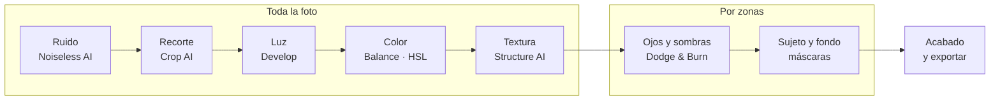

# 🎨 Retoques con Luminar

### De un JPEG plano a la foto que recuerdas, paso a paso y desde cero

**[📖 Empezar](00-introduccion.md)** · **[🎯 Ajustes locales](05-ajustes-locales.md)** · **[📄 Guía completa](guia-completa.md)** · **[🖨️ PDF](../pdf/guia-retoques.pdf)** · **[✅ Lista de comprobación](16-errores-y-lista.md)**

---

Tus fotos de Namibia están en **JPEG**, y esta guía está escrita justo para eso. Explica **qué** hacer en Luminar, **cómo** hacerlo clic a clic y **por qué** funciona, sin dar nada por sabido. Cada herramienta, control y atajo está comprobado con la documentación oficial de Skylum; lo que la documentación no dice, la guía lo indica.

## 🔁 El método en un vistazo

## 🧭 Empieza por aquí

| Si… | Lee |
|---|---|
| Empiezas de cero en fotografía | La [ruta de aprendizaje](../RUTA.md): el orden de todo el repo |
| Nunca has editado una foto | [1. Conceptos básicos](01-conceptos-basicos.md) → [2. Luminar por dentro](02-luminar-por-dentro.md) → [3. Las herramientas](03-herramientas-una-a-una.md) → [4. El flujo base](04-flujo-base.md) |
| Quieres aclarar **los ojos**, abrir **una sombra** u oscurecer **el cielo** | [5. Ajustes locales](05-ajustes-locales.md) |
| No sabes por dónde empezar con **esta** foto | [¿Qué hay en tu foto? La ruta según el contenido](04-flujo-base.md#qué-hay-en-tu-foto-la-ruta-según-el-contenido) |
| Tienes una foto de un animal delante | [7. Safari](07-safari.md) |
| Tienes dunas, montaña o un atardecer | [8. Paisaje](08-paisaje.md) |
| Tienes estrellas, luna o fuego | [9. Noche](09-noche.md) |
| Acabas de volver del viaje | [11.4. De la tarjeta a la selección](11-trabajar-en-serie.md#114-tus-fotos-del-viaje-de-la-tarjeta-a-la-selección) |
| Una foto oscura, quemada, movida o con mucho ruido | [Rescatar un JPEG difícil](04-flujo-base.md#rescatar-un-jpeg-difícil) |
| Vas a compartir con la familia o imprimir | [13.5. Compartir e imprimir](13-exportar.md#135-tus-fotos-compartir-con-la-familia-e-imprimir) |
| Vas a imprimir una foto | [13.6. Consejos para imprimir](13-exportar.md#136-consejos-para-las-fotos-que-vas-a-imprimir) |
| Tienes 500 fotos que editar | [11. Trabajar en serie](11-trabajar-en-serie.md) |
| Vas a imprimir o publicar | [13. Exportar](13-exportar.md) |

## 📚 Todos los capítulos

| Parte | Capítulo | Contenido |
|---|---|---|
| | [Introducción](00-introduccion.md) | Cómo está organizada y cómo leerla |
| **I · Fundamentos** | [1. Conceptos básicos](01-conceptos-basicos.md) | JPEG frente a RAW, zonas de brillo, histograma, balance de blancos, contraste, ruido, color |
| | [2. Luminar por dentro](02-luminar-por-dentro.md) | Catálogo, categorías de herramientas, copias virtuales, máscaras, capas |
| | [3. Las herramientas, una a una](03-herramientas-una-a-una.md) 🆕 | Dónde está cada herramienta, qué hace, **con qué número empezar**, el límite en JPEG y cómo saber que te has pasado |
| **II · El método** | [4. El flujo base: 10 pasos](04-flujo-base.md) | El esqueleto de cualquier edición y la ruta según lo que hay en la foto |
| | [5. Ajustes locales](05-ajustes-locales.md) 🆕 | Aclarar u oscurecer solo una parte: ojos, sombras, cielo, sujeto y fondo. Qué, cómo y qué significa |
| | [6. Herramientas avanzadas](06-herramientas-avanzadas.md) | Curves, Supercontrast, Color Harmony, Dodge & Burn, Light Depth, Black & White, Landscape, Creative |
| **III · Por tipo de foto** | [7. Safari 🦁](07-safari.md) | Ruido, contraluz, luz dura, el animal como protagonista, casos concretos |
| | [8. Paisaje 🏜️](08-paisaje.md) | Cielo y suelo, profundidad, dunas, atardecer, montaña, agua, hora azul |
| | [9. Noche 🌌](09-noche.md) | Vía Láctea, apilar una serie, contaminación lumínica, luces artificiales, charca con focos, fuego, luna |
| **IV · Más allá de una foto** | [10. Recetas completas](10-recetas.md) ⚠️ | Cinco casos de principio a fin (*provisional*) |
| | [11. Trabajar en serie](11-trabajar-en-serie.md) | Sync Adjustments, presets propios, coherencia |
| | [12. Varias fotos en una](12-varias-fotos.md) | HDR Merge, Panorama Stitching, Focus Stacking, Upscale, herramientas generativas |
| | [13. Exportar](13-exportar.md) | Formatos, tamaños por uso, impresión |
| | [14. Ética y ubicación](14-etica.md) | Qué es manipular, concursos, GPS y fauna amenazada |
| | [15. Disparar mejores JPEG](15-disparar-mejores-jpeg.md) | Ajustes de cámara para la próxima vez (y que sea RAW) |
| **V · Referencia** | [16. Errores y lista](16-errores-y-lista.md) | Errores típicos y lista de comprobación imprimible |
| | [17. Atajos de teclado](17-atajos.md) | Atajos de macOS verificados |
| | [18. Glosario](18-glosario.md) | Términos básicos |
| | [19. Preguntas frecuentes](19-preguntas-frecuentes.md) | Dudas habituales |
| | [20. Fuentes](20-fuentes.md) | Documentación oficial de Skylum consultada |

## ⌨️ Los diez atajos que más vas a usar

| | | | |
|---|---|---|---|
| **`J`** aviso de recorte | **`\`** ver el original | **`⌘1`** zoom 100 % | **`C`** recortar |
| **`W`** cuentagotas | **`A`** Mask AI | **`/`** ver la máscara | **`⌘I`** invertir la máscara |
| **`[`** **`]`** tamaño del pincel | **`⇧⌘E`** exportar | | |

---

Sección anterior: [🎛️ Manejo de la a6700](../manejo-a6700/README.md) · [🏠 Inicio](../README.md) · [✅ Pendientes](../PENDIENTES.md)
